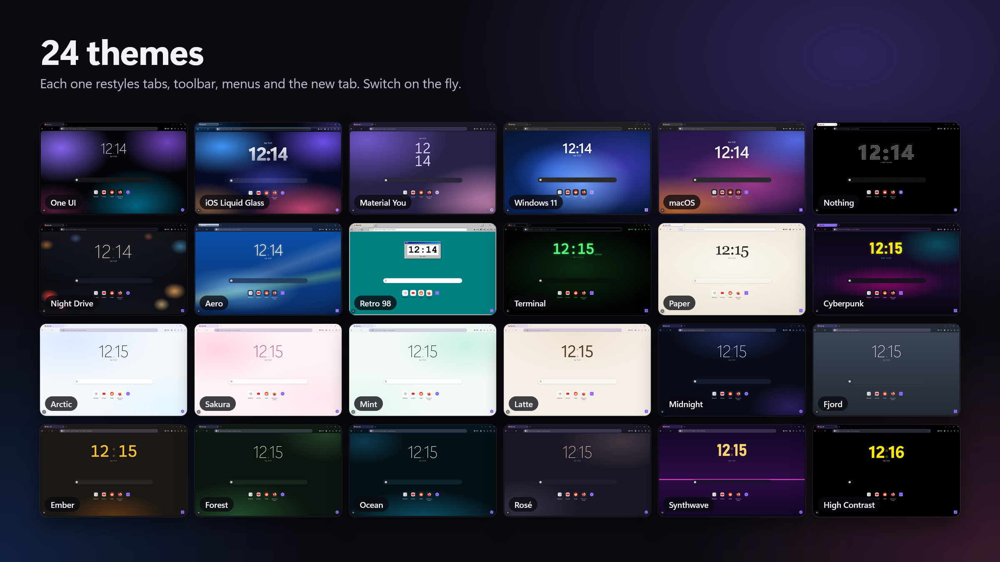
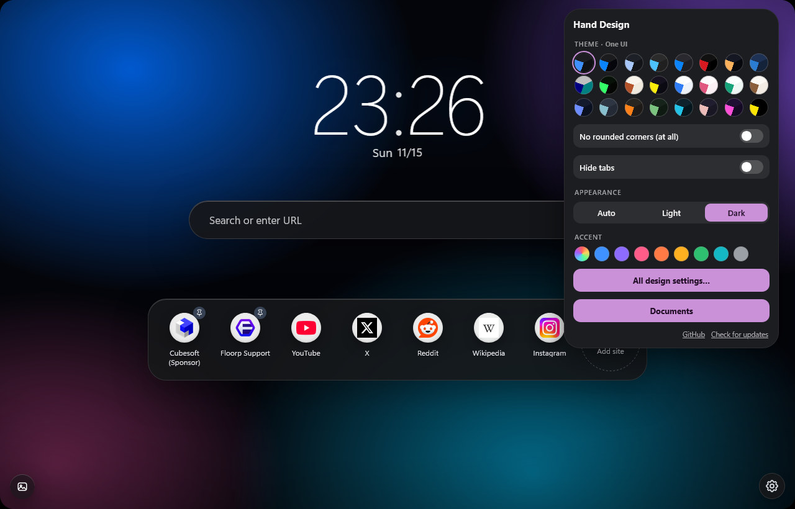
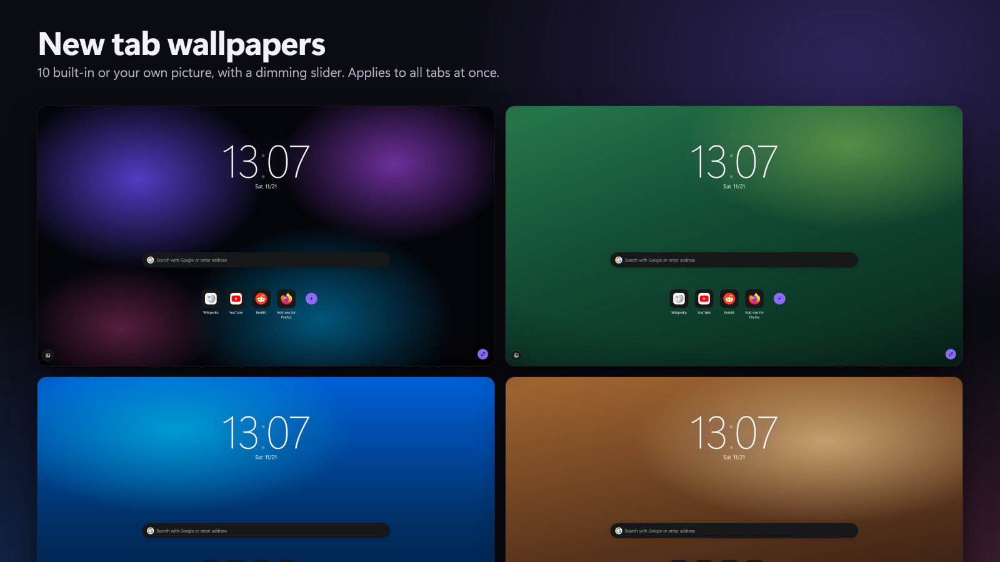

<div align="center">


# Hand Design

**A redesign for Firefox and Chromium browsers on Windows.**<br>
24 themes, a Studio for every detail, notes like in Obsidian, PDF, Markdown, CSV and image editors right in the browser.

[](firefox/CHANGELOG.md)
[](chrome/README.md)
[](#install)
[](LICENSE)

### [Download](https://github.com/WiWaSu/Hand-Design---browsers-redesign-/releases/latest) · [What's new](firefox/CHANGELOG.md) · [По-русски](#по-русски) · [Chromium version](chrome/README.md)

</div>

---

Works with **Firefox** (including Developer Edition and Nightly) and its forks: **LibreWolf, Waterfox, Zen, Floorp 12 and Mercury**.  
Also works with **Chrome, Edge, Brave, Vivaldi and Opera** (Chromium edition).

Needs Windows 10 or 11. Firefox edition requires Firefox 156 or newer. Earlier names of the project: Redesigned Fox, Floorp Modern.

<table>
<tr>
<td width="50%" valign="top">

**24 themes**<br>
iOS Liquid Glass, One UI, Material You, Windows 11, macOS, Nothing, Retro 98 and 17 more. Switch them on the fly. Same themes in Firefox and Chromium.

</td>
<td width="50%" valign="top">

**Theme details**<br>
Take the clock from one theme, the background from another and the window from a third. (Firefox)

</td>
</tr>
<tr>
<td valign="top">

**Studio**<br>
Colors, corners, tabs, address bar, menus, fonts, animations. Everything a theme sets can be set here without it.

</td>
<td valign="top">

**Notes**<br>
Formatted text without markup, `[[links]]`, tags, a graph, daily notes. Plain `.md` files that Obsidian opens too. (Firefox)

</td>
</tr>
<tr>
<td valign="top">

**PDF, Markdown, CSV, Images**<br>
Draw and type on PDFs, edit `.md` and `.csv` files, simple image editor. (Full set on Firefox)

</td>
<td valign="top">

**Calls and music**<br>
A call bar with mic and camera buttons, and a Now Bar for music playing in other tabs. Works in both editions.

</td>
</tr>
</table>

## Themes

Some themes copy the look of a phone or an OS, some are made up, and ten are color palettes. The same 24 themes are available in Firefox and Chromium.



<details>
<summary><b>What each theme does</b></summary>

- **One UI**: black background, pill tabs and buttons, thin lock-screen clock
- **iOS (Liquid Glass)**: the wallpaper shows behind the window, glass toolbar, tabs and menus
- **Material You**: colors derived from your accent, stacked clock
- **Windows 11**: square-ish corners, accent underline, Bloom wallpaper
- **macOS**: traffic-light window buttons, blue menus
- **Nothing**: monochrome with one red dot, dot-matrix clock
- **Night Drive**: blurred city lights, as if through a car window at night
- **Aero** (Windows 7), **Retro 98** (grey bevels, no rounding), **Terminal** (green monospace), **Paper** (serif, warm background), **Cyberpunk** (cut corners, yellow neon)
- light palettes: **Arctic, Sakura, Mint, Latte**
- dark palettes: **Midnight, Fjord, Ember, Forest, Ocean, Rosé**
- **Synthwave** and **High Contrast**

</details>

## Theme details (Firefox)

Every theme has its own extras: the selected tab and menus, the new tab clock, the background and the search box. In Studio → Theme details you can take any of them from any other theme, for example the Nothing dot clock and the Night Drive lights on top of iOS. Each option has a preview, and "No extras" turns a part off.


## Quick panel and Studio

The palette button on the toolbar opens the quick panel: theme, light or dark, accent and a switch that removes rounded corners everywhere. Changes show up at once.

Studio is the full settings page: open it from the quick panel, from ☰ → Design or with `Alt+Shift+S`.

<table>
<tr>
<td width="42%"></td>
<td width="58%"></td>
</tr>
</table>

## Notes (Firefox)

`Alt+Shift+N` or ☰ → Notes. Each note is a plain `.md` file in a folder you pick, so the same folder opens in Obsidian.


- only formatted text on screen: `#`, `**` and ` ``` ` stay hidden even under the cursor
- folder tree, search, pinned notes, drag and drop, right-click menu
- `[[links]]`, backlinks, `#tags`, callouts, graph, daily notes, templates
- notes save as you type, deleted notes go to `.trash`

## PDF, Markdown, CSV and Images (Firefox)


- **PDF** — new toolbar, drawing, highlights, text, bookmarks
- **Markdown** — open `.md` files, edit tables in place, `Ctrl+S`
- **CSV** — opens as an editable table instead of downloading
- **Image editor** — crop, arrows, blur, save as PNG/JPEG/WebP


## Calls, music and the new tab

Works in both Firefox and Chromium editions.

<table>
<tr>
<td width="50%" valign="top">

**Call bar.** When a call runs in another tab, a bar at the top shows the site, timer and mic/camera buttons.


</td>
<td width="50%" valign="top">

**New tab.** 10 built-in wallpapers or your own picture, with a dimming slider.



</td>
</tr>
</table>

Also: **Now Bar** for music from other tabs.

## Chromium edition

Already includes the same 24 themes, new tab with clock and wallpapers, quick panel, Studio, Now Bar, Call Bar and PDF viewer.  
Still lighter than the Firefox edition (no Notes / CSV / full document editors yet).

See [chrome/README.md](chrome/README.md) for details.

## Install

### Firefox edition

1. Download **`Hand-Design-Setup-v<version>.exe`** from [Releases](https://github.com/WiWaSu/Hand-Design---browsers-redesign-/releases/latest) and run it.
2. Allow administrator rights (needed once).
3. Pick a theme and browsers, press Install.
4. Restart the browser.

> [!NOTE]
> If SmartScreen says "Windows protected your PC", click "More info" → "Run anyway".

### Chromium edition

See [chrome/README.md](chrome/README.md).

## License

[MIT](LICENSE). Unofficial mod, not connected with Mozilla or Google.