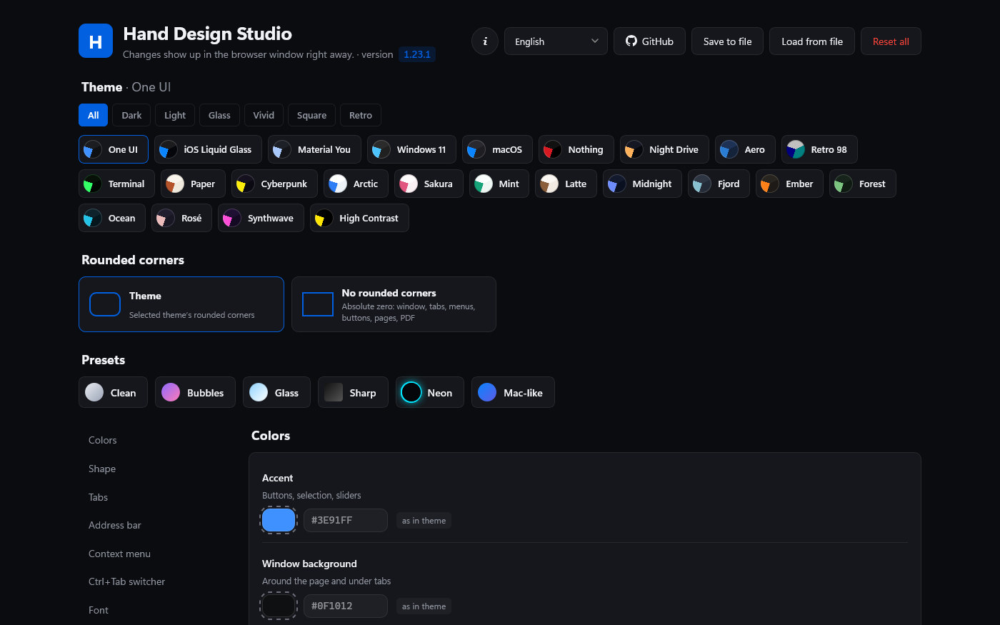
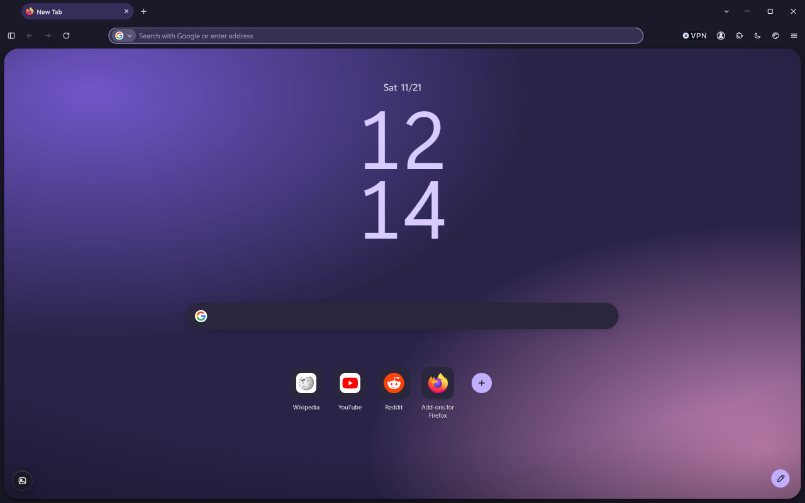
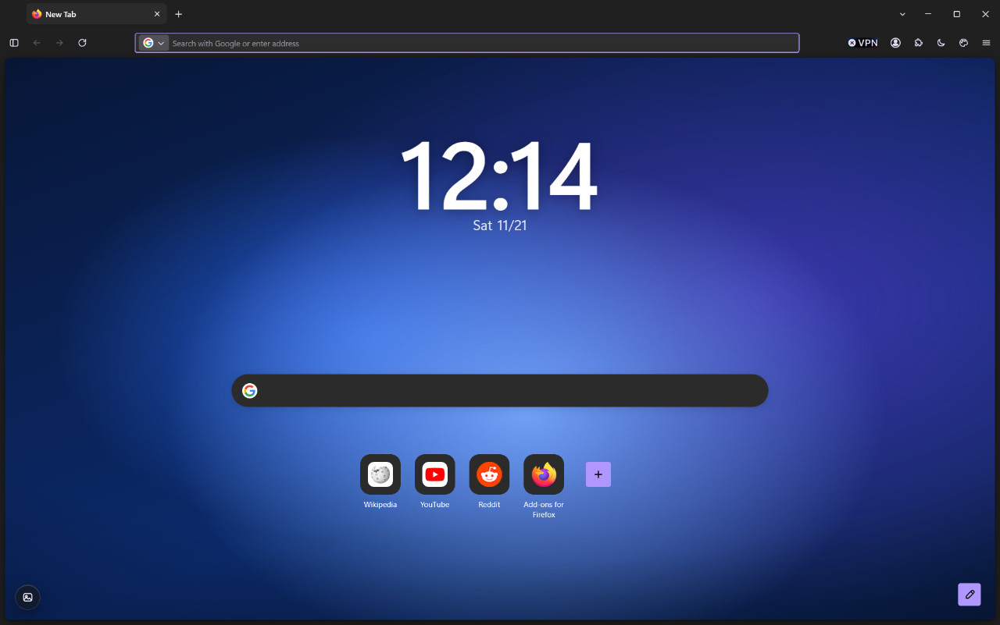
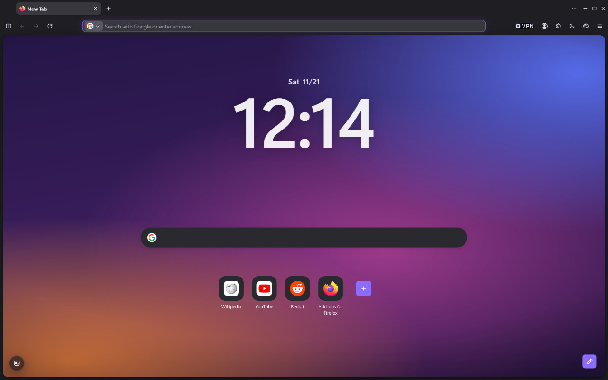
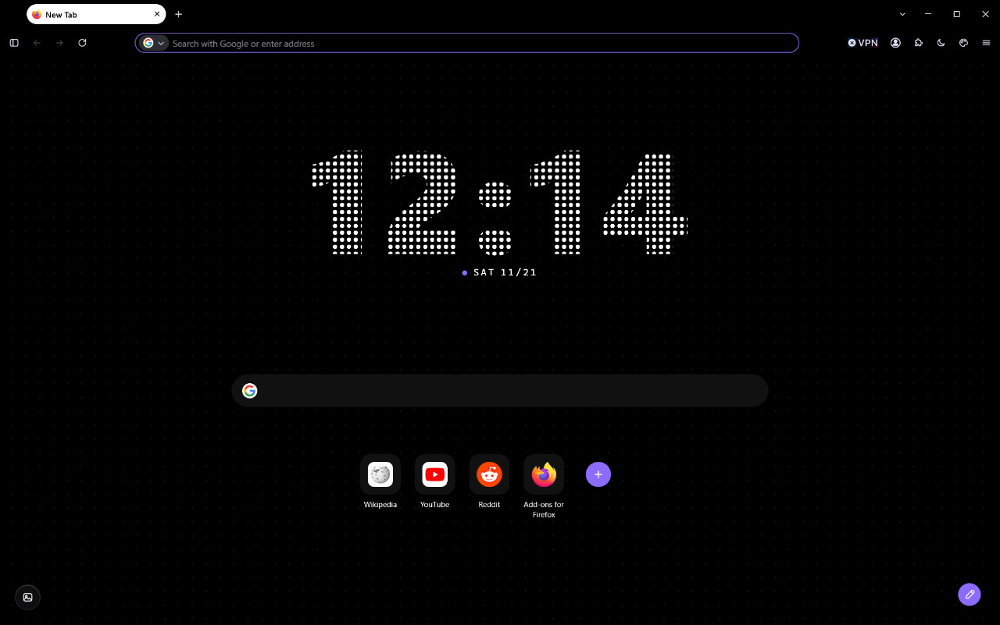
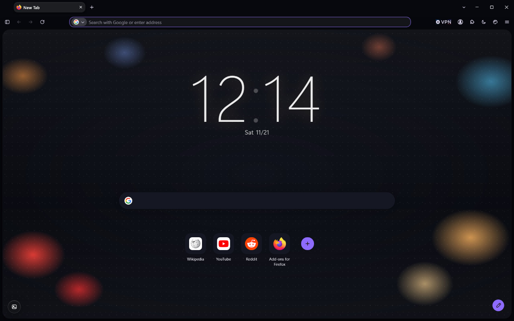
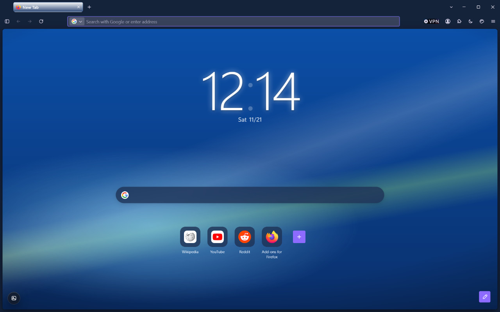
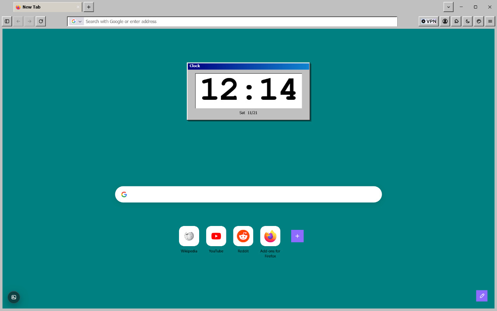
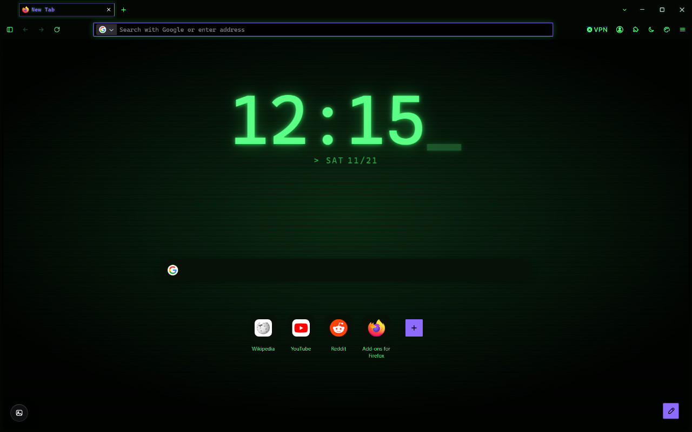
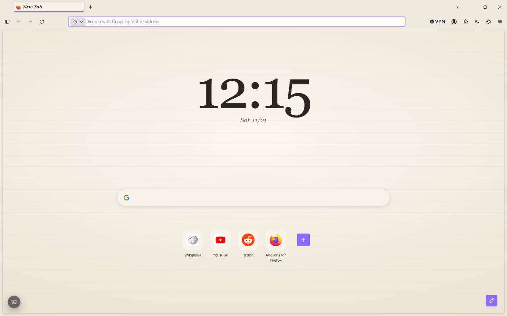

<div align="center">


# Hand Design

**A Firefox mod for Windows that redesigns the whole browser.**<br>
24 themes, a Studio for every detail, notes like in Obsidian, PDF, Markdown, CSV and image editors right in the browser.

[](firefox/CHANGELOG.md)
[](#install)
[](#install)
[](LICENSE)

### [Download](https://github.com/WiWaSu/Hand-Design---browsers-redesign-/releases/latest) · [What's new](firefox/CHANGELOG.md) · [По-русски](#по-русски) · [Chromium version](chrome/README.md)

</div>

---

Works with **Firefox** (including Developer Edition and Nightly) and its forks: **LibreWolf, Waterfox, Zen, Floorp 12 and Mercury**. Needs Windows 10 or 11 and Firefox 156 or newer. Earlier names of the project: Redesigned Fox, Floorp Modern.

<table>
<tr>
<td width="50%" valign="top">

**24 themes**<br>
iOS Liquid Glass, One UI, Material You, Windows 11, macOS, Nothing, Retro 98 and 17 more. Switch them on the fly.

</td>
<td width="50%" valign="top">

**Theme details**<br>
Take the clock from one theme, the background from another and the window from a third.

</td>
</tr>
<tr>
<td valign="top">

**Studio**<br>
Colors, corners, tabs, address bar, menus, fonts, animations. Everything a theme sets can be set here without it.

</td>
<td valign="top">

**Notes**<br>
Formatted text without markup, `[[links]]`, tags, a graph, daily notes. Plain `.md` files that Obsidian opens too.

</td>
</tr>
<tr>
<td valign="top">

**PDF and Markdown**<br>
Draw and type on PDFs, edit `.md` files and their tables in place, save with `Ctrl+S`.

</td>
<td valign="top">

**Calls and music**<br>
A call bar with mic and camera buttons, and a Now Bar for music playing in other tabs.

</td>
</tr>
</table>

## Themes

Some themes copy the look of a phone or an OS, some are made up, and ten are color palettes.


<details>
<summary><b>What each theme does</b></summary>

- **One UI**: black background, pill tabs and buttons, thin lock-screen clock
- **iOS (Liquid Glass)**: the wallpaper shows behind the window, glass toolbar, tabs and menus
- **Material You**: colors derived from your accent, stacked clock
- **Windows 11**: square-ish corners, accent underline, Bloom wallpaper
- **macOS**: traffic-light window buttons, blue menus
- **Nothing**: monochrome with one red dot, dot-matrix clock
- **Night Drive**: blurred city lights, as if through a car window at night
- **Aero** (Windows 7), **Retro 98** (grey bevels, no rounding), **Terminal** (green monospace), **Paper** (serif, warm background), **Cyberpunk** (cut corners, yellow neon)
- light palettes: **Arctic, Sakura, Mint, Latte**
- dark palettes: **Midnight, Fjord, Ember, Forest, Ocean, Rosé**
- **Synthwave** and **High Contrast**

</details>

## Theme details

Every theme has its own extras: the selected tab and menus, the new tab clock, the background and the search box. In Studio → Theme details you can take any of them from any other theme, for example the Nothing dot clock and the Night Drive lights on top of iOS. Each option has a preview, and "No extras" turns a part off.


## Quick panel and Studio

The palette button on the toolbar opens the quick panel: theme, light or dark, accent and a switch that removes rounded corners everywhere. Changes show up at once in all windows, on the new tab, on settings pages and in PDFs.

Studio is the full settings page: open it from the quick panel, from ☰ → Design or with `Alt+Shift+S`.

<table>
<tr>
<td width="42%"></td>
<td width="58%"></td>
</tr>
</table>

What Studio changes, on top of any theme:

- **colors**: accent, window background, fields, menus, text, secondary text, lines, hover and press highlights, toggles, menu transparency and blur
- **shape**: corners of pages, menus and menu items, gaps, shadows, button shape, density
- **tabs**: 6 shapes, how the selected tab is marked, size, close button; tabs can hide and slide out from the window edge (`Alt+Shift+T`)
- **address bar**: height, corners, alignment, border
- **menus**: right-click menus in 7 styles, Ctrl+Tab with previews in 4 styles, tiles of the main menu ☰
- **font**, UI text size and animation speed
- **new tab**: clock size and position, date, search width, shortcuts, wallpaper blur
- **show or hide**: bookmarks bar, toolbar buttons, Now Bar, call bar, loading line

There are 6 presets, and settings can be saved to a file and loaded back.

## Notes

`Alt+Shift+N` or ☰ → Notes. Each note is a plain `.md` file in a folder you pick, so the same folder opens in Obsidian, and an Obsidian vault opens here.


- only formatted text on screen: `#`, `**` and ` ``` ` stay hidden even under the cursor (Studio can show them on the cursor line, like in Obsidian)
- folder tree, search, pinned notes, drag and drop, right-click menu
- `[[links]]` with suggestions, a Mentions list under each note, links follow renamed notes
- `#tags`, `> [!note]` callouts, properties, footnotes, `%%comments%%`
- pasted and dropped images, `![[image.png]]` from Obsidian vaults
- **graph** of links, quick switcher `Ctrl+O`, daily note, templates
- notes save as you type, deleted notes go to `.trash`

## PDF and Markdown


**PDF viewer**

- new toolbar that fits a half-screen window, light or dark interface, paper / sepia / night pages
- drawing like in Edge, straight lines with Shift, text, highlights
- page bookmarks with notes (`Ctrl+B`)
- click a "……" gap or double-click empty space to type there
- each PDF reopens on the page where you stopped

**Markdown**

- drag a `.md` file into the window: table of contents, read / side by side / text modes, a formatting toolbar, `Ctrl+S` saves
- tables are edited right in the document: click a cell, `Tab` and `Enter` move between cells
- the Documents page creates and opens `.md` files and keeps a list of recent ones

**CSV tables**

- `.csv` files open as a table instead of downloading: edit cells, sort by a column, search, add and delete rows and columns, paste a block from Excel, `Ctrl+S` saves in the same encoding and delimiter

**Image editor** (off by default, turn it on in Studio → Documents)

- crop, rotate, flip, arrows, boxes, brush, text, blur for emails, faces and card numbers
- opens a picture from disk, from "Edit image" in the right-click menu, or a screenshot pasted with `Ctrl+V`
- "Save as…" writes PNG, JPEG or WebP and shows the file size before saving


## Calls, music and the new tab

<table>
<tr>
<td width="50%" valign="top">

**Call bar.** When a call runs in another tab (Telegram, Discord, WhatsApp, Meet), a bar at the top shows the site, a timer and mic and camera buttons. `Alt+Shift+M` mutes the mic from any tab.


</td>
<td width="50%" valign="top">

**New tab.** 10 built-in wallpapers or your own picture, with a dimming slider. The button is in the bottom left corner.


</td>
</tr>
</table>

Also:

- **Now Bar**: when music plays in another tab, a bar you can drag shows the cover, progress and controls
- **screen sharing** looks like in Discord: tabs for windows, screens and tabs, large cards and a live preview
- **spring animations** like on iPhone; they work even when animations are off in Windows
- a loading line under the toolbar, a theme button for Auto / Light / Dark, small notices for downloads, zoom and muted tabs
- **10 languages**: English, Russian, Ukrainian, German, French, Spanish, Portuguese, Polish, Turkish, Chinese
- **updates**: each start the browser checks `latest.json` here and shows a notice if a new version is out. Nothing is downloaded by itself; the check can be turned off in Studio → Updates

## Shortcuts

| Keys | What it does |
|---|---|
| `Alt+Shift+S` | Studio |
| `Alt+Shift+N` | Notes |
| `Alt+Shift+T` | hide or show tabs |
| `Alt+Shift+M` | mute the mic in a call from any tab |
| `Alt+Shift+C` | copy the page address |
| `Alt+Shift+D` | close duplicate tabs |
| `Alt+Shift+Z` | focus mode |
| `Ctrl+O` | quick switcher in Notes |
| `Ctrl+B` | page bookmarks in PDF |
| `Ctrl+S` / `Ctrl+E` | save a `.md` file / switch between reading and text |

## Install

1. Download **`Hand-Design-Setup-v<version>.exe`** from [Releases](https://github.com/WiWaSu/Hand-Design---browsers-redesign-/releases/latest) and run it.
2. Allow administrator rights. They are needed once, to put a small script loader into the browser's program folder.
3. Pick a theme, wallpaper, accent, corners, animations and browsers, press Install.
4. Restart the browser.

> [!NOTE]
> If SmartScreen says "Windows protected your PC", click "More info", then "Run anyway". The file is not signed with a paid certificate.

Without the `.exe`: download `Hand-Design-v<version>.zip`, unzip it and run `Setup.cmd`. From a copy of the whole repository (Code → Download ZIP), the files are in the `firefox` folder. `install.cmd` does the same in the console.

**Update.** Run the new installer and press "Update to v&lt;version&gt;". It updates only the profiles that have Hand Design and keeps the theme, accent, language, wallpaper and other settings. `update.cmd` does the same in the console.

**After a big browser update** the loader in the program folder can disappear. If the toolbar buttons or the PDF features are gone, run `Setup.cmd` again.

**Uninstall.** `Setup.cmd` → "Remove theme", or `uninstall.cmd`. Your own rules in `userChrome.css` / `userContent.css` stay, backups are saved as `*.bak-floorp-modern`.

In the browser settings keep the built-in "System theme — auto": third-party themes repaint the window frame and get in the way.

<details>
<summary><b>How it works</b></summary>

| Where | What |
|---|---|
| Browser folder (`C:\Program Files\…`) | `config.js` and `defaults\pref\config-prefs.js`, the AutoConfig loader |
| `chrome\userChrome.css` in the profile | the browser interface (`FLOORP-MODERN` block) |
| `chrome\userContent.css` in the profile | new tab, settings pages, PDF viewer (`FLOORP-MODERN` and `PDF-TWEAKS` blocks) |
| `chrome\pdf-tweaks\` in the profile | scripts for the window and the PDF viewer, Studio, Notes, wallpapers, themes for switching on the fly |
| `user.js` in the profile | a few prefs (stylesheets, animations) |

The current theme is stored in the `floorp.modern.theme` pref. Inside the CSS files the theme sits between `FM-THEME BEGIN` and `FM-THEME END`, so the browser can replace it without the installer. Studio settings are kept in `floorp.modern.studio` and applied as a live stylesheet. If something breaks, look at `chrome\pdf-tweaks\fm-log.json` and `fm-boot.json`.

The internal names still say "floorp-modern", so that existing settings keep working.

</details>

<details>
<summary><b>Folders and development</b></summary>

| Folder or file | What is inside |
|---|---|
| `firefox/` | The edition for Firefox and its forks: installer, styles, scripts, `CHANGELOG.md`. This folder goes into the release zip. |
| `chrome/` | The edition for Chromium browsers: extension, installer, `CHANGELOG.md`. |
| `docs/` | Pictures for this README and for release pages. |
| `release-notes/` | Text for each GitHub release, one file per version. |
| `latest.json` | The latest version number. Installed copies read it to show "update available". |

The CSS is generated by the scripts in `firefox/tools/`. Run them from the `firefox` folder:

```sh
python3 tools/gen_chrome.py files                 # base chrome + content CSS
python3 tools/gen_ios.py src/themes               # iOS theme, into src/themes
python3 tools/gen_themes.py src/themes            # the other themes, into src/themes
python3 tools/pack_themes.py                      # src/themes -> files/pdf-tweaks/themes
sh tools/build.sh                                 # release zip
```

`files/pdf-viewer-theme.css` is edited by hand: `tools/gen_css.py` is older and would overwrite it. `src/` is an intermediate folder and is not kept in the repository. `tools/l10n.py` expects translation sources in `src/l10n/`; the built dictionaries are in `files/pdf-tweaks/l10n/`. `firefox/build-exe.bat` builds the `.exe` with the C# compiler that comes with Windows (.NET Framework 4).

</details>

<details>
<summary><b>More screenshots</b></summary>

<table>
<tr><td><br>One UI</td><td><br>iOS</td></tr>
<tr><td><br>Material You</td><td><br>Windows 11</td></tr>
<tr><td><br>macOS</td><td><br>Nothing</td></tr>
<tr><td><br>Night Drive</td><td><br>Aero</td></tr>
<tr><td><br>Retro 98</td><td><br>Terminal</td></tr>
<tr><td><br>Paper</td><td><br>Cyberpunk</td></tr>
<tr><td><br>Wallpaper picker</td><td><br>Menu styles in Studio</td></tr>
</table>

</details>

## License

[MIT](LICENSE). The notes editor is built on [CodeMirror 6](https://codemirror.net) and Lezer (MIT); its source and build script are in `firefox/tools/notes-editor`.

This is an unofficial mod, not connected with Mozilla or Ablaze (Floorp). It only uses the customization hooks the browsers already have (`userChrome.css`, `userContent.css`, AutoConfig). Use it at your own risk.

---

<div align="center">

## По-русски

**Мод для Firefox на Windows, который меняет оформление всего браузера.**<br>
24 темы, Studio для любой мелочи, заметки как в Obsidian, редакторы PDF, Markdown, CSV и картинок прямо в браузере.

### [Скачать](https://github.com/WiWaSu/Hand-Design---browsers-redesign-/releases/latest) · [Что нового](firefox/CHANGELOG.md) · [Версия для Chromium](chrome/README.md)

</div>

Работает с Firefox (и Developer Edition, и Nightly) и его форками: LibreWolf, Waterfox, Zen, Floorp 12 и Mercury. Нужны Windows 10 или 11 и Firefox 156 или новее. Раньше проект назывался Redesigned Fox, а ещё раньше Floorp Modern.

### Темы

24 темы. Часть повторяет вид телефонов и систем: One UI, iOS (Liquid Glass), Material You, Windows 11, macOS, Nothing, Aero, Retro 98. Ещё есть Night Drive, Terminal, Paper, Cyberpunk, Synthwave, High Contrast и десять палитр: Arctic, Sakura, Mint, Latte, Midnight, Fjord, Ember, Forest, Ocean, Rosé.


### Детали тем

У каждой темы есть свои особенности: выбранная вкладка и меню, часы на новой вкладке, фон и поиск. В Studio → «Детали тем» любую из них можно взять из другой темы, например точечные часы Nothing и огни Night Drive поверх iOS. У каждого варианта есть картинка, «Без особенностей» выключает деталь.


### Быстрая панель и Studio

Кнопка с палитрой на панели открывает быструю панель: тема, светлое или тёмное оформление, акцент и переключатель «Без скруглений». Меняется сразу во всех окнах, на новой вкладке, в настройках и в PDF.

Studio открывается из быстрой панели, через ☰ → «Дизайн» или по `Alt+Shift+S`. Там настраиваются все цвета темы, скругления, форма вкладок (их можно спрятать, `Alt+Shift+T`), адресная строка, меню правой кнопки (7 стилей), окно Ctrl+Tab, плитки главного меню, шрифт, скорость анимаций и новая вкладка. Есть 6 готовых наборов, настройки можно сохранить в файл.

### Заметки

`Alt+Shift+N` или ☰ → «Заметки». Каждая заметка — обычный файл `.md` в выбранной папке, эту папку открывает и Obsidian.


- на экране только оформленный текст: `#`, `**` и ` ``` ` не видны даже под курсором (в Studio можно показывать их в строке с курсором, как в Obsidian)
- дерево папок, поиск, закреплённые заметки, перетаскивание, своё меню правой кнопки
- `[[ссылки]]` с подсказками, блок «Упоминания», ссылки обновляются при переименовании
- `#теги`, блоки `> [!note]`, свойства, сноски, `%%комментарии%%`
- картинки из буфера и перетаскиванием, `![[картинка.png]]` из папок Obsidian
- граф связей, быстрый переход `Ctrl+O`, заметка дня, шаблоны
- сохраняются сами, удалённые попадают в `.trash`

### PDF и Markdown


- PDF: панель помещается в половину экрана, рисование как в Edge, ровные линии с Shift, текст, выделение, закладки страниц (`Ctrl+B`), быстрый текст по «……», PDF открывается там, где вы остановились
- Markdown: перетащите файл `.md` в окно, и он откроется оформленным; три режима, панель кнопок, `Ctrl+S` сохраняет, таблицы правятся прямо в документе
- страница «Документы» создаёт и открывает `.md` и помнит недавние
- таблицы `.csv` открываются в браузере вместо скачивания: правка ячеек, сортировка, поиск, строки и столбцы, вставка из Excel, `Ctrl+S` сохраняет в той же кодировке
- редактор картинок (по умолчанию выключен, включается в Studio → «Документы»): обрезка, поворот, стрелки, рамки, кисть, текст, размытие почты, лиц и номеров карт; сохраняет в PNG, JPEG или WebP и заранее показывает размер файла


### Ещё

- плашка звонка: если в другой вкладке идёт звонок, сверху видно таймер и кнопки микрофона и камеры, `Alt+Shift+M` выключает микрофон из любой вкладки
- Now Bar: плашка с обложкой и кнопками, когда в другой вкладке играет музыка
- показ экрана как в Discord: вкладки «Окна», «Экраны», «Вкладки», крупные карточки и живое превью
- обои новой вкладки: 10 своих или любая картинка
- анимации-«пружины» как на iPhone, работают даже с выключенными анимациями Windows
- 10 языков интерфейса, язык выбирается в установщике и в Studio
- проверка обновлений при каждом запуске браузера; сама ничего не скачивает, выключается в Studio → «Обновления»

### Горячие клавиши

| Клавиши | Что делают |
|---|---|
| `Alt+Shift+S` | Studio |
| `Alt+Shift+N` | заметки |
| `Alt+Shift+T` | спрятать или показать вкладки |
| `Alt+Shift+M` | выключить микрофон в звонке из любой вкладки |
| `Alt+Shift+C` | скопировать адрес страницы |
| `Alt+Shift+D` | закрыть одинаковые вкладки |
| `Alt+Shift+Z` | режим фокуса |
| `Ctrl+O` | быстрый переход в заметках |
| `Ctrl+B` | закладки страниц в PDF |
| `Ctrl+S` / `Ctrl+E` | сохранить `.md` / переключить просмотр и текст |

### Установка

1. Скачайте **`Hand-Design-Setup-v<версия>.exe`** со страницы [Releases](https://github.com/WiWaSu/Hand-Design---browsers-redesign-/releases/latest) и запустите.
2. Разрешите права администратора. Они нужны один раз, чтобы положить загрузчик в папку браузера.
3. Выберите тему, обои, акцент, скругления, анимации и браузеры, нажмите «Установить».
4. Перезапустите браузер.

> [!NOTE]
> Если SmartScreen пишет «Система Windows защитила ваш компьютер», нажмите «Подробнее» → «Выполнить в любом случае»: у файла нет платной цифровой подписи.

Без `.exe`: скачайте `Hand-Design-v<версия>.zip`, распакуйте и запустите `Setup.cmd`. Если скачали весь репозиторий (Code → Download ZIP), файлы лежат в папке `firefox`. Консольный вариант: `install.cmd`.

**Обновление.** Запустите новый установщик и нажмите «Обновить до v&lt;версия&gt;». Обновятся только профили, где Hand Design уже стоит; тема, акцент, язык, обои и остальные настройки останутся. В консоли то же делает `update.cmd`.

**После большого обновления браузера** загрузчик в папке программы может пропасть. Если исчезли кнопки на панели или функции PDF, запустите `Setup.cmd` ещё раз.

**Удаление.** `Setup.cmd` → «Удалить оформление» или `uninstall.cmd`. Ваши собственные стили в `userChrome.css` / `userContent.css` остаются.

В настройках браузера оставьте встроенную тему «Системная тема — авто».

Неофициальный мод, с Mozilla и Ablaze не связан. Используйте на свой страх и риск. Лицензия MIT.
