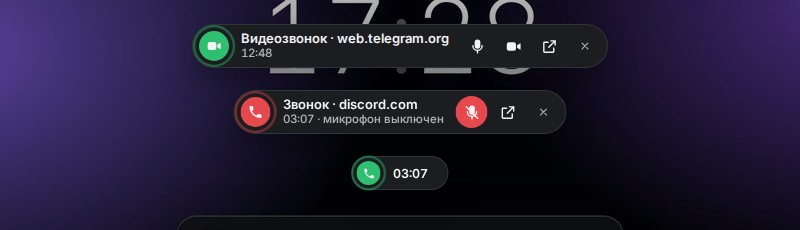

<div align="center">


# Hand Design

**A browser mod for Windows that redesigns Firefox, Chrome, Edge, Brave, Vivaldi and Opera.**<br>
24 themes, a Studio for every detail, notes like in Obsidian, PDF, Markdown, CSV and image editors right in the browser.

[](firefox/CHANGELOG.md)
[](chrome/CHANGELOG.md)
[](#install)
[](LICENSE)

### [Download](https://github.com/WiWaSu/Hand-Design---browsers-redesign-/releases/latest) · [What's new](#whats-new) · [По-русски](#по-русски)

</div>

---

Works with **Firefox** (including Developer Edition and Nightly) and its forks: **LibreWolf, Waterfox, Zen, Floorp 12 and Mercury**, as well as **Chromium browsers**: **Chrome, Edge, Brave, Vivaldi, Opera and Yandex Browser**. Needs Windows 10 or 11. Earlier names of the project: Redesigned Fox, Floorp Modern.

<table>
<tr>
<td width="50%" valign="top">

**24 themes**<br>
iOS Liquid Glass, One UI, Material You, Windows 11, macOS, Nothing, Retro 98 and 17 more. Switch them on the fly.

</td>
<td width="50%" valign="top">

**Theme details**<br>
Take the clock from one theme, the background from another and the window from a third.

</td>
</tr>
<tr>
<td valign="top">

**Studio**<br>
Colors, corners, tabs, address bar, menus, fonts, animations. Everything a theme sets can be set here without it.

</td>
<td valign="top">

**Notes**<br>
Formatted text without markup, `[[links]]`, tags, a graph, daily notes. Plain `.md` files that Obsidian opens too.

</td>
</tr>
<tr>
<td valign="top">

**PDF and Markdown**<br>
Draw and type on PDFs, edit `.md` files and their tables in place, save with `Ctrl+S`.

</td>
<td valign="top">

**Calls and music**<br>
A call bar with mic and camera buttons, and a Now Bar for music playing in other tabs.

</td>
</tr>
</table>

## Themes

Some themes copy the look of a phone or an OS, some are made up, and ten are color palettes.


<details>
<summary><b>What each theme does</b></summary>

- **One UI**: black background, pill tabs and buttons, thin lock-screen clock
- **iOS (Liquid Glass)**: the wallpaper shows behind the window, glass toolbar, tabs and menus
- **Material You**: colors derived from your accent, stacked clock
- **Windows 11**: square-ish corners, accent underline, Bloom wallpaper
- **macOS**: traffic-light window buttons, blue menus
- **Nothing**: monochrome with one red dot, dot-matrix clock
- **Night Drive**: blurred city lights, as if through a car window at night
- **Aero** (Windows 7), **Retro 98** (grey bevels, no rounding), **Terminal** (green monospace), **Paper** (serif, warm background), **Cyberpunk** (cut corners, yellow neon)
- light palettes: **Arctic, Sakura, Mint, Latte**
- dark palettes: **Midnight, Fjord, Ember, Forest, Ocean, Rosé**
- **Synthwave** and **High Contrast**

</details>

## Theme details

Every theme has its own extras: the selected tab and menus, the new tab clock, the background and the search box. In Studio → Theme details you can take any of them from any other theme, for example the Nothing dot clock and the Night Drive lights on top of iOS. Each option has a preview, and "No extras" turns a part off.


## Quick panel and Studio

The palette button on the toolbar opens the quick panel: theme, light or dark, accent and a switch that removes rounded corners everywhere. Changes show up at once in all windows, on the new tab, on settings pages and in PDFs.

Studio is the full settings page: open it from the quick panel, from ☰ → Design or with `Alt+Shift+S`.

<table>
<tr>
<td width="42%"></td>
<td width="58%"></td>
</tr>
</table>

What Studio changes, on top of any theme:

- **colors**: accent, window background, fields, menus, text, secondary text, lines, hover and press highlights, toggles, menu transparency and blur
- **shape**: corners of pages, menus and menu items, gaps, shadows, button shape, density
- **tabs**: 6 shapes, hover previews (Card, Compact, Large), how the selected tab is marked, size, close button; tabs can hide and slide out from the window edge (`Alt+Shift+T`)
- **address bar**: height, corners, alignment, border
- **menus**: right-click menus in 7 styles (with icons), Ctrl+Tab with previews in 4 styles, tiles of the main menu ☰
- **font**, UI text size and animation speed
- **new tab**: clock size and position, date, search width, shortcuts, wallpaper blur
- **show or hide**: bookmarks bar, toolbar buttons, Now Bar, call bar, loading line, PDF features

There are 6 presets, and settings can be saved to a file and loaded back.

## Notes

`Alt+Shift+N` or ☰ → Notes. Each note is a plain `.md` file in a folder you pick, so the same folder opens in Obsidian, and an Obsidian vault opens here.


- only formatted text on screen: `#`, `**` and ` ``` ` stay hidden even under the cursor (Studio can show them on the cursor line, like in Obsidian)
- folder tree, search, pinned notes, drag and drop, right-click menu
- `[[links]]` with suggestions, a Mentions list under each note, links follow renamed notes
- `#tags`, `> [!note]` callouts, properties, footnotes, `%%comments%%`
- pasted and dropped images, `![[image.png]]` from Obsidian vaults
- **graph** of links, quick switcher `Ctrl+O`, daily note, templates
- notes save as you type, deleted notes go to `.trash`

## PDF and Markdown


**PDF viewer**
- new toolbar that fits a half-screen window, light or dark interface, paper / sepia / night pages
- presentation mode: only pages on screen, drawing tools hidden
- drawing like in Edge, straight lines with Shift (angle follows the mouse), text, highlights, drawing on top of inserted images
- page bookmarks with notes (`Ctrl+B`)
- click a "……" gap or double-click empty space to type there
- each PDF reopens on the page where you stopped
- redesigned Pages sidebar with hover checkboxes and accent borders

**Markdown**
- drag a `.md` file into the window: table of contents, read / side by side / text modes, a formatting toolbar, `Ctrl+S` saves
- tables are edited right in the document: click a cell, `Tab` and `Enter` move between cells
- the Documents page creates and opens `.md` files and keeps a list of recent ones

**CSV tables**
- `.csv` files open as a table instead of downloading: edit cells, sort by a column, search, add and delete rows and columns, paste a block from Excel, `Ctrl+S` saves in the same encoding and delimiter

**Image editor** (off by default, turn it on in Studio → Documents)
- crop, rotate, flip, arrows, boxes, brush, text, blur for emails, faces and card numbers
- opens a picture from disk, from "Edit image" in the right-click menu, or a screenshot pasted with `Ctrl+V`
- "Save as…" writes PNG, JPEG or WebP and shows the file size before saving


## Calls, music and the new tab

<table>
<tr>
<td width="50%" valign="top">

**Call bar.** When a call runs in another tab (Telegram, Discord, WhatsApp, Meet), a bar at the top shows the site, a timer and mic and camera buttons. `Alt+Shift+M` mutes the mic from any tab.



</td>
<td width="50%" valign="top">

**New tab.** 10 built-in wallpapers or your own picture, with a dimming slider. The button is in the bottom left corner.


</td>
</tr>
</table>

Also:
- **Now Bar**: when music plays in another tab, a bar you can drag shows the cover, progress and controls
- **screen sharing** looks like in Discord: tabs for windows, screens and tabs, large cards and a live preview
- **spring animations** like on iPhone; they work even when animations are off in Windows
- a loading line under the toolbar, a theme button for Auto / Light / Dark, small notices for downloads, zoom and muted tabs
- **10 languages**: English, Russian, Ukrainian, German, French, Spanish, Portuguese, Polish, Turkish, Chinese
- **updates**: each start the browser checks `latest.json` here and shows a notice if a new version is out. Nothing is downloaded by itself; the check can be turned off in Studio → Updates

## Shortcuts

| Keys | What it does |
|---|---|
| `Alt+Shift+S` | Studio |
| `Alt+Shift+N` | Notes |
| `Alt+Shift+T` | hide or show tabs |
| `Alt+Shift+M` | mute the mic in a call from any tab |
| `Alt+Shift+C` | copy the page address |
| `Alt+Shift+D` | close duplicate tabs |
| `Alt+Shift+Z` | focus mode |
| `Ctrl+O` | quick switcher in Notes |
| `Ctrl+B` | page bookmarks in PDF |
| `Ctrl+S` / `Ctrl+E` | save a `.md` file / switch between reading and text |

## Install

### Firefox & Forks
1. Download **`Hand-Design-Setup-v<version>.exe`** from [Releases](https://github.com/WiWaSu/Hand-Design---browsers-redesign-/releases/latest) and run it.
2. Allow administrator rights. They are needed once, to put a small script loader into the browser's program folder.
3. Pick a theme, wallpaper, accent, corners, animations and browsers, press Install.
4. Restart the browser.

> [!NOTE]
> If SmartScreen says "Windows protected your PC", click "More info", then "Run anyway". The file is not signed with a paid certificate.

Without the `.exe`: download `Hand-Design-v<version>.zip`, unzip it and run `Setup.cmd`. `install.cmd` does the same in the console.

### Chromium (Chrome, Edge, Brave, etc.)
1. Download **`Hand-Design-Chromium-Setup-v<version>.exe`** from Releases and run it. Without the `.exe`: unzip `Hand-Design-Chromium-v<version>.zip` and run `Setup.cmd`.
2. Pick a theme and browsers, press Install.
3. In the browser once: extensions page → Developer mode → Load unpacked → Ctrl+V → Select folder.
4. For Edge, Opera, Yandex, or if you want the theme picture behind the tabs: load the `frame` folder the same way. Chrome, Brave and Chromium get the frame color automatically.

**Update (Both).** Run the new installer and press "Update to v&lt;version&gt;". It updates only the profiles that have Hand Design and keeps settings. For Chromium, press ⟳ on the extension card.
**After a big browser update**, the loader in the program folder can disappear. Run `Setup.cmd` again.

**Uninstall.** `Setup.cmd` → "Remove theme", or `uninstall.cmd`. Your own rules in `userChrome.css` / `userContent.css` stay.

<details>
<summary><b>How it works (Firefox)</b></summary>

| Where | What |
|---|---|
| Browser folder (`C:\Program Files\…`) | `config.js` and `defaults\pref\config-prefs.js`, the AutoConfig loader |
| `chrome\userChrome.css` in the profile | the browser interface (`FLOORP-MODERN` block) |
| `chrome\userContent.css` in the profile | new tab, settings pages, PDF viewer |
| `chrome\pdf-tweaks\` in the profile | scripts for the window and the PDF viewer, Studio, Notes, wallpapers, themes |
| `user.js` in the profile | a few prefs (stylesheets, animations) |

The current theme is stored in the `floorp.modern.theme` pref. Studio settings are kept in `floorp.modern.studio`. If something breaks, look at `chrome\pdf-tweaks\fm-log.json` and `fm-boot.json`.

</details>

<details>
<summary><b>Folders and development</b></summary>

| Folder or file | What is inside |
|---|---|
| `firefox/` | The edition for Firefox and its forks: installer, styles, scripts, `CHANGELOG.md`. |
| `chrome/` | The edition for Chromium browsers: extension, installer, `CHANGELOG.md`. |
| `shared/` | Shared assets, logic, and translations used by both Firefox and Chromium editions. |
| `tools/` | Python scripts for generating CSS, packing themes, building release zips, and localization. |
| `docs/` | Pictures for this README and for release pages. |
| `release-notes/` | Text for each GitHub release, one file per version. |
| `latest.json` | The latest version number. Installed copies read it to show "update available". |

The CSS is generated by the scripts in `tools/`. Run them from the root folder:

```sh
python3 tools/gen_chrome.py files                 # base chrome + content CSS
python3 tools/gen_ios.py src/themes               # iOS theme
python3 tools/gen_themes.py src/themes            # the other themes
python3 tools/pack_themes.py                      # src/themes -> files/pdf-tweaks/themes
sh tools/build.sh                                 # release zip