# Hand Design

A redesign for Floorp, Firefox and Firefox forks on Windows. It used to be called Redesigned Fox, and before that Floorp Modern.

There is also a [version for Chromium browsers](chrome/README.md) (Chrome, Edge, Brave, Vivaldi, Opera, Yandex). It has its own numbering and changelog.


[По-русски](#по-русски) · [Changelog](firefox/CHANGELOG.md) · [Release notes](release-notes/)


## What it does

Works with Floorp, Firefox (including Developer Edition and Nightly), LibreWolf, Waterfox, Zen and Mercury. Needs Windows 10 or 11 and Firefox 156 or newer (Floorp 12).

### Themes

24 themes. Some copy the look of a phone or an OS, some are made up, and ten are just color palettes:

- One UI: black background, pill tabs and buttons, thin lock-screen clock
- iOS (Liquid Glass): the wallpaper shows behind the window, glass toolbar, tabs and menus
- Material You: colors derived from your accent, stacked clock
- Windows 11: square-ish corners, accent underline, Bloom wallpaper
- macOS: traffic-light window buttons, blue menus
- Nothing: monochrome with one red dot, dot-matrix clock
- Night Drive: blurred city lights, as if through a car window at night
- Aero (Windows 7), Retro 98 (grey bevels, no rounding at all), Terminal (green monospace), Paper (serif, warm background), Cyberpunk (cut corners, yellow neon)
- Light palettes: Arctic, Sakura, Mint, Latte
- Dark palettes: Midnight, Fjord, Ember, Forest, Ocean, Rosé
- Synthwave and High Contrast

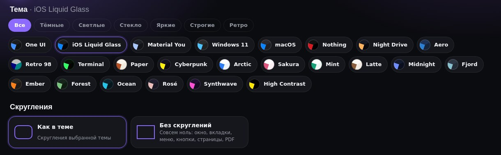

### Quick panel

The palette button on the toolbar opens a small panel: theme, light or dark, accent color, and a switch that turns off rounded corners everywhere. Changes show up right away in all windows, on the new tab, on settings pages and in PDFs. They are also written into `userChrome.css` / `userContent.css`, so they survive a restart.

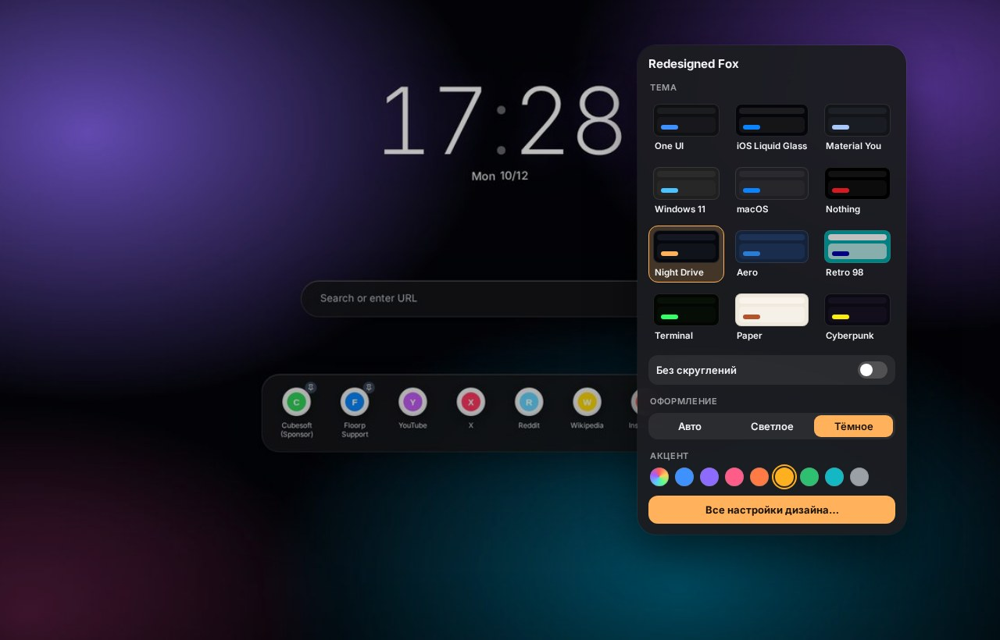

### Studio

Studio is the full settings page. Open it from the quick panel ("All design settings…"), from ☰ → Design, or with `Alt+Shift+S`. What you can change there, on top of any theme:

- colors: accent, window background, fields, menus, text, menu transparency and blur
- shape: corner radius of pages and menus, gaps and shadows, button shape, density
- tabs: 6 shapes (pill, rounded, square, underline, card, Chrome-like), how the selected tab is marked, size, close button. Tabs can also be hidden entirely and slide out from the window edge on hover (`Alt+Shift+T`)
- address bar: height, radius, alignment, border
- right-click menus in 7 styles, and a Ctrl+Tab window with previews in 4 styles
- font and UI text size, animation speed
- new tab: clock size and position, date, search width, shortcuts, wallpaper blur
- which extras are shown (bookmarks bar, toolbar buttons, Now Bar, call bar, loading line)

There are 6 presets, and settings can be saved to a file and loaded back.

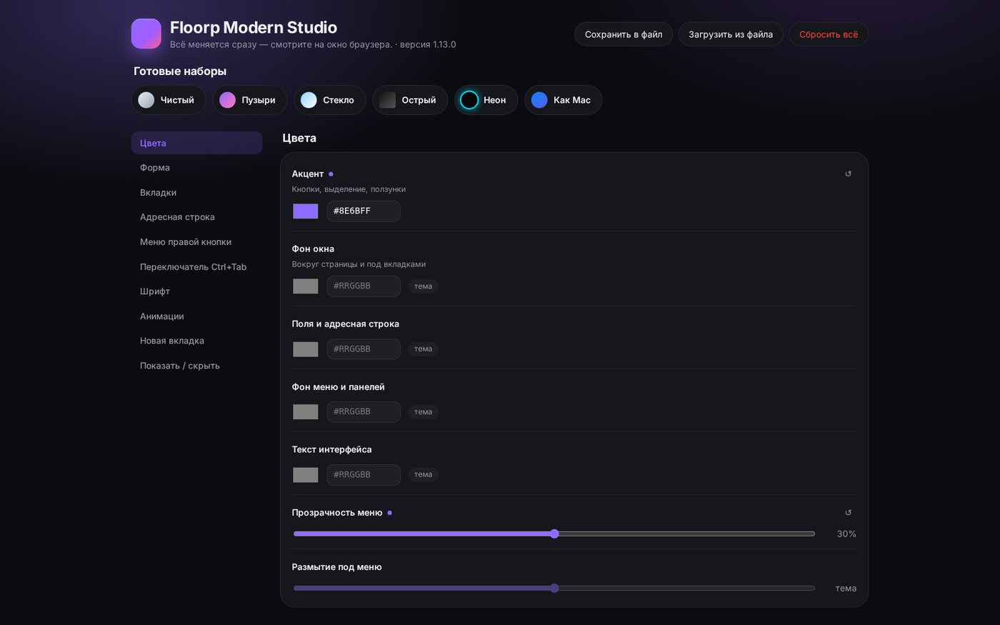

### Call bar

When a call is going on in another tab (Telegram, Discord, WhatsApp, Meet and so on), a small bar appears at the top with the site, a timer, and mic and camera buttons. After a few seconds it shrinks to a pill with the timer. `Alt+Shift+M` mutes the mic from any tab. If the site turned the camera off by itself, the bar presses the site's own button to turn it back on.

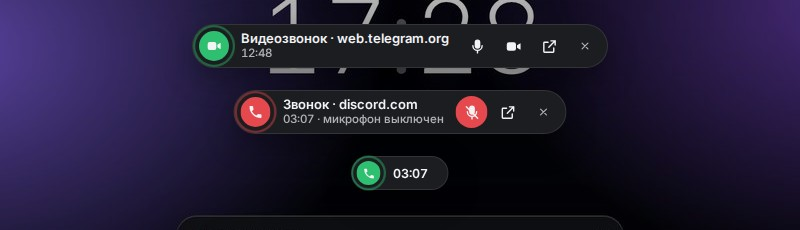

### New tab

10 built-in wallpapers or your own picture, with a dimming slider. The button is in the bottom left corner of the new tab. The wallpaper can also be picked in the installer.

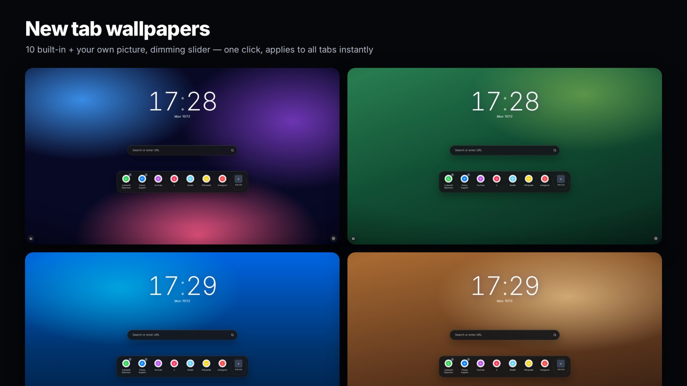

### Animations

Tabs, menus and buttons use spring animations (a small overshoot, like on iPhone). The installer has four modes: iOS springs, smooth, system (follows Windows) and off. They work even when animations are turned off in Windows.

### PDF viewer

- new toolbar and icons, light/dark interface, paper / sepia / night page tone
- drawing works like in Edge: no selection box around strokes, you can keep drawing right next to an existing drawing
- straight lines while holding Shift
- page bookmarks with notes (`Ctrl+B`)
- click a "……" gap or double-click empty space to type text there
- reopens each PDF on the page where you stopped
- redraws pages after the laptop switches GPUs

### Other things

- Now Bar: if music plays in another tab, a draggable bar shows the cover, progress and controls (YouTube, Telegram and others)
- a loading line under the toolbar
- a theme button that cycles Auto / Light / Dark
- small notifications for finished downloads, page zoom and muted tabs
- `Alt+Shift+C` copies the page address, `Alt+Shift+D` closes duplicate tabs, `Alt+Shift+Z` toggles focus mode
- the interface is translated into 10 languages: English, Russian, Ukrainian, German, French, Spanish, Portuguese, Polish, Turkish and Chinese. The installer has a language button, and Studio can change it later

### Updates

Once a day the browser looks at `latest.json` in this repository. If there is a new version, you get a notification and a red dot on the Design button. Nothing is downloaded automatically. You can turn the check off in Studio → Updates.

## Screenshots

<table>
<tr><td><br>One UI</td><td><br>iOS</td></tr>
<tr><td>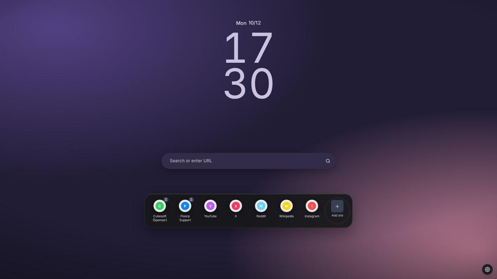<br>Material You</td><td>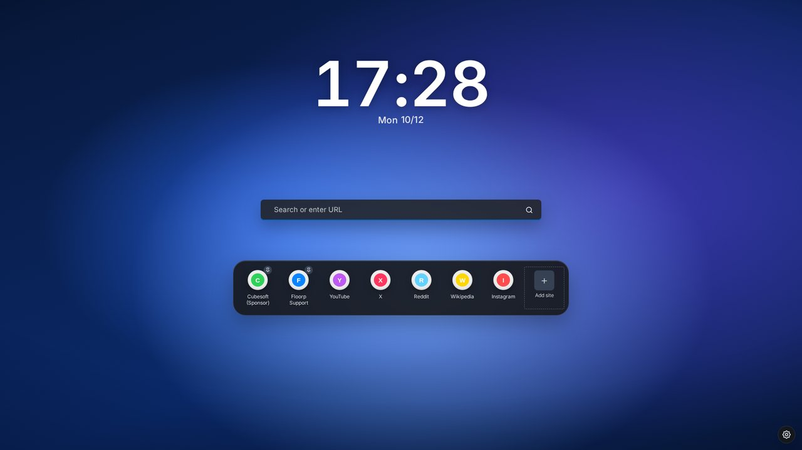<br>Windows 11</td></tr>
<tr><td>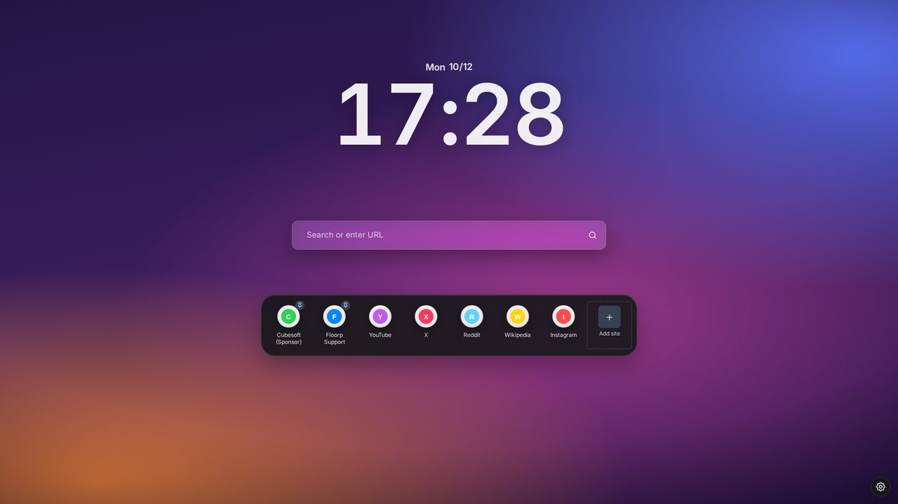<br>macOS</td><td>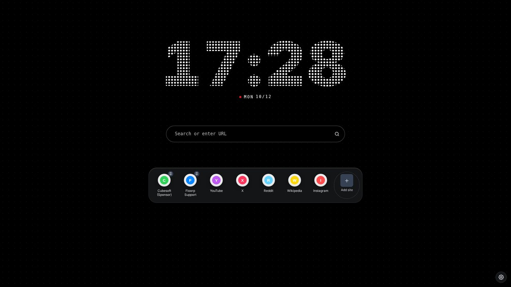<br>Nothing</td></tr>
<tr><td><br>Night Drive</td><td>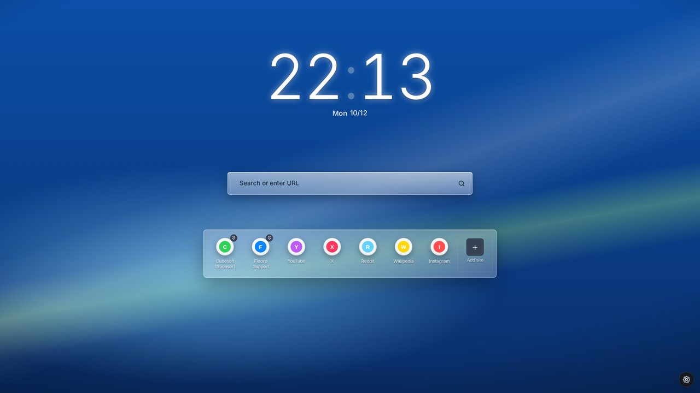<br>Aero</td></tr>
<tr><td>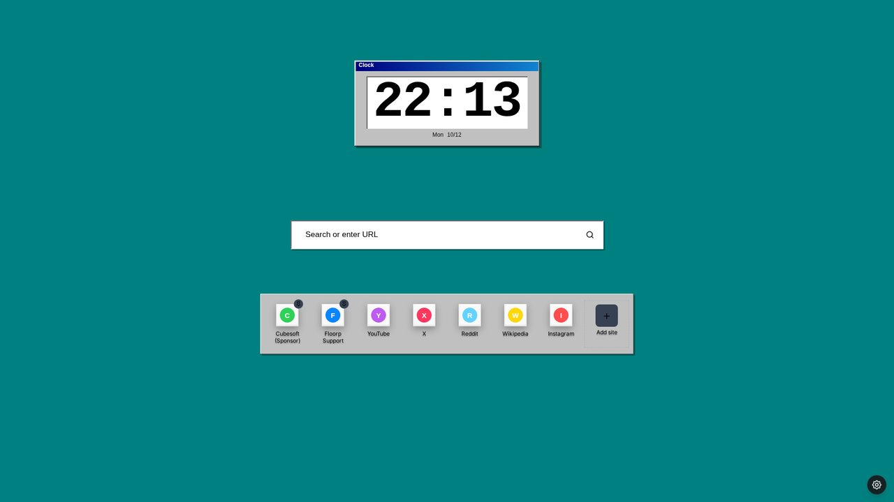<br>Retro 98</td><td>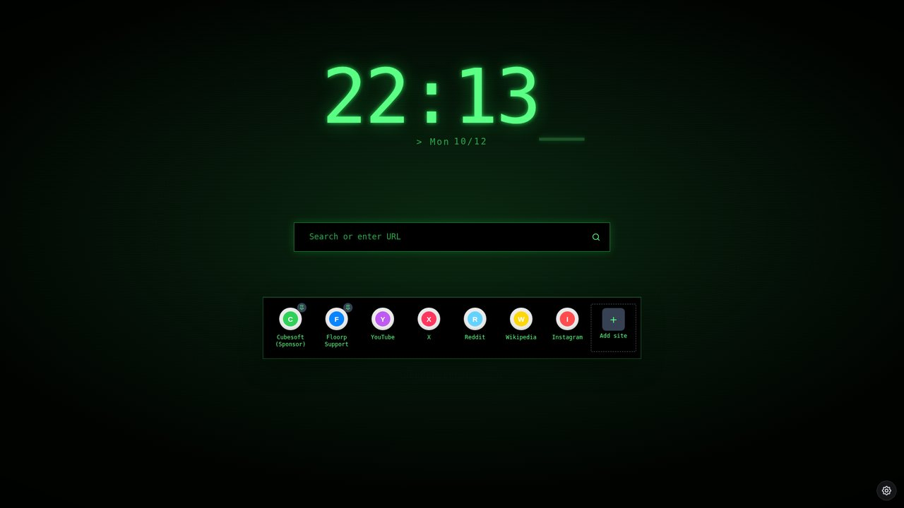<br>Terminal</td></tr>
<tr><td>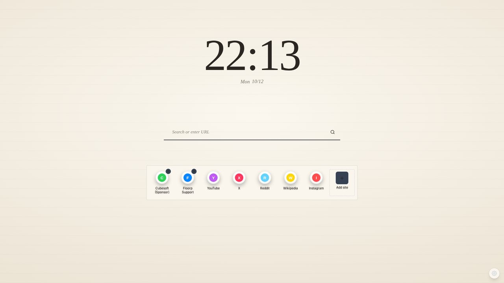<br>Paper</td><td><br>Cyberpunk</td></tr>
<tr><td><br>Wallpaper picker</td><td><br>Menu styles in Studio</td></tr>
</table>

## Install

1. Download `Hand-Design-v<version>.zip` from [Releases](https://github.com/WiWaSu/Hand-Design---browsers-redesign-/releases) and unzip it. If you took the whole repository instead (Code → Download ZIP), the files you need are in the `firefox` folder.
2. Run `Setup.cmd` and allow administrator rights. They are needed once, to put a small script loader into the browser's program folder.
3. Pick a theme, wallpaper, accent, corners, animations and the browsers to install into, then press Install.
4. Restart the browser.

`install.cmd` does the same in the console.

If Hand Design is already installed, `Setup.cmd` shows "Update to v<version>" on the first screen. It updates only the profiles that already have Hand Design and keeps the theme, accent, language, wallpaper and other settings. `update.cmd` does the same in the console. If SmartScreen complains, click "More info", then "Run anyway".

In the browser settings, keep the built-in "System theme — auto". Third-party themes repaint the window frame and get in the way.

To get a single `.exe`, run `build-exe.bat` from the same folder. It builds `Hand-Design-Setup-v<version>.exe` with tools that come with Windows (PowerShell and IExpress). This file is not included in the release zip.

## Uninstall

Run `Setup.cmd` and choose "Remove theme", or run `uninstall.cmd`. After a restart the browser looks as before, with the stock PDF viewer. Your own rules in `userChrome.css` / `userContent.css` stay, and backups are saved as `*.bak-floorp-modern`.

## After a browser update

A big update can remove the loader from the program folder. If the toolbar buttons or the PDF features are gone, run `Setup.cmd` again.

## How it works

| Where | What |
|---|---|
| Browser folder (`C:\Program Files\…`) | `config.js` and `defaults\pref\config-prefs.js`, the AutoConfig loader |
| `chrome\userChrome.css` in the profile | the browser interface (`FLOORP-MODERN` block) |
| `chrome\userContent.css` in the profile | new tab, settings pages, PDF viewer (`FLOORP-MODERN` and `PDF-TWEAKS` blocks) |
| `chrome\pdf-tweaks\` in the profile | scripts for the window and the PDF viewer, Studio, wallpapers, themes for switching on the fly |
| `user.js` in the profile | a few prefs (stylesheets, animations) |

The current theme is stored in the `floorp.modern.theme` pref. Inside the CSS files the theme sits between `FM-THEME BEGIN` and `FM-THEME END`, so the browser can replace it without the installer. Studio settings are kept in `floorp.modern.studio` and applied as a live stylesheet. If something breaks, look at `chrome\pdf-tweaks\fm-log.json` and `fm-boot.json`.

The internal names still say "floorp-modern". They were left as they were so that existing settings keep working.

## Folders

| Folder or file | What is inside |
|---|---|
| `firefox/` | The edition for Firefox, Floorp and forks: installer, styles, scripts, `CHANGELOG.md`. This folder is what goes into the release zip. |
| `chrome/` | The edition for Chromium browsers: extension, installer, `CHANGELOG.md`. |
| `docs/` | Pictures for this README and for release pages. |
| `release-notes/` | Text for each GitHub release, one file per version, in `firefox/` and `chrome/`. |
| `latest.json` | The latest version number. Installed copies read it to show "update available". |
| `releases/` | Built zips for uploading to GitHub. Local only, not in the repository. |
| `archive/` | Old versions and files that are no longer used. Local only. |

## Development

The CSS is generated by the scripts in `firefox/tools/`. Run them from the `firefox` folder:

```sh
python3 tools/gen_chrome.py files                 # base chrome + content CSS
python3 tools/gen_ios.py src/themes               # iOS theme, into src/themes
python3 tools/gen_themes.py src/themes            # the other themes, into src/themes
python3 tools/pack_themes.py                      # src/themes -> files/pdf-tweaks/themes
sh tools/build.sh                                 # release zip
```

`files/pdf-viewer-theme.css` is edited by hand: `tools/gen_css.py` is older than it and would overwrite the changes.

`src/` is an intermediate folder and is not kept in the repository. `tools/l10n.py` expects the translation sources in `src/l10n/`. The built dictionaries are in `files/pdf-tweaks/l10n/`.

## Disclaimer

This is an unofficial mod. It has nothing to do with Mozilla or Ablaze (Floorp). It only uses the customization hooks the browsers already have (`userChrome.css`, `userContent.css`, AutoConfig). Use it at your own risk.

## License

[MIT](LICENSE)

---

## По-русски

Редизайн Floorp, Firefox и форков Firefox для Windows. Раньше проект назывался Redesigned Fox, а ещё раньше Floorp Modern. Для Chrome, Edge, Brave, Vivaldi, Opera и Яндекс Браузера есть [отдельная версия](chrome/README.md).

Работает с Floorp, Firefox (и Developer Edition, и Nightly), LibreWolf, Waterfox, Zen и Mercury. Нужны Windows 10 или 11.

### Что есть

24 темы. Часть повторяет вид телефонов и систем: One UI, iOS (Liquid Glass), Material You, Windows 11, macOS, Nothing, Aero, Retro 98. Ещё есть Night Drive, Terminal, Paper, Cyberpunk, Synthwave, High Contrast и десять палитр: Arctic, Sakura, Mint, Latte, Midnight, Fjord, Ember, Forest, Ocean, Rosé.

Кнопка с палитрой на панели открывает быструю панель: тема, светлое или тёмное оформление, акцент и переключатель «Без скруглений». Меняется сразу во всех окнах, на новой вкладке, в настройках и в PDF, перезапуск не нужен.

Studio открывается из быстрой панели, через ☰ → «Дизайн» или по `Alt+Shift+S`. Там настраиваются цвета, скругления, форма вкладок (можно спрятать их совсем, `Alt+Shift+T`), адресная строка, меню правой кнопки (7 стилей), окно Ctrl+Tab с превью, шрифт, скорость анимаций и новая вкладка. Есть 6 готовых наборов, настройки можно сохранить в файл.

Ещё есть:
- плашка звонка: если в другой вкладке идёт звонок, сверху видно таймер и кнопки микрофона и камеры (`Alt+Shift+M` выключает микрофон из любой вкладки);
- Now Bar: плашка с обложкой и кнопками, когда в другой вкладке играет музыка;
- обои новой вкладки: 10 своих или любая картинка;
- анимации-«пружины» как на iPhone, работают даже с выключенными анимациями Windows;
- свой вид просмотрщика PDF: рисование как в Edge, ровные линии с Shift, закладки страниц (`Ctrl+B`), быстрый текст, PDF открывается там, где вы остановились;
- 10 языков интерфейса, язык выбирается в установщике и в Studio;
- проверка обновлений раз в сутки (ничего не скачивает сама, выключается в Studio → «Обновления»).

### Установка

1. Скачайте `Hand-Design-v<версия>.zip` со страницы [Releases](https://github.com/WiWaSu/Hand-Design---browsers-redesign-/releases) и распакуйте. Если скачали весь репозиторий (Code → Download ZIP), нужные файлы лежат в папке `firefox`.
2. Запустите `Setup.cmd` и разрешите права администратора. Они нужны один раз, чтобы положить загрузчик в папку браузера.
3. Выберите тему, обои, акцент, скругления, анимации и браузеры, нажмите «Установить».
4. Перезапустите браузер.

Консольный вариант: `install.cmd`.

Если Hand Design уже стоит, на первом экране `Setup.cmd` есть кнопка «Обновить до v<версия>». Она обновляет только профили, где Hand Design уже есть, и оставляет тему, акцент, язык, обои и остальные настройки. В консоли то же делает `update.cmd`. В настройках браузера оставьте встроенную тему «Системная тема — авто».

`build-exe.bat` собирает установщик в один файл `Hand-Design-Setup-v<версия>.exe` средствами самой Windows (PowerShell и IExpress). В архив релиза он не входит.

### Удаление

`Setup.cmd` → «Удалить оформление» или `uninstall.cmd`. Ваши собственные стили в `userChrome.css` / `userContent.css` остаются.

Если после обновления браузера пропали кнопки на панели или функции PDF, запустите `Setup.cmd` ещё раз.

### Папки

| Папка или файл | Что внутри |
|---|---|
| `firefox/` | Версия для Firefox, Floorp и форков: установщик, стили, скрипты, `CHANGELOG.md`. Эта папка и уходит в архив релиза. |
| `chrome/` | Версия для браузеров на Chromium: расширение, установщик, `CHANGELOG.md`. |
| `docs/` | Картинки для README и страниц релизов. |
| `release-notes/` | Текст для каждого релиза на GitHub, по файлу на версию, в `firefox/` и `chrome/`. |
| `latest.json` | Номер последней версии. По нему установленные копии показывают «есть обновление». |
| `releases/` | Собранные архивы для загрузки на GitHub. Только на компьютере, в репозиторий не попадает. |
| `archive/` | Старые версии и файлы, которые больше не используются. Только на компьютере. |

Неофициальный мод, с Mozilla и Ablaze не связан. Используйте на свой страх и риск. Лицензия MIT.
