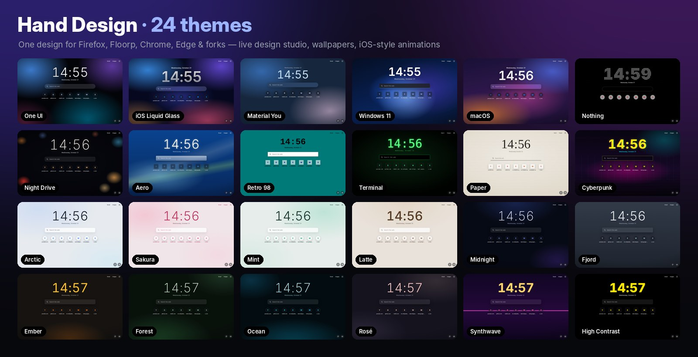
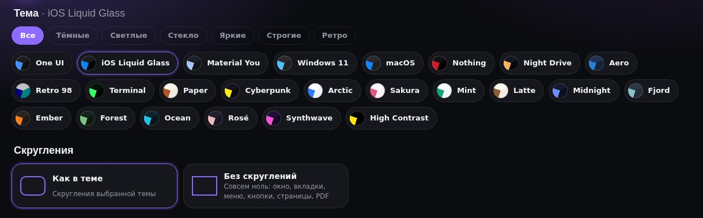
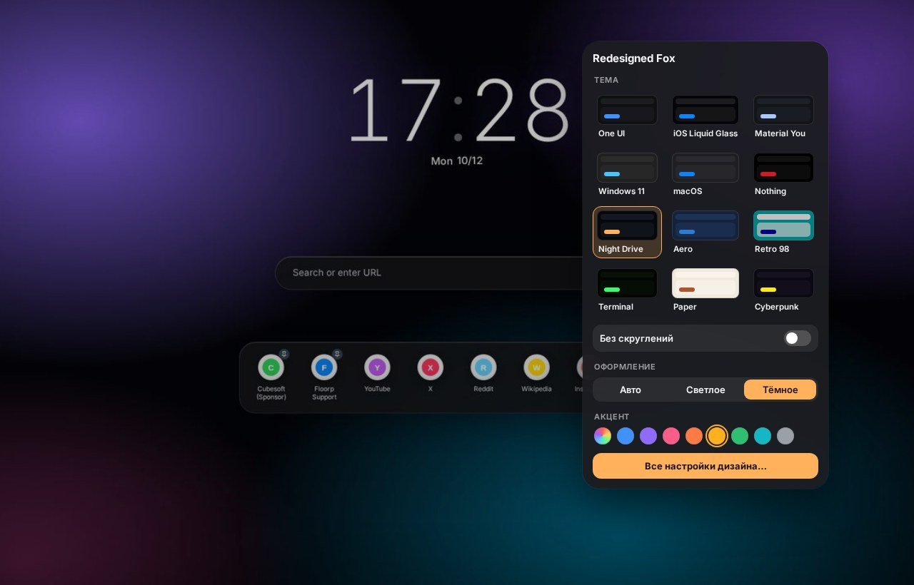
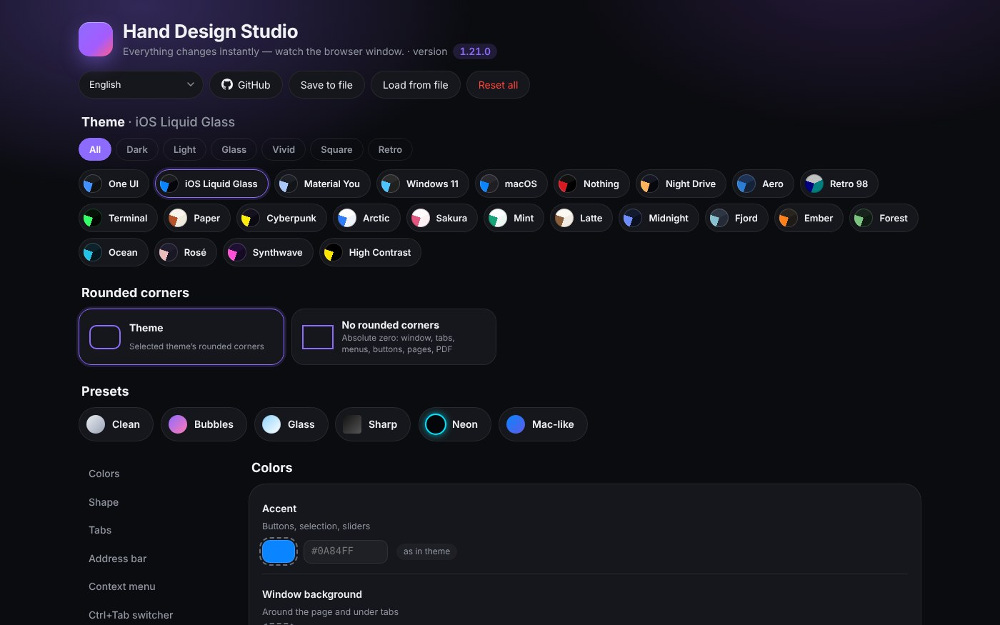
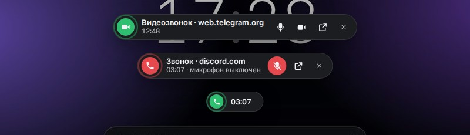

<div align="center">

# Hand Design

**One design for your whole browser — Firefox, Floorp, Chrome, Edge and their forks.**

Themes · live design studio · new-tab wallpapers · iOS-style animations · call bar · Now Bar · reworked PDF viewer


[**Download**](../../releases/latest) · [Changelog](CHANGELOG.md) · [Release notes](changes/) · [Русская версия ↓](#русский)



<sub>formerly Redesigned Fox and Floorp Modern</sub>

</div>

---

## Pick your browser

Hand Design comes in two editions. They share the same palettes, the same quick panel idea and the same Studio — each one goes as deep as its browser allows.

| | 🦊 **Firefox edition** | 🌐 **Chromium edition** |
|---|---|---|
| **Browsers** | Floorp · Firefox · Firefox Developer Edition · Firefox Nightly · LibreWolf · Waterfox · Zen · Mercury | Chrome · Edge · Brave · Vivaldi · Opera / Opera GX · Yandex · Chromium · Thorium |
| **Version** | 1.21.0 — stable | 0.1.0 — early |
| **How it works** | Restyles the whole browser interface (`userChrome.css`, `userContent.css`, a small AutoConfig loader) | MV3 extension + a theme package for the window frame |
| **Folder** | [`firefox/`](firefox/) | [`chrome/`](chrome/) |
| **Installer** | `Setup.cmd` (10 languages) | `Setup.cmd` (Russian / English) |

Not sure? If you use Floorp or Firefox, the Firefox edition gives you the full redesign. The Chromium edition is newer and limited by what Chrome lets extensions change.

## What you get

### 🎨 Themes
24 hand-tuned themes in the Firefox edition; the Chromium edition is generated from the very same palettes (with light and dark variants where a theme has both).

| Group | Themes |
|---|---|
| **Inspired by systems** | One UI · iOS Liquid Glass · Material You · Windows 11 · macOS · Nothing |
| **Mood** | Night Drive · Cyberpunk · Synthwave |
| **Retro** | Aero · Retro 98 · Terminal · Paper |
| **Light palettes** | Arctic · Sakura · Mint · Latte |
| **Dark palettes** | Midnight · Fjord · Ember · Forest · Ocean · Rosé |
| **Accessibility** | High Contrast |



### 🎛 Quick panel
One button on the toolbar: switch theme, light / dark, accent color, turn **all rounded corners off**. Applies instantly — no restart, no installer.



### 🛠 Hand Design Studio
Every detail, live, on top of any theme: colors, shape, density, tabs, address bar, right-click menu styles, Ctrl+Tab switcher, font, animations, new tab, PDF viewer, language. Your own colors always win over the theme; switching the theme resets them, so every theme still looks like itself. Presets, export / import, one-click reset.



### 🖼 New tab
Lock-screen clock, 10 built-in wallpapers or your own picture, dimming and blur, search and shortcuts — in every supported browser.


### 📞 Call bar & 🎵 Now Bar
A call in another tab (Telegram, Discord, WhatsApp, Meet…) shows a small island with a timer, mic and camera controls and a jump-back button. Music playing in another tab gets a draggable player with artwork and controls.



### 📄 PDF viewer
New toolbar and page tones (paper / sepia / night), Edge-style ink with no selection frames, straight lines with Shift, **Clear**, page bookmarks with notes, quick text, own color picker, reopens where you stopped.

### ✨ Animations
Real spring physics like on iPhone. Four modes: **iOS springs**, **Smooth**, **System**, **Off**.

### 🌍 10 languages
English, Русский, Українська, Deutsch, Français, Español, Português, Polski, Türkçe, 中文 — in the Firefox installer (globe button) and in Studio. The Chromium edition currently speaks Russian and English.

## Editions compared

| Feature | Firefox | Chromium |
|---|:---:|:---:|
| Themes for the whole interface | ✅ | Window frame colors only |
| Quick panel & Studio | ✅ | ✅ |
| New tab: clock, wallpapers | ✅ | ✅ |
| Tab shape, address bar shape | ✅ | — |
| Hide tabs completely | ✅ | — |
| Right-click menu styles | ✅ | — |
| Tab switcher with previews | Ctrl+Tab | Alt+Q |
| Call bar · Now Bar | ✅ | ✅ |
| PDF viewer with drawing | ✅ | ✅ |
| Update check | ✅ | ✅ |
| Interface languages | 10 | 2 |

Vivaldi also gets an experimental full-interface stylesheet in the Chromium edition.

## Install

Download the latest release from [**Releases**](../../releases/latest) and unzip it.

### 🦊 Firefox edition
1. Run **`Setup.cmd`** and allow administrator rights (once — it puts a tiny loader into the browser folder).
2. Pick language, theme, wallpaper, accent, light / dark, corners, animations, features and browsers.
3. Press **Install** and restart the browser.

Use the built-in browser theme **“System theme — auto”**: third-party themes repaint the window frame. Prefer the console? `install.cmd` does the same with text prompts.

### 🌐 Chromium edition
1. Run **`Setup.cmd`** and pick a theme and settings. Files go to `%LOCALAPPDATA%\HandDesign\Chrome`.
2. Chrome doesn't let programs install extensions, so do this once in the browser: open the extensions page, turn on **Developer mode**, click **Load unpacked** and paste the path the installer copied for you.
3. Repeat **Load unpacked** for the `frame` folder — that's the window-frame theme.

To update later, just run the installer again and restart the browser.

> SmartScreen warning? *More info → Run anyway.* The scripts are plain text — you can read every line before running them.

## Keyboard shortcuts

| Action | Firefox | Chromium |
|---|---|---|
| Open Studio | `Alt+Shift+S` | `Alt+Shift+S` |
| Quick panel | toolbar button | `Alt+Shift+D` |
| Tab switcher | `Ctrl+Tab` | `Alt+Q` |
| Mute mic in a call | `Alt+Shift+M` | `Alt+Shift+M` |
| Hide / show tabs | `Alt+Shift+T` | — |
| Copy page address | `Alt+Shift+C` | — |
| Close duplicate tabs | `Alt+Shift+D` | — |
| Focus mode | `Alt+Shift+Z` | — |
| Bookmark PDF page | `Ctrl+B` | — |

## Updates

Big updates come out **once a week, on Fridays**. Both editions check this repository once a day: a new version shows a notification and a dot on the Design button, with **Download**, **What's new** and **Later**. Nothing is downloaded automatically, and the check can be turned off in Studio.

Firefox: after a major browser update the loader may disappear from the program folder — if the toolbar buttons or PDF features are gone, run `Setup.cmd` again.

## Uninstall

- **Firefox:** `Setup.cmd` → **Remove theme** (or `uninstall.cmd`). The stock look comes back after a restart; your own CSS rules are kept, backups are saved as `*.bak-floorp-modern`.
- **Chromium:** `uninstall.cmd`, then remove the two unpacked extensions in the browser.

## Repository layout

```
firefox/     Firefox edition: installer, styles, scripts, tools
chrome/      Chromium edition: extension, theme packages, installer, tools
docs/        screenshots and images
changes/     release notes for every version
CHANGELOG.md full history
```

Building, generators and internals are described in each edition's own folder.

## Disclaimer

Unofficial community project, not affiliated with or endorsed by Mozilla, Ablaze (Floorp), Google or any other browser vendor. It uses documented customization mechanisms only. Use at your own risk.

## License

[MIT](LICENSE)

---

<a id="русский"></a>

<div align="center">

# Hand Design — по-русски

**Единый дизайн для всего браузера — Firefox, Floorp, Chrome, Edge и их форков.**

<sub>раньше — Redesigned Fox и Floorp Modern</sub>

</div>

## Выберите браузер

У Hand Design две версии. Палитры, быстрая панель и Studio у них общие, а настраивают они ровно столько, сколько позволяет браузер.

| | 🦊 **Для Firefox** | 🌐 **Для Chromium** |
|---|---|---|
| **Браузеры** | Floorp · Firefox · Firefox Developer Edition · Firefox Nightly · LibreWolf · Waterfox · Zen · Mercury | Chrome · Edge · Brave · Vivaldi · Opera / Opera GX · Яндекс · Chromium · Thorium |
| **Версия** | 1.21.0 — стабильная | 0.1.0 — ранняя |
| **Как устроено** | Перерисовывает весь интерфейс браузера (`userChrome.css`, `userContent.css`, маленький загрузчик AutoConfig) | Расширение MV3 + тема-пакет для рамки окна |
| **Папка** | [`firefox/`](firefox/) | [`chrome/`](chrome/) |
| **Установщик** | `Setup.cmd` (10 языков) | `Setup.cmd` (русский / английский) |

Сомневаетесь — если у вас Floorp или Firefox, берите версию для Firefox: это полный редизайн. Версия для Chromium моложе, и Chrome разрешает расширениям менять меньше.

## Что внутри

### 🎨 Темы
24 темы в версии для Firefox; версия для Chromium собирается из тех же палитр (со светлым и тёмным вариантом, где они есть).

| Группа | Темы |
|---|---|
| **Как в системах** | One UI · iOS Liquid Glass · Material You · Windows 11 · macOS · Nothing |
| **Настроение** | Night Drive · Cyberpunk · Synthwave |
| **Ретро** | Aero · Retro 98 · Terminal · Paper |
| **Светлые палитры** | Arctic · Sakura · Mint · Latte |
| **Тёмные палитры** | Midnight · Fjord · Ember · Forest · Ocean · Rosé |
| **Доступность** | High Contrast |

### 🎛 Быстрая панель
Одна кнопка на панели: тема, светлое / тёмное, цвет акцента, **«Без скруглений»**. Меняется сразу — без перезапуска и без установщика.

### 🛠 Hand Design Studio
Каждая мелочь, вживую, поверх любой темы: цвета, форма, плотность, вкладки, адресная строка, стили меню правой кнопки, переключатель Ctrl+Tab, шрифт, анимации, новая вкладка, просмотрщик PDF, язык. Ваши цвета всегда сильнее темы; при смене темы они сбрасываются, чтобы каждая тема выглядела собой. Готовые наборы, сохранение в файл, сброс в один клик.

### 🖼 Новая вкладка
Часы как на экране блокировки, 10 готовых обоев или своя картинка, затемнение и размытие, поиск и ярлыки — во всех поддерживаемых браузерах.

### 📞 Плашка звонка и 🎵 Now Bar
Звонок в другой вкладке (Telegram, Discord, WhatsApp, Meet…) — сверху «островок» с таймером, микрофоном, камерой и кнопкой «к звонку». Музыка в другой вкладке — перетаскиваемый плеер с обложкой и кнопками.

### 📄 Просмотрщик PDF
Новая панель и цвет страниц (бумага / сепия / ночь), рисование как в Edge без рамок, прямые линии с Shift, «Очистить», закладки страниц с заметками, быстрый текст, своя палитра, открытие на той же странице.

### ✨ Анимации
Настоящие «пружины», как на iPhone. Четыре режима: **Как в iOS**, **Плавные**, **Как в Windows**, **Выкл**.

### 🌍 10 языков
Русский, English, Українська, Deutsch, Français, Español, Português, Polski, Türkçe, 中文 — в установщике для Firefox (кнопка с глобусом) и в Studio. Версия для Chromium пока говорит по-русски и по-английски.

## Сравнение версий

| Возможность | Firefox | Chromium |
|---|:---:|:---:|
| Темы для всего интерфейса | ✅ | Только цвета рамки окна |
| Быстрая панель и Studio | ✅ | ✅ |
| Новая вкладка: часы, обои | ✅ | ✅ |
| Форма вкладок и адресной строки | ✅ | — |
| Скрыть вкладки целиком | ✅ | — |
| Стили меню правой кнопки | ✅ | — |
| Переключатель вкладок с превью | Ctrl+Tab | Alt+Q |
| Плашка звонка · Now Bar | ✅ | ✅ |
| Просмотрщик PDF с рисованием | ✅ | ✅ |
| Проверка обновлений | ✅ | ✅ |
| Языки интерфейса | 10 | 2 |

Для Vivaldi в версии для Chromium есть опытный стиль всего интерфейса.

## Установка

Скачайте последний выпуск из [**Releases**](../../releases/latest) и распакуйте.

### 🦊 Для Firefox
1. Запустите **`Setup.cmd`** и разрешите права администратора (один раз — чтобы положить загрузчик в папку браузера).
2. Выберите язык, тему, обои, акцент, светлое / тёмное, скругления, анимации, функции и браузеры.
3. Нажмите **«Установить»** и перезапустите браузер.

Тема браузера должна быть встроенной: **«Системная тема — авто»**. Консольный вариант — `install.cmd`.

### 🌐 Для Chromium
1. Запустите **`Setup.cmd`** и выберите тему и настройки. Файлы ставятся в `%LOCALAPPDATA%\HandDesign\Chrome`.
2. Chrome не даёт программам ставить расширения, поэтому один раз в браузере: страница расширений → **«Режим разработчика»** → **«Загрузить распакованное»** → вставьте путь, который скопировал установщик.
3. Ещё раз **«Загрузить распакованное»** — для папки `frame`, это тема рамки окна.

Обновление — снова запустить установщик и перезапустить браузер.

> Предупреждение SmartScreen? *Подробнее → Выполнить в любом случае.* Скрипты — обычный текст, каждую строку можно прочитать до запуска.

## Горячие клавиши

| Действие | Firefox | Chromium |
|---|---|---|
| Открыть Studio | `Alt+Shift+S` | `Alt+Shift+S` |
| Быстрая панель | кнопка на панели | `Alt+Shift+D` |
| Переключатель вкладок | `Ctrl+Tab` | `Alt+Q` |
| Микрофон в звонке | `Alt+Shift+M` | `Alt+Shift+M` |
| Скрыть / показать вкладки | `Alt+Shift+T` | — |
| Копировать адрес | `Alt+Shift+C` | — |
| Закрыть одинаковые вкладки | `Alt+Shift+D` | — |
| Режим фокуса | `Alt+Shift+Z` | — |
| Закладка страницы PDF | `Ctrl+B` | — |

## Обновления

Большие обновления выходят **раз в неделю, по пятницам**. Обе версии раз в сутки заглядывают в этот репозиторий: есть новая версия — уведомление и точка на кнопке «Дизайн», в панели «Скачать», «Что нового», «Позже». Сами ничего не скачивают; проверку можно выключить в Studio.

Firefox: после крупного обновления браузера загрузчик может пропасть из папки программы — если исчезли кнопки на панели или функции PDF, запустите `Setup.cmd` ещё раз.

## Удаление

- **Firefox:** `Setup.cmd` → **«Удалить оформление»** (или `uninstall.cmd`). После перезапуска вернётся обычный вид; ваши собственные стили не трогаются, копии сохраняются как `*.bak-floorp-modern`.
- **Chromium:** `uninstall.cmd`, затем удалите два распакованных расширения в браузере.

## Устройство репозитория

```
firefox/     версия для Firefox: установщик, стили, скрипты, инструменты
chrome/      версия для Chromium: расширение, тема-пакеты, установщик, инструменты
docs/        скриншоты и картинки
changes/     заметки к каждой версии
CHANGELOG.md полная история
```

Сборка, генераторы и внутреннее устройство описаны в папке каждой версии.

Неофициальный проект сообщества, не связан с Mozilla, Ablaze (Floorp), Google и другими разработчиками браузеров. Используются только документированные способы настройки. На свой страх и риск. Лицензия [MIT](LICENSE).
