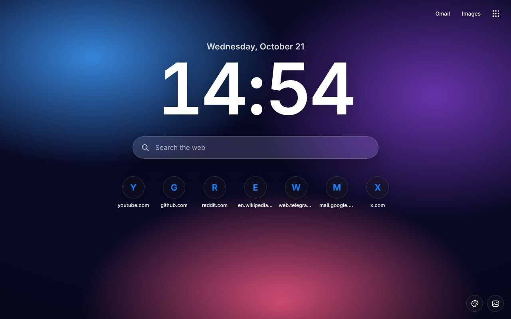
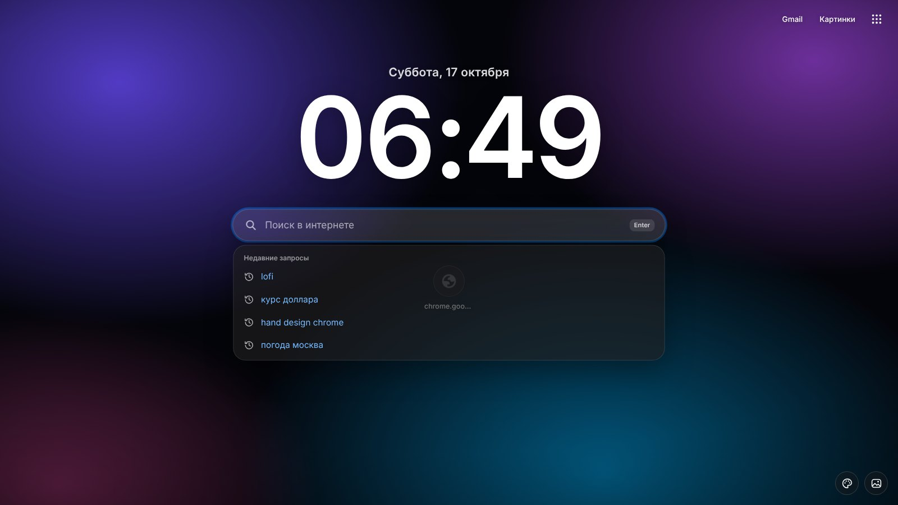
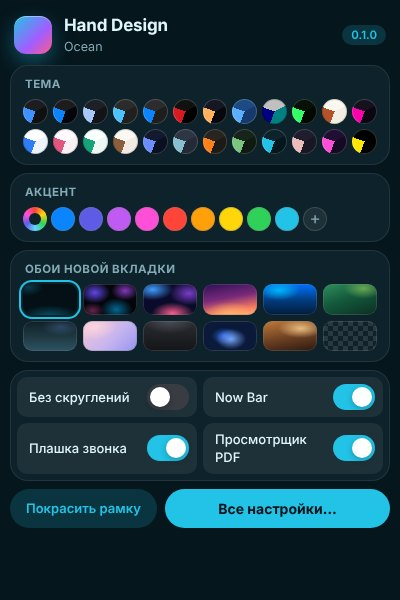
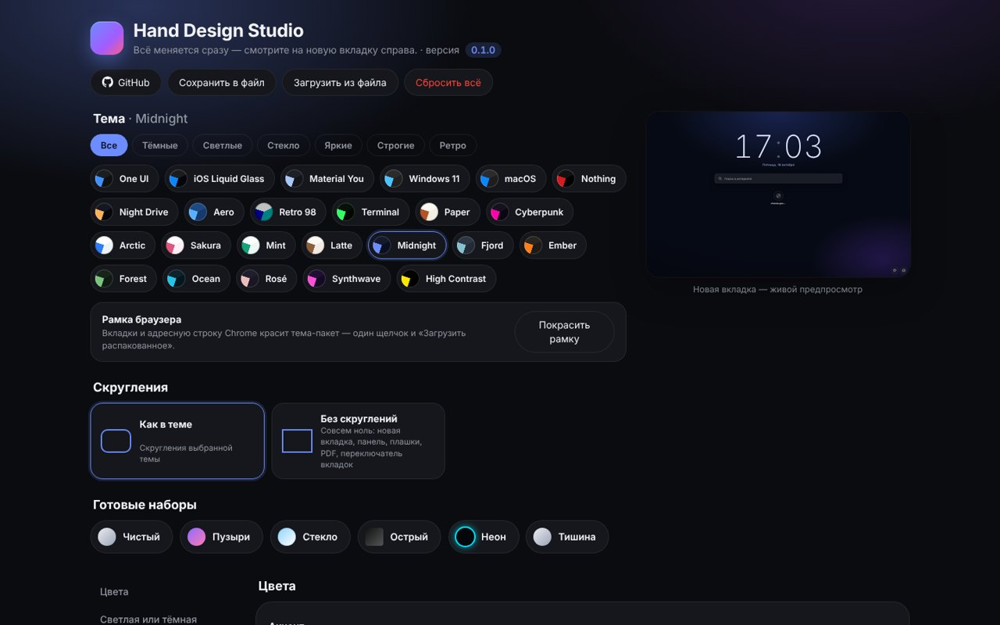

# Hand Design for Chromium

Редизайн для Chrome, Edge, Brave, Vivaldi, Opera и Яндекс Браузера. Сначала Hand Design делался для Firefox и Floorp ([Firefox-версия](../README.md)), а это порт: те же палитры тем, те же обои, тот же Studio. Нумерация своя, сейчас это 1.0.0.

English: see [below](#english).



Что нового в 1.0.0: заметки как в Obsidian, редакторы Markdown, CSV и картинок, страница «Документы», детали тем, 10 языков и картинка темы под полосой вкладок. Подробно в [журнале изменений](CHANGELOG.md).

## Установка

1. Скачайте `Hand-Design-Chromium-v<версия>.zip` со страницы [Releases](https://github.com/WiWaSu/Hand-Design---browsers-redesign-/releases) и распакуйте.
2. Запустите `Setup.cmd`. Выберите язык, тему, обои, акцент и браузеры, нажмите «Установить».
3. Установщик откроет страницу расширений браузера и сам подключит Hand Design: включит «Режим разработчика», нажмёт «Загрузить распакованное» и выберет папку. Для Edge, Opera и Яндекса он так же подключит рамку браузера. Несколько секунд не трогайте мышь и клавиатуру.

Если подключить само не получилось, установщик покажет, что нажать: включить «Режим разработчика», «Загрузить распакованное», вставить путь (Ctrl+V) и выбрать папку.

Файлы ставятся в `%LOCALAPPDATA%\HandDesign\Chrome`. Браузер читает расширение оттуда, так что эту папку не удаляйте.

Чтобы обновиться, запустите установщик новой версии и нажмите ⟳ на карточке Hand Design на странице расширений. Настройки останутся. А вот если удалить расширение и добавить заново, Chrome сотрёт его данные, поэтому перед этим лучше сохранить настройки: Studio → «Сохранить в файл».

## Что внутри

- 24 темы, те же, что в Firefox-версии: One UI, iOS, Material You, Windows 11, macOS, Nothing, Night Drive, Aero, Retro 98, Terminal, Paper, Cyberpunk и палитры.
- Новая вкладка: обои темы, 10 готовых или своя картинка, затемнение, размытие, живые обои. Часы в стиле темы, ярлыки сайтов. Открывается и при запуске браузера.
- Поиск на новой вкладке ищет тем поисковиком, что выбран в браузере. По щелчку показывает недавние запросы, при вводе подсказывает прошлые запросы, сайты из истории и подсказки Google. Лишний запрос убирается крестиком.
- Справа сверху Gmail, Картинки и меню с историей, загрузками, закладками, паролями, расширениями, настройками Chrome и приложениями Google.
- Быстрая панель (кнопка на панели или `Alt+Shift+D`): тема, светлая или тёмная, акцент, обои, «Без скруглений» и переключатели плашек.
- Studio (`Alt+Shift+S`): цвета, форма, детали тем, новая вкладка, переключатель вкладок, шрифт, анимации, плашки, PDF, документы и заметки, готовые наборы, сохранение в файл.
- Детали тем: часы, фон новой вкладки и поиск можно взять из любой темы и поставить на любую другую. У каждого варианта есть картинка.
- Заметки (кнопка в быстрой панели): то же приложение, что в Firefox-версии. Live Preview, папки, `[[ссылки]]` и упоминания, `#теги`, блоки `[!note]`, картинки, граф связей, быстрый переход `Ctrl+O`, заметка дня и шаблоны. Каждая заметка — файл `.md` в выбранной папке, её открывает и Obsidian.
- Редакторы файлов: `.md` открывается оформленным, `.csv` — таблицей вместо скачивания, картинку можно обрезать, подписать, размыть и сжать (с компьютера или через «Редактировать картинку» в меню правой кнопки). Страница «Документы» создаёт и открывает файлы и помнит недавние.
- Now Bar: если в другой вкладке играет музыка или видео, сверху страницы появляется плашка с обложкой и кнопками. Видит и «невидимые» плееры Telegram и VK.
- Плашка звонка для Meet, Телемоста, Zoom в браузере и других: таймер, кнопки микрофона и камеры, `Alt+Shift+M`. Её можно перетащить, двойной щелчок возвращает на место.
- Вкладки с превью (`Alt+Q`): недавние вкладки с миниатюрами, поиск по ним. Отпустили Alt, и вы на выбранной вкладке.
- Свой просмотрщик PDF на pdf.js: темы, сепия и ночной тон страниц, рисование, надписи, маркер, сохранение с рисунками. Запоминает, где вы остановились.
- Верх браузера в цвет темы. В Chrome, Brave и Chromium это делает помощник Hand Design (подробнее в вопросах ниже). Ещё есть 31 тема-пакет (24 темы плюс светлые варианты): в них под полосой вкладок картинка — фон новой вкладки этой темы.
- Для Vivaldi дополнительно ставится CSS для всего интерфейса. Это пока опытная функция.
- 10 языков интерфейса, общие с Firefox-версией. Язык меняется в Studio → «Цвета».
- При каждом запуске браузера и раз в сутки расширение проверяет [`latest.json`](../latest.json) в этом репозитории и показывает стрелку на значке, если вышла новая версия.

| Поиск с историей | Быстрая панель |
|:-:|:-:|
|  |  |
| Now Bar | Studio |
|  |  |

## Клавиши

| Клавиши | Что делает |
|---|---|
| <kbd>Alt</kbd>+<kbd>Shift</kbd>+<kbd>D</kbd> | быстрая панель |
| <kbd>Alt</kbd>+<kbd>Shift</kbd>+<kbd>S</kbd> | Studio |
| <kbd>Alt</kbd>+<kbd>Q</kbd> | вкладки с превью |
| <kbd>Alt</kbd>+<kbd>Shift</kbd>+<kbd>M</kbd> | выключить или включить микрофон в звонке |
| <kbd>Ctrl</kbd>+<kbd>O</kbd> | быстрый переход в заметках |
| <kbd>Ctrl</kbd>+<kbd>S</kbd> | сохранить заметку, `.md` или `.csv` |
| <kbd>↑</kbd> <kbd>↓</kbd>, <kbd>Enter</kbd>, <kbd>Esc</kbd> | подсказки в поиске на новой вкладке |

Поменять клавиши и назначить клавишу для заметок можно на странице `chrome://extensions/shortcuts`.

## Вопросы

**Внизу новой вкладки полоса «Hand Design» и «Настроить Chrome».**
Её рисует сам Chrome (с версии 138) на любой новой вкладке от расширения. Убрать её можно правым щелчком по ней или в «Настроить Chrome». Расширение до неё не дотягивается.

**Видеокарта нагружена, вентиляторы шумят.**
Это было в 0.1.0. С 0.1.1 живые обои пересчитываются 20 раз в секунду, а не на частоте монитора, и без «стекла» поверх. Если хочется совсем тихую вкладку, выключите живые обои: Studio → «Новая вкладка».

**В меню Chrome написано «Управляется вашей организацией».**
Так Hand Design красит верх браузера, другого способа Chrome не оставляет. Установщик ставит помощник, и тот задаёт цвет через политику `BrowserThemeColor` в разделе текущего пользователя. Это только цвет, другие настройки браузера никто не трогает. Убрать надпись: Studio → «Цвета» → «Красить верх браузера». Помощник удалит политику, и верх станет обычным.

**Вкладки и адресная строка остались серыми.**
В Chrome, Brave и Chromium запустите установщик 0.1.2 или новее (именно он ставит помощник) и нажмите ⟳ на карточке расширения. Проверьте, что в Studio включено «Красить верх браузера». В Edge, Opera и Яндексе нажмите в быстрой панели «Покрасить рамку»: путь к папке темы скопируется, её нужно загрузить через «Загрузить распакованное».

**Настройки сбросились после обновления.**
Значит, расширение удалили и добавили заново, а Chrome при этом стирает его данные. Для обновления достаточно ⟳ на карточке.

**Заметки или файл просят разрешение после перезапуска браузера.**
Так Chrome устроен: доступ к папке или файлу на диске после перезапуска подтверждается одним щелчком. В заметках это кнопка «Открыть прошлую папку», в редакторах — «Открыть файл».

**Файл `.md` открылся, но «Сохранить» спрашивает, куда сохранить.**
Файл открыт из проводника, а такие Chrome не даёт перезаписать. Выберите тот же файл в окне «Сохранить как», и дальше `Ctrl+S` будет сохранять на место. Файлы, открытые через «Документы», сохраняются сразу.

**Почему нельзя поменять меню правой кнопки и форму вкладок, как в Firefox-версии?**
Интерфейс Chrome закрыт для расширений: меню, форму вкладок и адресной строки, «Скрыть вкладки» сделать нельзя. Исключение Vivaldi, у него интерфейс на CSS, и Hand Design этим пользуется.

## Папки

```
chrome/
├─ Setup.cmd, Setup-debug.cmd, uninstall.cmd, build-exe.bat, VERSION, CHANGELOG.md, LICENSE
├─ files/
│  ├─ installer.ps1          установщик (окно WPF и режим без окна)
│  ├─ host/                  помощник: красит верх браузера (native messaging → политика BrowserThemeColor)
│  ├─ extension/             расширение (Manifest V3)
│  │  ├─ background.js       Now Bar, звонки, вкладки с превью, PDF, стартовая страница, обновления
│  │  ├─ newtab/             новая вкладка: обои, часы, поиск с историей, панель инструментов
│  │  ├─ popup/ studio/ switcher/ pdf/
│  │  ├─ docs/               страницы заметок, Markdown, CSV, картинок и «Документов»: файлы через File System Access
│  │  ├─ apps/ l10n/ details/  копии общего кода из ../shared (не править здесь)
│  │  ├─ content/            page-hook.js (в странице), bridge.js, island.js (плашки)
│  │  └─ shared/             themes.js (генерируется), settings.js, apply.js, walls.js, i18n.js
│  ├─ themes/<id>/           тема-пакеты рамки для Edge, Opera, Яндекса (генерируются) + themes.json
│  └─ vivaldi/<id>.css       CSS для Vivaldi (генерируется)
└─ tools/
   ├─ gen_chrome_themes.py   темы из палитр Firefox-версии
   ├─ release.py             выпуск версии: архивы, заметки, latest.json, журналы
   ├─ build.py               только архив релиза
   └─ unpack-pdf.cmd         распаковать pdf.js, чтобы загрузить расширение без установщика
```

## Разработка

Палитры берутся из Firefox-версии: `python tools/gen_chrome_themes.py` пересобирает `themes.js`, тема-пакеты и CSS для Vivaldi. Картинки полосы вкладок рисует `node tools/frames.mjs <id расширения>` (нужен Chrome с `--remote-debugging-port=9333`).

Заметки, редакторы файлов, словари и превью деталей тем общие с Firefox-версией и лежат в `shared/` в корне репозитория. Правьте их там и запускайте `python tools/sync.py` из корня: он разложит копии в `chrome/files/extension` и `firefox/files/pdf-tweaks`.

Без установщика: запустите `tools\unpack-pdf.cmd`, потом «Загрузить распакованное» → `files\extension`.

Новая версия:
1. Поднять номер в `VERSION` и `files/extension/manifest.json`.
2. Добавить раздел `## X.Y.Z — ГГГГ-ММ-ДД` в [CHANGELOG.md](CHANGELOG.md).
3. Запустить `python tools/release.py`. Он раскладывает архивы, заметки к версии, `latest.json` и журналы. Тег в git: `chromium-vX.Y.Z`.

Настройки хранятся в `chrome.storage.local` под ключом `hd`, и только те, что отличаются от умолчаний. Умолчания лежат в `shared/settings.js`.

`files/extension/pdf/lib.zip` это pdf.js без изменений (pdfjs-dist 6.4.299, сборка legacy, Apache-2.0).

## English

A port of Hand Design to Chromium browsers: Chrome, Edge, Brave, Vivaldi, Opera and Yandex Browser. Same themes, wallpapers, theme details and Studio as the [Firefox edition](../README.md), and the same Notes app (Live Preview, `[[links]]`, tags, graph, daily notes) with Markdown, CSV and image editors. It also has a new tab with search history, a Now Bar, a call bar, a tab switcher with previews (`Alt+Q`) and its own PDF viewer. The interface is in 10 languages.

To install:

1. Download the zip from [Releases](https://github.com/WiWaSu/Hand-Design---browsers-redesign-/releases) and unzip it.
2. Run `Setup.cmd`, pick a language, theme, wallpaper, accent and browsers, press Install.
3. The installer opens the browser's extensions page and connects Hand Design by itself: it turns on Developer mode, clicks Load unpacked and picks the folder. For Edge, Opera and Yandex it adds the browser frame the same way. Leave the mouse and keyboard alone for a few seconds.

If that fails, the installer shows what to click by hand. To update, run the new installer and press ⟳ on the Hand Design card.

The Chromium UI is closed to extensions, so right-click menus and the tab shape can't be changed the way the Firefox edition does it. Vivaldi is the exception.

## Лицензия

[MIT](LICENSE). pdf.js распространяется под Apache-2.0.
