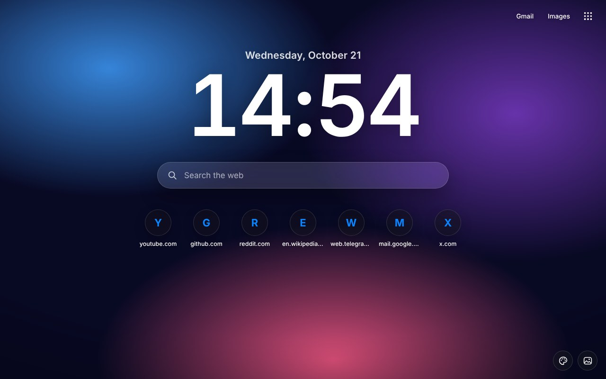
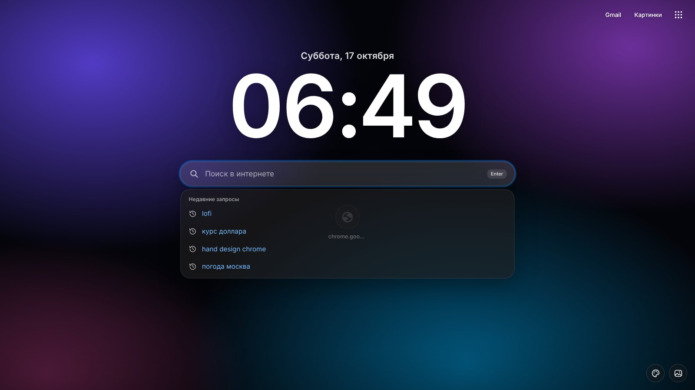
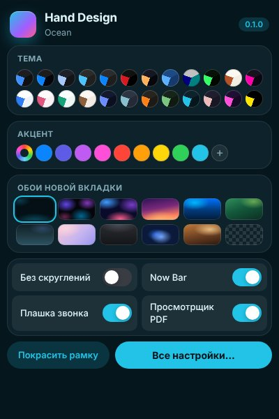
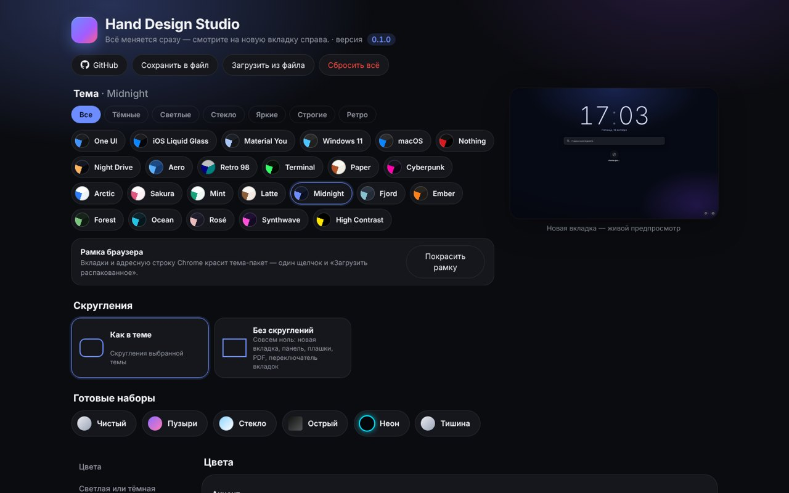

# Hand Design for Chromium

Редизайн для Chrome, Edge, Brave, Vivaldi, Opera и Яндекс Браузера. Сначала Hand Design делался для Firefox и Floorp ([Firefox-версия](../README.md)), а это порт: те же палитры тем, те же обои, тот же Studio. Нумерация своя (`0.x`), пока порт не догонит Firefox-версию. Сейчас это 0.1.2.

English: see [below](#english).



Что нового в 0.1.2: верх браузера (вкладки и адресная строка) сам перекрашивается в цвет темы при каждой смене, папку `frame` больше не надо загружать руками. Остальное в [журнале изменений](CHANGELOG.md).

## Установка

1. Скачайте `Hand-Design-Chromium-v<версия>.zip` со страницы [Releases](https://github.com/WiWaSu/Hand-Design---browsers-redesign-/releases) и распакуйте.
2. Запустите `Setup.cmd`. Выберите язык, тему, обои, акцент и браузеры, нажмите «Установить».
3. Браузер откроет страницу расширений. Включите «Режим разработчика» (переключатель справа сверху), нажмите «Загрузить распакованное», вставьте путь (Ctrl+V) и нажмите «Выбрать папку».
4. Только для Edge, Opera и Яндекса: ещё раз «Загрузить распакованное», папка `frame`. В Chrome, Brave и Chromium вкладки и адресная строка красятся сами.

Шаги 3 и 4 делаются один раз. Chrome не даёт программам ставить расширения в обход магазина, поэтому последнюю кнопку приходится нажать самому. Установщик хотя бы открывает нужную страницу и копирует путь.

Файлы ставятся в `%LOCALAPPDATA%\HandDesign\Chrome`. Браузер читает расширение оттуда, так что эту папку не удаляйте.

Чтобы обновиться, запустите установщик новой версии и нажмите ⟳ на карточке Hand Design на странице расширений. Настройки останутся. А вот если удалить расширение и добавить заново, Chrome сотрёт его данные, поэтому перед этим лучше сохранить настройки: Studio → «Сохранить в файл».

## Что внутри

- 24 темы, те же, что в Firefox-версии: One UI, iOS, Material You, Windows 11, macOS, Nothing, Night Drive, Aero, Retro 98, Terminal, Paper, Cyberpunk и палитры.
- Новая вкладка: обои темы, 10 готовых или своя картинка, затемнение, размытие, живые обои. Часы в стиле темы, ярлыки сайтов. Открывается и при запуске браузера.
- Поиск на новой вкладке ищет тем поисковиком, что выбран в браузере. По щелчку показывает недавние запросы, при вводе подсказывает прошлые запросы, сайты из истории и подсказки Google. Лишний запрос убирается крестиком.
- Справа сверху Gmail, Картинки и меню с историей, загрузками, закладками, паролями, расширениями, настройками Chrome и приложениями Google.
- Быстрая панель (кнопка на панели или `Alt+Shift+D`): тема, светлая или тёмная, акцент, обои, «Без скруглений» и переключатели плашек.
- Studio (`Alt+Shift+S`): цвета, форма, новая вкладка, переключатель вкладок, шрифт, анимации, плашки, PDF, готовые наборы, сохранение в файл.
- Now Bar: если в другой вкладке играет музыка или видео, сверху страницы появляется плашка с обложкой и кнопками. Видит и «невидимые» плееры Telegram и VK.
- Плашка звонка для Meet, Телемоста, Zoom в браузере и других: таймер, кнопки микрофона и камеры, `Alt+Shift+M`. Её можно перетащить, двойной щелчок возвращает на место.
- Вкладки с превью (`Alt+Q`): недавние вкладки с миниатюрами, поиск по ним. Отпустили Alt, и вы на выбранной вкладке.
- Свой просмотрщик PDF на pdf.js: темы, сепия и ночной тон страниц, рисование, надписи, маркер, сохранение с рисунками. Запоминает, где вы остановились.
- Верх браузера в цвет темы. В Chrome, Brave и Chromium это делает помощник Hand Design (подробнее в вопросах ниже). Для Edge, Opera и Яндекса есть 31 тема-пакет: 24 темы плюс светлые варианты.
- Для Vivaldi дополнительно ставится CSS для всего интерфейса. Это пока опытная функция.
- Раз в сутки расширение проверяет [`latest.json`](../latest.json) в этом репозитории и показывает стрелку на значке, если вышла новая версия.

| Поиск с историей | Быстрая панель |
|:-:|:-:|
|  |  |
| Now Bar | Studio |
|  |  |

## Клавиши

| Клавиши | Что делает |
|---|---|
| <kbd>Alt</kbd>+<kbd>Shift</kbd>+<kbd>D</kbd> | быстрая панель |
| <kbd>Alt</kbd>+<kbd>Shift</kbd>+<kbd>S</kbd> | Studio |
| <kbd>Alt</kbd>+<kbd>Q</kbd> | вкладки с превью |
| <kbd>Alt</kbd>+<kbd>Shift</kbd>+<kbd>M</kbd> | выключить или включить микрофон в звонке |
| <kbd>↑</kbd> <kbd>↓</kbd>, <kbd>Enter</kbd>, <kbd>Esc</kbd> | подсказки в поиске на новой вкладке |

Поменять клавиши можно на странице `chrome://extensions/shortcuts`.

## Вопросы

**Внизу новой вкладки полоса «Hand Design» и «Настроить Chrome».**
Её рисует сам Chrome (с версии 138) на любой новой вкладке от расширения. Убрать её можно правым щелчком по ней или в «Настроить Chrome». Расширение до неё не дотягивается.

**Видеокарта нагружена, вентиляторы шумят.**
Это было в 0.1.0. С 0.1.1 живые обои пересчитываются 20 раз в секунду, а не на частоте монитора, и без «стекла» поверх. Если хочется совсем тихую вкладку, выключите живые обои: Studio → «Новая вкладка».

**В меню Chrome написано «Управляется вашей организацией».**
Так Hand Design красит верх браузера, другого способа Chrome не оставляет. Установщик ставит помощник, и тот задаёт цвет через политику `BrowserThemeColor` в разделе текущего пользователя. Это только цвет, другие настройки браузера никто не трогает. Убрать надпись: Studio → «Цвета» → «Красить верх браузера». Помощник удалит политику, и верх станет обычным.

**Вкладки и адресная строка остались серыми.**
В Chrome, Brave и Chromium запустите установщик 0.1.2 или новее (именно он ставит помощник) и нажмите ⟳ на карточке расширения. Проверьте, что в Studio включено «Красить верх браузера». В Edge, Opera и Яндексе нажмите в быстрой панели «Покрасить рамку»: путь к папке темы скопируется, её нужно загрузить через «Загрузить распакованное».

**Настройки сбросились после обновления.**
Значит, расширение удалили и добавили заново, а Chrome при этом стирает его данные. Для обновления достаточно ⟳ на карточке.

**Почему нельзя поменять меню правой кнопки и форму вкладок, как в Firefox-версии?**
Интерфейс Chrome закрыт для расширений: меню, форму вкладок и адресной строки, «Скрыть вкладки» сделать нельзя. Исключение Vivaldi, у него интерфейс на CSS, и Hand Design этим пользуется.

## Папки

```
chrome/
├─ Setup.cmd, Setup-debug.cmd, uninstall.cmd, build-exe.bat, VERSION, CHANGELOG.md, LICENSE
├─ files/
│  ├─ installer.ps1          установщик (окно WPF и режим без окна)
│  ├─ host/                  помощник: красит верх браузера (native messaging → политика BrowserThemeColor)
│  ├─ extension/             расширение (Manifest V3)
│  │  ├─ background.js       Now Bar, звонки, вкладки с превью, PDF, стартовая страница, обновления
│  │  ├─ newtab/             новая вкладка: обои, часы, поиск с историей, панель инструментов
│  │  ├─ popup/ studio/ switcher/ pdf/
│  │  ├─ content/            page-hook.js (в странице), bridge.js, island.js (плашки)
│  │  └─ shared/             themes.js (генерируется), settings.js, apply.js, walls.js, i18n.js
│  ├─ themes/<id>/           тема-пакеты рамки для Edge, Opera, Яндекса (генерируются) + themes.json
│  └─ vivaldi/<id>.css       CSS для Vivaldi (генерируется)
└─ tools/
   ├─ gen_chrome_themes.py   темы из палитр Firefox-версии
   ├─ release.py             выпуск версии: архивы, заметки, latest.json, журналы
   ├─ build.py               только архив релиза
   └─ unpack-pdf.cmd         распаковать pdf.js, чтобы загрузить расширение без установщика
```

## Разработка

Палитры берутся из Firefox-версии: `python tools/gen_chrome_themes.py` пересобирает `themes.js`, тема-пакеты и CSS для Vivaldi.

Без установщика: запустите `tools\unpack-pdf.cmd`, потом «Загрузить распакованное» → `files\extension`.

Новая версия:
1. Поднять номер в `VERSION` и `files/extension/manifest.json`.
2. Добавить раздел `## X.Y.Z — ГГГГ-ММ-ДД` в [CHANGELOG.md](CHANGELOG.md).
3. Запустить `python tools/release.py`. Он раскладывает архивы, заметки к версии, `latest.json` и журналы. Тег в git: `chrome-vX.Y.Z`.

Настройки хранятся в `chrome.storage.local` под ключом `hd`, и только те, что отличаются от умолчаний. Умолчания лежат в `shared/settings.js`.

`files/extension/pdf/lib.zip` это pdf.js без изменений (pdfjs-dist 6.4.299, сборка legacy, Apache-2.0).

## English

A port of Hand Design to Chromium browsers: Chrome, Edge, Brave, Vivaldi, Opera and Yandex Browser. Same themes, wallpapers and Studio as the [Firefox edition](../README.md). It also has a new tab with search history, a Now Bar, a call bar, a tab switcher with previews (`Alt+Q`) and its own PDF viewer.

To install:

1. Download the zip from [Releases](https://github.com/WiWaSu/Hand-Design---browsers-redesign-/releases) and unzip it.
2. Run `Setup.cmd`, pick a language, theme, wallpaper, accent and browsers, press Install.
3. The browser opens its extensions page. Turn on Developer mode, click Load unpacked, paste the path with Ctrl+V and select the folder.
4. Edge, Opera and Yandex only: click Load unpacked once more and pick the `frame` folder. Chrome, Brave and Chromium color the tab strip by themselves.

Chrome doesn't let programs install extensions outside the store, so steps 3 and 4 have to be done by hand, once. To update, run the new installer and press ⟳ on the Hand Design card.

The Chromium UI is closed to extensions, so right-click menus and the tab shape can't be changed the way the Firefox edition does it. Vivaldi is the exception.

## Лицензия

[MIT](LICENSE). pdf.js распространяется под Apache-2.0.
