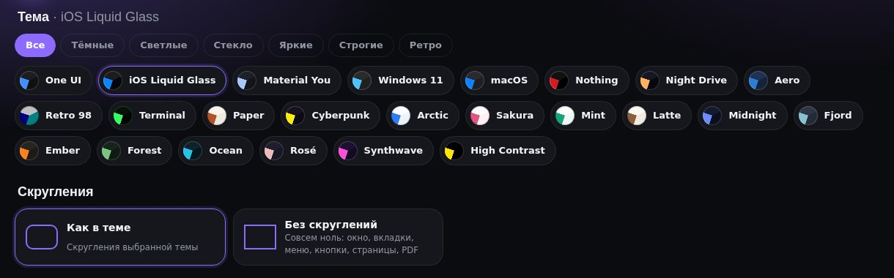
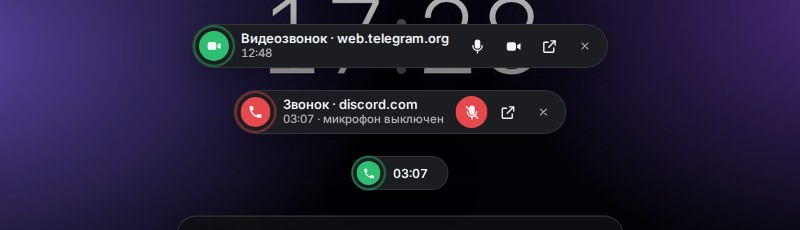
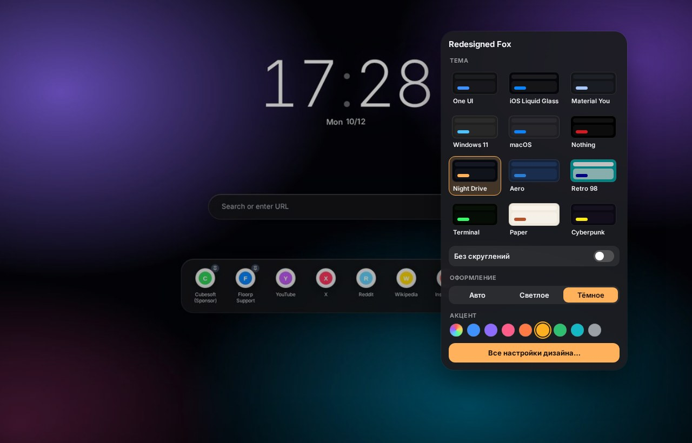

# Изменения / Changelog

> Журнал версии для **Firefox, Floorp и форков**. Версия для Chromium — [chrome/CHANGELOG.md](../chrome/CHANGELOG.md).
> Firefox edition changelog. Chromium edition: [chrome/CHANGELOG.md](../chrome/CHANGELOG.md).

> С версии 1.20.2 проект называется **Hand Design** (1.14–1.20.1 — Redesigned Fox, раньше — Floorp Modern).

Версия установщика видна в заголовке окна, в консоли и в файле
`chrome\floorp-modern-version.txt` профиля после установки.
The installer version is shown in the setup window, the console and
`chrome\floorp-modern-version.txt` in the profile.

## 1.23.0 — 2026-11-14

**English summary:** Markdown editor right in the browser: drag a .md file into the window and it opens formatted, with a table of contents, three modes (read, side by side, text), syntax highlighting, a formatting toolbar, clickable task checkboxes and Ctrl+S to save. A "Documents" page creates new files, opens files and lists recent ones. If the file is changed in another program, the editor notices and does not overwrite it silently. Studio gets an “i” button with a short guide to Hand Design and a “Check for updates” button in the Updates section.

- Редактор Markdown. Файл `.md`, открытый в браузере (перетащите его в окно), показывается оформленным документом: заголовки, списки, таблицы, код, цитаты, ссылки и картинки. Слева содержание по заголовкам, текущий раздел подсвечивается при прокрутке.
- Три режима сверху: «Просмотр», «Рядом» (текст и готовый вид, прокрутка вместе) и «Текст». В тексте подсвечивается разметка: заголовки, жирный, ссылки, код, маркеры списков.
- Сохранение по Ctrl+S, в тот же файл. Переводы строк (CRLF или LF) и BOM остаются как были. Пока есть несохранённые изменения, рядом с именем горит точка, а при закрытии вкладки браузер переспросит.
- Панель кнопок над текстом: заголовок (каждое нажатие меняет уровень), жирный, курсив, зачёркнутый, код, ссылка, список, нумерованный список, задача, цитата, таблица, блок кода, разделитель. Повторное нажатие снимает оформление, Ctrl+Z отменяет.
- Клавиши в тексте: Ctrl+B, Ctrl+I, Ctrl+K — жирный, курсив, ссылка; Tab и Shift+Tab — отступ; Enter в конце пункта продолжает список, в том числе нумерованный и задачи. Ctrl+E переключает просмотр и текст.
- Щелчок по кружку задачи в просмотре отмечает её прямо в тексте.
- Если файл изменили в другой программе, редактор сам загружает новую версию, а при несохранённых правках спрашивает, какую оставить. Перед сохранением он проверяет, не изменился ли файл после открытия, и не перезаписывает чужие правки без спроса.
- HTML из файла не выполняется, ссылки `javascript:` не работают. Записать можно только тот файл, который открыт на странице.
- Страница «Документы» — кнопка в быстрой панели «Дизайн» или значок MD в редакторе. На ней «Новый документ» (выбираете, где сохранить, файл создаётся и сразу открывается), «Открыть файл» и список недавних с папкой и временем. Файл, которого больше нет на диске, помечается; убрать его из списка можно крестиком.
- Выключается в Studio → «Документы» → «Редактор Markdown». Тогда `.md` открывается обычным текстом, как раньше.
- Studio: кнопка «i» в шапке открывает короткую справку по Hand Design: быстрая панель, горячие клавиши, Now Bar, плашка звонка, новая вкладка, PDF, Markdown, Studio, обновление.
- Studio: в разделе «Обновления» появилась кнопка «Проверить обновления». Под ней показывается, какая версия последняя, и ссылки «Что нового» и «Скачать».

## 1.22.1 — 2026-11-14

**English summary:** The call bar, the Now Bar and pop-up notifications no longer get squeezed into a narrow strip with their buttons and text spilling out. The new installer texts from 1.22.0 (the Update button, "Updating…", "Updated to…") are now translated into all 10 languages.

- Плашка звонка, Now Bar и уведомления (например, «Ссылка скопирована») иногда сжимались в узкую полоску, а кнопки и текст вылезали наружу. Теперь их ширина считается по содержимому, а положение — от окна браузера, а не от родительского элемента. Сохранённые места, куда вы перетащили плашки, остаются прежними.
- Надписи установщика из 1.22.0 переведены на все языки: кнопка «Обновить до…», «Обновляю…», «Обновлено до…» и сообщение для `update.cmd`, когда Hand Design ещё не установлен. Раньше на украинском, немецком, французском, испанском, португальском, польском, турецком и китайском они показывались по-английски.

## 1.22.0 — 2026-11-10

**English summary:** The installer can update an existing install. When Hand Design is already in a browser, `Setup.cmd` shows "Update to v1.22.0" on the first screen, and `update.cmd` does the same in the console. The theme (including one picked in the browser), accent, language, wallpaper and other settings are kept. The PDF viewer no longer recalculates the page layout every second while you scroll, and the Now Bar stays collapsed when you switch to another tab or open a new one.

- Обновление без повторной настройки. Если Hand Design уже стоит, на первом экране `Setup.cmd` появляется кнопка «Обновить до v1.22.0». Файлы обновляются только в профилях, где Hand Design уже есть. Тема (в том числе выбранная прямо в браузере), акцент, язык, обои и остальные настройки остаются прежними. В консоли то же делает `update.cmd` (`installer.ps1 -Action update`).
- PDF: меньше рывков при прокрутке. Проверка пустых страниц раз в секунду замеряла положение каждой страницы и заставляла браузер пересчитывать раскладку; теперь видимые страницы отслеживаются без этого. Ленточки закладок перерисовываются, только когда меняются закладки или число страниц, а не каждые 1,5 с. Пока в документе нет рисунков, движение мыши ничего не считает. У холста страницы убрана вторая обрезка со скруглением.
- Now Bar: если плашка уже свернулась в кружок, при переходе на другую или новую вкладку она появляется свёрнутой. Развёрнутой — когда звук пошёл из новой вкладки или при наведении.

## 1.21.1 — 2026-10-21

**English summary:** Hand Design now lives in one repository for every browser — [WiWaSu/Hand-Design---browsers-redesign-](https://github.com/WiWaSu/Hand-Design---browsers-redesign-) (Firefox edition in `firefox/`, Chromium edition in `chrome/`). Update checks, the installer's "new version" link, the GitHub button in the quick panel and in Studio now point there. Downloads are on the Releases page. Also: the call bar mic button no longer always shows "off", and the Now Bar player hides while the call bar is shown.

- Всё в одном репозитории. Hand Design переехал в [WiWaSu/Hand-Design---browsers-redesign-](https://github.com/WiWaSu/Hand-Design---browsers-redesign-): версия для Firefox — папка `firefox/`, для Chromium — `chrome/`, скачивать — со страницы Releases. Туда же теперь смотрят проверка обновлений, ссылка «есть новая версия» в установщике и кнопки GitHub в быстрой панели и Studio. Старый репозиторий релизов ещё какое-то время показывает, что вышла новая версия, и ведёт сюда.
- Плашка звонка: кнопка микрофона больше не «выключена» всегда. Состояние берётся и из индикатора доступа Firefox (webrtcUI), а не только из атрибута вкладки — в видеозвонке он показывал одну камеру. Если сайт сам отпустил микрофон, кнопка не краснеет, пока его не выключили отсюда. Что сообщает браузер — пишется в журнал `fm-log.json` («call bar: состояние»).
- Пока идёт звонок, плеер Now Bar не показывается — сверху только плашка звонка; после звонка плеер возвращается.

## 1.21.0 — 2026-10-16

Большое недельное обновление. / Big weekly update.

**English summary:** Hand Design now speaks 10 languages (English, Russian, Ukrainian, German, French, Spanish, Portuguese, Polish, Turkish, Chinese) — pick one with the globe button in the installer or in Studio. Themes look like themselves again (Studio colors no longer override every theme). PDF viewer: "Clear" button (remove drawings / remove everything), straight lines with Shift like in Paint, tools no longer pop open their settings (small ▾ arrow instead), fast handwriting is no longer merged into one drawing, a new drawing is not auto-selected, a cleaner round toolbar for selected drawings, and two new Studio sections with every PDF viewer and pen timing setting.

- Языки. Hand Design теперь на 10 языках: русский, английский, украинский, немецкий, французский, испанский, португальский, польский, турецкий, китайский. В установщике — кнопка с глобусом в шапке: меняет язык окна сразу и ставит этот же язык всему Hand Design в браузере (Studio, панель «Дизайн», PDF, новая вкладка, уведомления). В Studio — выбор языка в шапке. По умолчанию — язык Windows / браузера.
- Темы снова разные. Свои цвета из Studio (фон окна, поля, меню, текст, акцент) перекрывали любую тему — при смене темы они теперь сбрасываются.
- После рисования рисунок не выделяется сам и панелька не выезжает — выделение по щелчку (Studio → «PDF: карандаш и тайминги»).
- build-exe.bat: собирает .exe и в папке с пробелами в пути.
- PDF: панелька у выделенного рисунка поправлена под новый просмотрщик Firefox: цвет — круглая кнопка с кружком выбранного цвета, без разделителей.
- PDF: «Очистить» — новая кнопка рядом с инструментами: «Убрать все рисунки» (только линии от руки, текст и выделения остаются) и «Убрать всё». Ctrl+Z возвращает.
- PDF: инструменты без лишних окон. Нажатие на карандаш, текст или маркер просто выбирает инструмент — панель настроек больше не выскакивает. Рядом с кнопкой маленькая стрелочка ▾: она открывает полную панель (цвет, толщина/размер с кнопками − / + и готовыми размерами). Клик мимо или Esc — закрыть.
- PDF: быстрое письмо карандашом больше не склеивает всю строку в один рисунок: новый рисунок начинается, если следующий штрих далеко от предыдущего, после паузы или когда рисунок разросся больше слова. Пока пишете, не считается «наведение» на рисунки — не тормозит.
- Studio: два новых раздела для PDF. «Просмотрщик PDF» — оформление и цвет страниц, открывать ли панель инструмента сразу, кнопки − / +, своя палитра, «Очистить», закладки, кнопка темы, быстрый текст, «открывать там, где остановились», анимации. «PDF: карандаш и тайминги» — собирать ли штрихи в рисунок, пауза (мс) и расстояние (px) до нового рисунка, максимальный размер рисунка, захват линии мышью, Shift-линии и шаг угла (45° / 15° / 90°), скорость и задержка автоповтора − / +. Всё применяется сразу.
- PDF: ровные линии с Shift, как в Paint — зажмите Shift во время рисования: линия идёт строго по горизонтали, вертикали или под 45°, пока тянете — видна подсказка.

## 1.20.9 — 2026-10-15
- PDF: размер текста и толщину линии удобно менять. Рядом с ползунком — кнопки − / + с числом (зажатая кнопка меняет быстро, колёсико мыши тоже работает) и готовые размеры одним нажатием. Сам ползунок с видимой дорожкой и заливкой.
- PDF: кружок «Цвет» показывает выбранный цвет (раньше был пустой квадратик).
- PDF: новая панелька у выделенной надписи или рисунка — стеклянная «капсула» без разделителей, круглые кнопки, «Удалить» краснеет при наведении.

## 1.20.8 — 2026-10-15
- Ctrl+Tab: без «рамки в рамке». Браузер обводил выбранную миниатюру своей квадратной рамкой фокуса, а поверх рисовались наши — получалось три рамки. Теперь рамка фокуса браузера убрана, выделение одно.
- «Неон» в Ctrl+Tab переделан: одна светящаяся скруглённая рамка вокруг выбранной вкладки, лёгкая подсветка внутри, без лишних обводок у миниатюр; кнопка «Показать весь список» — неоновая «таблетка».

## 1.20.7 — 2026-10-15
- Ctrl+Tab больше не накладывается. Когда вкладки спрятаны и включено окно с превью, по Ctrl+Tab показывается только это окно — полоска вкладок больше не выезжает поверх него.
- Окно Ctrl+Tab без квадрата вокруг. Само окно теперь прозрачное и без системной тени, у содержимого есть место для тени и свечения — стиль «Неон» светится, а не упирается в прямоугольник. «Неон» ярче: светящаяся рамка у выбранной миниатюры.

## 1.20.6 — 2026-10-14
- Плашка звонка: микрофон и камера — две независимые кнопки, всегда на месте. Каждая показывает своё состояние и включает/выключает только своё устройство.
- Включить то, что сайт выключил сам. Телемост, Meet и другие при выключении камеры отпускают её целиком — браузер тогда не может включить её обратно. Теперь плашка в таком случае нажимает собственную кнопку сайта («Включить камеру», «Turn on camera», «Включить микрофон»…). Если такой кнопки не нашлось — открывает вкладку звонка и говорит об этом.

## 1.20.5 — 2026-10-14
- Плашка звонка: микрофон и камеру можно и выключить, и включить обратно. Кнопка показывает настоящее состояние из браузера (выключено — красная), не пропадает после выключения, повторное нажатие включает. Alt+Shift+M — то же с клавиатуры.
- Время звонка больше не начинается заново, если сайт на секунду отпустил микрофон (смена устройства, переподключение): плашка ждёт 30 секунд, прежде чем считать звонок законченным.
- Плашку можно перетащить за зелёный кружок или надпись — место запоминается. Двойной щелчок по кружку возвращает её наверх по центру. Убрать совсем: Studio → «Показать / скрыть» → «Плашка звонка».

## 1.20.4 — 2026-10-14
- Меню без серых «ушей» по углам. На Windows 11 браузер подкладывал под каждое меню системный фон Mica — серый прямоугольник с маленькими скруглениями, и он торчал из-за круглых углов меню. Теперь подложка выключена (`widget.windows.mica.popups = 0`), окно меню прозрачное, видно только скругление темы. Полностью — после перезапуска браузера.

## 1.20.3 — 2026-10-14
- Свой выбор цвета в Studio вместо серого системного окна Windows: большая область цвета, ползунок оттенка, поле #RRGGBB, кружки цветов текущей темы, недавние цвета и готовая палитра. Всё меняется сразу; «Как было» — вернуть прежний цвет, Esc — отменить, «Как в теме» — сбросить. Если цвет не задан, плитка показывает цвет темы, а не серый.
- Номер версии в Studio заметнее — цветная плашка рядом с заголовком.
- Studio снова сильнее темы (меню правой кнопки и др.). Журнал показал, что в окне браузера CSS-слой Studio проигрывал теме (скругление пунктов меню: в Studio 10px, на деле 12px из темы). Правила Studio больше не в слое — их перевес держится на усиленных селекторах.

## 1.20.2 — 2026-10-14
- Новое имя: Hand Design (раньше Redesigned Fox, ещё раньше Floorp Modern). Поменялись названия в окне установщика, Studio, быстрой панели и README. Внутренние имена файлов и настроек прежние — все настройки сохраняются.
- `build-exe.bat` в папке версии — собирает установщик в один файл `Hand-Design-Setup-v<версия>.exe` встроенными средствами Windows (PowerShell + IExpress), без скачиваний. При запуске .exe распаковывает файлы в `%LOCALAPPDATA%\HandDesign` и открывает обычный установщик. В архивы релизов батник не входит.
- Проект на этой версии «заморожен»: дальше только небольшие исправления.

## 1.20.1 — 2026-10-13
- Настройки Studio теперь сильнее любой темы — в том числе iOS. Браузер не всегда учитывает CSS-слои внутри правил для окна, и тогда правила темы с более «сильными» селекторами перебивали Studio: стили меню правой кнопки (Неон, macOS, Windows 11…), форма вкладок и другое не менялись — заметнее всего в iOS, где у темы больше всего правил. Теперь каждое правило Studio усилено и всегда побеждает тему.
- Цвет акцента из Studio доходит и до меню, панелей и подсказок, а не только до панели инструментов.
- Боковая панель с вертикальными вкладками в iOS: фон — те же обои, что и вокруг окна, без серой подложки при наведении.
- В журнал `fm-log.json` при первом открытии меню правой кнопки пишется, какие стили к нему применились — чтобы быстро находить такие проблемы.

## 1.20.0 — 2026-10-13
- 24 темы вместо 12 — новые на любой вкус: светлые **Arctic, Sakura, Mint, Latte**, тёмные **Midnight, Fjord, Ember, Forest, Ocean, Rosé**, яркая **Synthwave** и **High Contrast** для максимальной читаемости.
- Выбор темы — компактно: в Studio вместо больших карточек маленькие «таблетки» с цветным кружком и фильтр «Все / Тёмные / Светлые / Стекло / Яркие / Строгие / Ретро»; в быстрой панели — сетка цветных кружков, название видно при наведении. В установщике — 6 тем в ряд.
- «Без скруглений» — отдельный блок вверху Studio («Как в теме» / «Без скруглений»). Теперь убирает скругления и внутри элементов: кнопки боковой панели, поля, меню новых версий Firefox, саму область страницы.
- Боковая панель с вертикальными вкладками в цветах темы. Раньше при тёмной/светлой теме Firefox или Floorp панель оставалась серой, а при наведении выезжала «не в тему». Теперь фон, выбранная вкладка и кнопки берутся из темы, развёрнутая панель — полупрозрачное стекло с тенью. Поправка подключается на лету (`fixes.css`), переустановка не нужна.
- Меню правой кнопки: стили из Studio не применялись в новых версиях Firefox — у меню больше нет внутренней части `::part(content)`. Теперь фон, скругление, отступы и рамка задаются ещё и через переменные `--panel-*`, которые понимают и старые, и новые версии.

## 1.19.1 — 2026-10-13
- Кнопка GitHub — страница Redesigned Fox ([WiWaSu/Redesigned-Firefox-and-forks-](https://github.com/WiWaSu/Redesigned-Firefox-and-forks-)) открывается из интерфейса: в быстрой панели кнопки «Дизайн» (внизу, рядом с «Проверить обновления») и в Studio (вверху, рядом с «Сохранить в файл»).

## 1.19.0 — 2026-10-13
- Проверка обновлений. Раз в сутки браузер смотрит в репозиторий релизов [WiWaSu/Redesigned-Firefox-and-forks-](https://github.com/WiWaSu/Redesigned-Firefox-and-forks-), есть ли версия новее. Если есть — уведомление, красная точка на кнопке «Дизайн», а в быстрой панели карточка «Доступна версия X»: «Скачать», «Что нового», «Позже». Внизу панели — номер версии и «Проверить обновления» (проверка сразу). Сам ничего не скачивает и не ставит.
- В Studio рядом с версией — ссылка «доступна X»; выключить проверку — Studio → «Обновления».
- Установщик тоже проверяет: если есть версия новее, рядом с номером версии появляется «есть vX — скачать» (в консоли — строка со ссылкой).
- Версия берётся из `latest.json` в репозитории релизов, а если его нет — из самого нового файла `vX.Y.Z.zip`.

## 1.18.0 — 2026-10-13
- Установщик: выбор языка при запуске — первым открывается маленькое окно «Русский / English», и весь установщик дальше на выбранном языке. В консольном режиме (`install.cmd`) — вопрос «1. Русский / 2. English». Для запуска без вопроса: параметр `-Lang ru` или `-Lang en`.
- Studio показывала старую версию («1.13.0»): номер брался из настройки, которую пишет только установщик. Теперь версия зашита в сам Redesigned Fox и обновляется вместе с файлами; `tools/build.sh` проверяет, что она совпадает с `VERSION`.

## 1.17.0 — 2026-10-13
- Скрыть вкладки целиком — не компактный вид, а полностью. Два режима:
  - «У края» — вертикальные вкладки спрятаны и выезжают шторкой поверх страницы, когда подводите мышь к левому краю окна; верхний ряд вкладок появляется при наведении на панель адреса;
  - «Полностью» — вкладок не видно совсем, страница на всю ширину.
- Где включить: быстрая панель по кнопке «Дизайн» → «Скрыть вкладки», Studio → «Вкладки → Скрыть вкладки» (выбор режима) или `Alt+Shift+T` — спрятать / показать в любой момент.
- Пока вкладки спрятаны, переключение `Ctrl+Tab` / `Ctrl+PageDown` на секунду показывает список вкладок.

## 1.16.0 — 2026-10-13
- Плашка звонка — отдельно от музыки. Когда в другой вкладке идёт звонок (Telegram, Discord, WhatsApp, Meet и т. д. — сайт занял микрофон или камеру), сверху по центру появляется «островок»: сайт, время звонка, кнопки «выключить микрофон», «выключить камеру», «перейти к звонку». Через 6 секунд сворачивается в маленькую таблетку с таймером, при наведении раскрывается. `Alt+Shift+M` — выключить / включить микрофон из любой вкладки. Вкладка со звонком больше не попадает в музыкальный Now Bar. Плашку можно скрыть в Studio («Показать / скрыть → Плашка звонка»).
- Now Bar: пауза в Telegram и похожих сайтах. Telegram играет музыку из «невидимого» плеера, которого нет на странице, — поэтому пауза часто не срабатывала. Теперь такие плееры запоминаются (Telegram, VK, OK, Яндекс Музыка, Звук, SoundCloud, Discord, WhatsApp) и останавливаются напрямую.
- Now Bar больше не выключает звук вкладки, когда пауза на самом деле сработала: раньше значок звука у вкладки гаснет с задержкой ~3 секунды, и Now Bar принимал это за «всё ещё играет».

## 1.15.0 — 2026-10-13
- Кнопка «Дизайн» (палитра на панели) теперь открывает быструю панель прямо под собой: 12 тем, переключатель «Без скруглений», светлое / тёмное оформление, цвет акцента и кнопка «Все настройки дизайна…». Раньше кнопка открывала вкладку настроек — в Floorp с рабочими пространствами эта вкладка могла оказаться скрытой, и казалось, что ничего не происходит. Теперь скрытая вкладка закрывается и открывается новая.
- Смена темы прямо в браузере, без установщика и без перезапуска. Тема меняется сразу во всех окнах, на новой вкладке, в настройках и в PDF, а заодно переписывается в userChrome.css / userContent.css — после перезапуска всё остаётся как выбрали. Темы можно менять и в Redesigned Fox Studio (новый раздел «Тема» сверху).
- «Без скруглений» — убирает вообще все скругления: окно, страница, вкладки, меню, кнопки, адресная строка, новая вкладка, страницы настроек, PDF. Есть в быстрой панели, в Studio (раздел «Форма») и в установщике («Скругление → Без»).
- Настройки установщика теперь всегда сильнее темы, а настройки Studio — сильнее настроек установщика (CSS-слои).
- Для разработчиков: исходники тем переехали в `src/themes/`, готовые темы для установщика и браузера собирает `tools/pack_themes.py` в `files/pdf-tweaks/themes/`.

## 1.14.0 — 2026-10-12
- Новое имя: Redesigned Fox (раньше Floorp Modern) — проект не только для Floorp, а для Firefox и всех его форков. Настройки дизайна теперь называются **Redesigned Fox Studio**. Все ваши настройки сохраняются.
- 6 новых тем, всего 12:
  - Night Drive — ночная дорога за запотевшим стеклом машины: размытые огни отодвинуты к краям, тонкие светящиеся часы как в One UI, стеклянный поиск (идея из комментария на Reddit);
  - Aero — Windows 7: голубое стекло с бликом, глянцевые кнопки;
  - Retro 98 — Windows 98: серые выпуклые кнопки, часы в «окошке», бирюзовый рабочий стол, ноль скруглений;
  - Terminal — зелёный фосфор, моноширинный шрифт, строки развёртки, мигающий курсор;
  - Paper — тёплая бумага, шрифт с засечками, плоско и спокойно;
  - Cyberpunk — срезанные углы, жёлтый неон, розово-голубая сетка города.
- Установщик: галерея тем в 4 колонки, у каждой новой темы своё превью.
- Релизы на GitHub собираются сами: при заливке новой версии появляется релиз с чистым архивом проекта и описанием с картинками.

## 1.13.4 — 2026-10-12
- Studio: настройки сами превращались в серые цвета и «ползунки посередине». Причина — браузер при восстановлении вкладки Studio заполнял все поля и сообщал об этом так, будто их поменял пользователь. Теперь Studio принимает только то, что вы реально трогали; уже испорченные настройки сбрасываются автоматически.
- «Выбранная вкладка»: новый вариант «Без подсветки».
- Форма «Подчёркивание» на вертикальных вкладках — полоска слева, а не снизу.

## 1.13.3 — 2026-10-12
- Studio: проверка, что настройки действительно дошли до окна браузера. Если общий способ не сработал, стили подключаются к каждому окну напрямую; результат пишется в журнал `chrome\pdf-tweaks\fm-log.json`.
- Studio: собранные стили сохраняются в `chrome\pdf-tweaks\fm-studio.css` — видно, что именно применилось.
- Кнопка «Дизайн» на панели: свой обработчик нажатия (в некоторых сборках Floorp обычный не срабатывал), двойные открытия отсекаются; каждое нажатие отмечается в журнале.

## 1.13.2 — 2026-10-12
- Studio: «Файл не найден» по адресу chrome://fmstudio — новый Floorp/Firefox не поддерживает старый способ регистрации адреса. Теперь адрес регистрируется через chrome.manifest; если и это не выйдет, Studio откроется по запасному адресу.
- Кнопка «Дизайн», когда вкладка Studio уже открыта, теперь не только переключается на неё, но и открывает её заново.

## 1.13.1 — 2026-10-12
- Floorp: кнопка «Дизайн» ничего не открывала. Studio теперь открывается как страница браузера (chrome://fmstudio/), а если что-то пойдёт не так — появится уведомление и запись в журнале.
- Floorp: на новой вкладке не было кнопки обоев, и обои из установщика не применялись — новая вкладка Floorp это страница браузера, туда не заходил скрипт. Теперь заходит.

## 1.13.0 — 2026-10-12
- Floorp Modern Studio — страница тонкой настройки дизайна (кнопка «Дизайн» на панели, пункт «Дизайн» в меню ☰, Alt+Shift+S, ссылка в меню обоев). Всё меняется сразу, без перезапуска, поверх любой темы:
  - цвета: акцент, фон окна, поля, меню, текст; прозрачность и размытие меню;
  - форма: скругление и отступ страницы, тень, скругление меню, форма кнопок, плотность;
  - вкладки: 6 форм (таблетки, скруглённые, прямые, подчёркивание, карточки, как в Chrome), 5 стилей выбранной вкладки, высота, ширина, крестик, жирность;
  - адресная строка: высота, скругление, выравнивание, рамка;
  - шрифт интерфейса (в том числе свой) и размер;
  - анимации: скорость и пружинистость;
  - новая вкладка: размер, толщина, шрифт и место часов, дата, ширина поиска, ярлыки, размытие обоев;
  - показать/скрыть: панель закладок, кнопки, Now Bar, полоску загрузки;
  - 6 готовых наборов, сохранение и загрузка настроек файлом, сброс.
- 7 стилей меню правой кнопки: One UI, стекло iOS, Windows 11, macOS, сенсорное, Nothing, неон.
- Окно Ctrl+Tab с превью вкладок и 4 стиля для него: iOS, Windows 11, список, неон.
- Material You: часы столбиком больше не рассыпаются по одной цифре с некоторыми шрифтами.

## 1.12.0 — 2026-10-11
- Обои на новой вкладке (Floorp, Firefox и форки): кнопка слева внизу открывает меню с 10 готовыми обоями (Аврора, Ирис, Закат, Океан, Лес, Ночь, Пудра, Графит, Bloom, Дюна), своей картинкой с компьютера и ползунком затемнения. Выбор сразу применяется во всех открытых новых вкладках.
- Своя картинка автоматически уменьшается до 3200 px и хранится в профиле (`chrome\pdf-tweaks\fm-wallpaper.img`), поэтому новая вкладка открывается быстро.
- В установщике на первой странице — выбор обоев: «Не менять» (по умолчанию), «Как в теме», готовые обои или своя картинка; превью сразу показывает выбранные обои. В консоли — параметр `-Wall`.

## 1.11.0 — 2026-10-10
- Анимации «как на iPhone»: настоящие пружины (с лёгким перелётом) вместо обычных кривых — вкладки, кнопки, меню, панели, адресная строка, новая вкладка, PDF.
  - главное меню ☰ раскрывается из угла, плитки появляются волной;
  - выбранная вкладка мягко «вспухает», закрываемая сжимается и тает;
  - часы на новой вкладке проявляются из размытия, ярлыки выпрыгивают по очереди;
  - вертикальные вкладки: при раскрытии панели названия выплывают следом;
  - боковая панель сайтов Floorp: значки пружинят под курсором и при нажатии, панель выезжает.
- В установщике новый пункт «Анимации»: «Как в iOS» (по умолчанию), «Плавные», «Как в Windows», «Выкл».
- Исправлено: если в Windows выключены эффекты анимации, Firefox и Floorp отключали все анимации — в том числе раскрытие вертикальных вкладок при наведении. В режимах «Как в iOS» и «Плавные» анимации теперь работают всегда.

## 1.10.0 — 2026-10-10
- Больше плавных анимаций во всех темах:
  - вкладки: новая «выныривает», фон и крестик меняются мягко, нажатая вкладка чуть проседает;
  - кнопки панели слегка приподнимаются под курсором, «назад» и «вперёд» кивают в свою сторону, «обновить» поворачивается;
  - меню ☰, загрузки, расширения раскрываются пружинкой; подсказки адресной строки появляются по очереди; подсветка строки разгорается плавно;
  - плашки уведомлений, поиск по странице, боковая панель и закладки на панели въезжают, а не появляются рывком;
  - новая вкладка: часы, поиск и ярлыки выплывают по очереди, ярлыки приподнимаются под курсором;
  - PDF: первые страницы проявляются при открытии, всплывающие меню PDF.js раскрываются пружинкой.
- Если в Windows выключены эффекты анимации, всё это отключается.

## 1.9.2 — 2026-10-10
- Новая вкладка Firefox: часы не появлялись. Firefox заранее готовит новую вкладку в скрытом виде и рисует её только при открытии, а скрипт ждал всего 5 секунд. Теперь он ждёт, сколько нужно. Ярлыки сайтов остаются на месте под поиском; убрать их можно штатно — карандаш внизу справа → «Ярлыки».
- В журнал `chrome\pdf-tweaks\fm-boot.json` пишется, поставились ли часы, — проще искать ошибки.

## 1.9.1 — 2026-10-05
- Firefox: кнопки «назад», «вперёд», «обновить» и другие значки панели были чёрными и сливались с фоном. Firefox (в отличие от Floorp) по умолчанию не даёт встроенным SVG-значкам брать цвет темы — установщик теперь включает это (`svg.context-properties.content.enabled`) во всех браузерах.

## 1.9.0 — 2026-10-05
- Новая вкладка Firefox, LibreWolf, Waterfox и других форков без своей стартовой страницы теперь как у Floorp: большие часы с датой в стиле выбранной темы, без логотипа Firefox, поиск и ярлыки ниже часов. Часы выключаются в установщике вместе с часами Floorp.

## 1.8.4 — 2026-10-05
- PDF, закладки: в списке пропадала кнопка «+ Стр. N», а длинный текст вылезал за край. Пункты меню больше не кнопки `<button>` (их перекрашивали стили PDF.js), у меню жёсткая ширина, текст обрезается многоточием.
- PDF, закладки: ленточка на странице не показывалась — место `::after` занято значком загрузки PDF.js, теперь ленточка на `::before`.

## 1.8.3 — 2026-10-05
- PDF: после переключения видеокарты (встроенная ↔ дискретная) страницы пропадали. Браузер ловит сброс графики и сам перерисовывает все открытые PDF.
- В меню «Тема» просмотрщика PDF — кнопка «↻ Перерисовать страницы» на всякий случай.

## 1.8.2 — 2026-10-05
- PDF: иногда страница оставалась пустой серой, пока не прокрутишь. Теперь просмотрщик сам замечает недорисованную видимую страницу и через 2 с заставляет PDF.js её дорисовать.
- PDF: убраны белые уголки у страниц в тёмном и ночном режиме; пока страница рисуется, её фон уже нужного цвета (без белых вспышек).

## 1.8.1 — 2026-10-05
- Исправлено: плашка «Вы предоставляете доступ к экрану» не менялась — это отдельное окно браузера, и её стили теперь в userChrome.css. Новый вид: капсула с «живой» красной точкой, кнопка-таблетка в цвете акцента, круглая кнопка «свернуть»; во всех темах.

## 1.8.0 — 2026-10-05
- PDF: **закладки страниц**. Кнопка-ленточка на панели открывает список закладок файла (номер страницы и начало текста), клик — переход, × — убрать. `Ctrl+B` — добавить или убрать закладку на текущей странице. На страницах с закладкой в углу видна ленточка. Закладки хранятся для каждого файла.

## 1.7.0 — 2026-10-05
- Шесть тем: One UI, iOS · Liquid Glass, а также новые **Material You** (Pixel, тональные цвета, часы столбиком), **Windows 11** (Fluent, строгие углы, обои Bloom), **macOS** («светофор» вместо кнопок окна, синие меню) и **Nothing** (монохром, красная точка, часы из точек).
- Настройка перед установкой (окно из трёх шагов: Тема → Настройка → Браузеры): цвет акцента (Windows, 8 готовых или свой HEX), светлая/тёмная, скругление страницы и меню, включение функций (Now Bar, полоска загрузки, адрес по центру, часы и живые обои на новой вкладке, просмотрщик PDF). Установщик запоминает выбор.
- Форки Firefox: Floorp, Firefox, Firefox Developer Edition, Firefox Nightly, LibreWolf, Waterfox, Zen Browser, Mercury. Для LibreWolf загрузчик дописывается в её `librewolf.cfg`, не ломая её настройки.
- Консоль: `-Theme`, `-Accent`, `-Mode`, `-Corners`, `-Features`, `-Target all|floorp,librewolf,…`.

## 1.6.0 — 2026-10-05
- Now Bar: обложка трека (или значок сайта), полоска прогресса, мини-режим — через 5 с плашка сворачивается в кружок и раскрывается при наведении.
- Медиа-клавиши клавиатуры (⏯ ⏭ ⏮) управляют плашкой, пока окно браузера активно.
- PDF: документ открывается на той странице, где вы остановились (с кнопкой «С начала»).
- PDF: быстрый текст — клик по пропуску «……» или двойной клик по пустому месту страницы, и сразу можно печатать; после ухода из поля инструмент «Текст» выключается сам.

## 1.5.1 — 2026-10-04
- Now Bar с Telegram и другими сайтами без «медиа-сессии»: пауза сначала через Firefox, потом через сам плеер на странице, а если звук всё равно идёт — выключается звук вкладки. «Продолжить» всё возвращает.
- Название трека: из данных сайта (исполнитель — трек) или из плеера Telegram; обновляется каждые 3 с.
- «Назад/вперёд» там, где сайт не умеет переключать треки, перематывают звук на 10 с.

## 1.5.0 — 2026-10-04
- Now Bar: кнопки «назад» и «вперёд» (трек или перемотка на 10 с, если сайт это поддерживает).
- Now Bar можно перетаскивать мышью, место запоминается. Двойной клик — вернуть вниз по центру.
- Исправлено: на новой вкладке поле поиска было чёрным прямоугольником, а кнопка настроек — квадратной (системный стиль Windows).

## 1.4.2 — 2026-10-04
- Исправлено: кружки палитры в PDF были серыми квадратами. Firefox рисовал их системным стилем кнопок Windows; теперь он отключён (`appearance: none`).

## 1.4.1 — 2026-10-04
- Исправлено: в PDF не выбирался цвет. Просмотрщик запрещает стили через атрибут `style=""` (CSP), поэтому палитра оставалась без цветов и позиции. Теперь стили задаются через CSSOM.

## 1.4.0 — 2026-10-04
- PDF: своя палитра цветов вместо системного окна Windows «Цвет»: 20 цветов, недавние, «Свой цвет» (поле оттенка, полоса цветов, HEX). Системное окно больше не открывается.
- Меню скриншота страницы (Ctrl+Shift+S) в стиле темы.
- Плашка «Вы предоставляете доступ к экрану» — скруглённая капсула.
- Версия установщика: в окне, консоли и профиле; архив называется `FloorpModern-Setup-vX.Y.Z.zip`.

## 1.3.2
- iOS: боковые панели прозрачные (видно обои), поиск на новой вкладке без двойной рамки, круглая кнопка настроек.

## 1.3.1
- Исправлено: окно установщика не открывалось («недопустимое значение для свойства BorderBrush»).

## 1.3.0
- Тема iOS переделана в **Liquid Glass** (iOS 26): обои под окном, стеклянная панель, вкладки, меню, часы; панель PDF поверх страниц.
- One UI: «пружинящие» меню и кнопки, адрес по центру, **Now Bar** для музыки, уведомления о масштабе и звуке, `Alt+Shift+D`, `Alt+Shift+Z`.
- Окно установщика из стекла Windows 11, живое превью темы, переключатель «Новый просмотрщик PDF».

## 1.2.0
- Вторая тема — iOS; установщик в виде окна (`Setup.cmd`).

## 1.1.0
- Установка во Floorp, Firefox или оба браузера.

## 1.0.0
- Первая версия: оформление One UI, новый просмотрщик PDF, установщик для Floorp.
