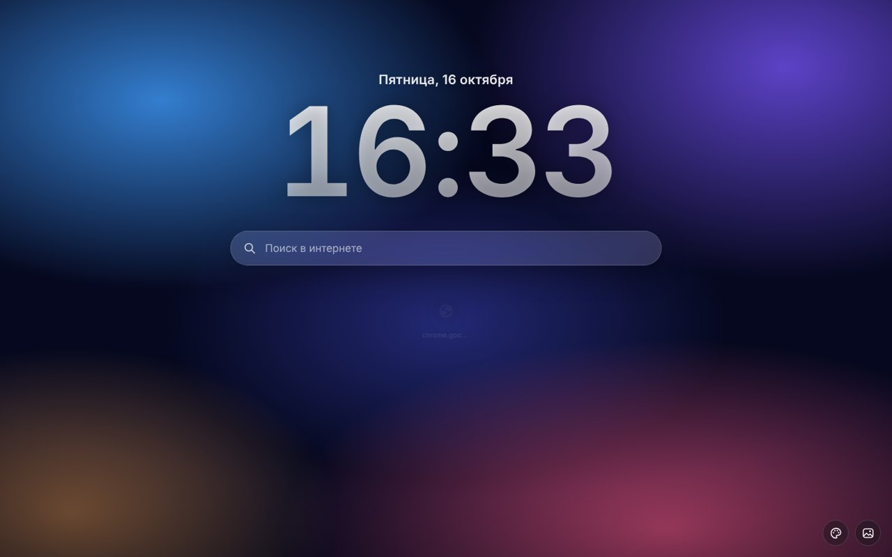
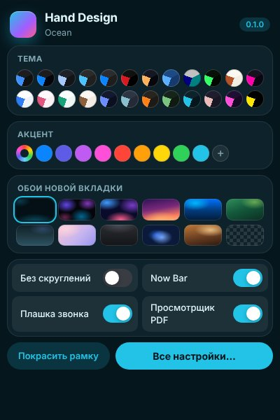
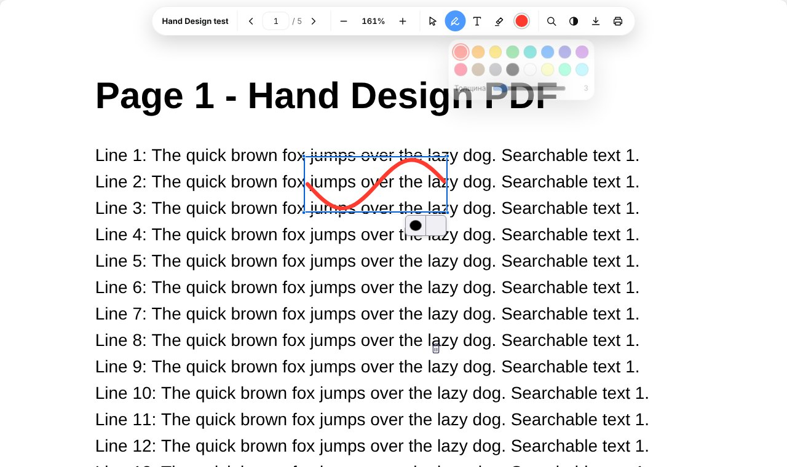
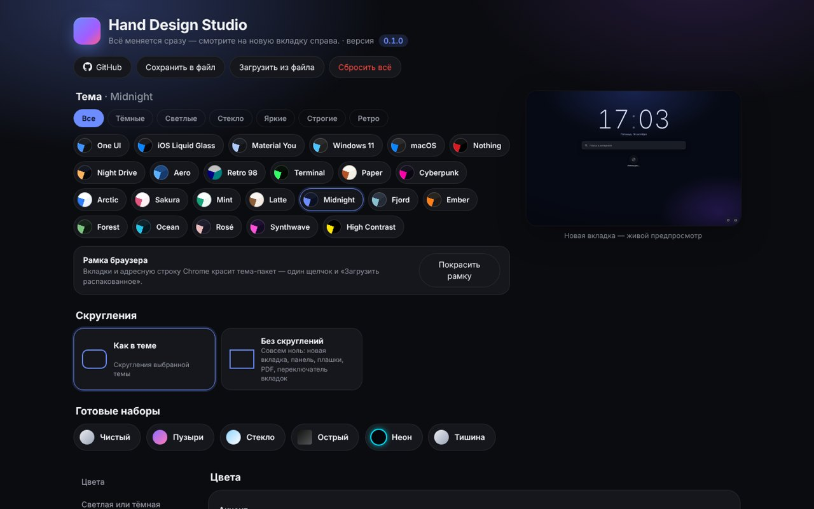

# Hand Design for Chromium 0.1.0

**A redesign for Chrome, Edge, Brave, Vivaldi, Opera and Yandex Browser** · 2026-10-16

## Что нового / What's new

Первая версия порта. Основа — Hand Design 1.20.9 для Firefox (палитры тем те же и в 1.21.0).
*English: first release of the Chromium edition — 24 themes, new tab with wallpapers and clock, quick panel, Studio, Now Bar, call bar, tab previews, PDF viewer, Windows installer.*

- 24 темы из тех же палитр, что в Firefox-версии (генератор `tools/gen_chrome_themes.py` берёт их прямо из `firefox/tools/gen_themes.py`).
- Рамка браузера в цвет темы: 31 тема-пакет (у тем с двумя вариантами — светлый и тёмный).
- Новая вкладка: обои темы, 10 готовых и своя картинка, затемнение, размытие, живые обои; часы в стиле темы (стеклянные в iOS), поиск поисковиком браузера, ярлыки сайтов.
- Быстрая панель «Дизайн» (кнопка расширения, Alt+Shift+D) и **Hand Design Studio** (Alt+Shift+S) с живым предпросмотром новой вкладки, готовыми наборами, сохранением настроек в файл.
- Now Bar и плашка звонка — «островок» сверху страницы: музыка из другой вкладки (обложка, пауза, назад/вперёд) и звонок (таймер, микрофон и камера, Alt+Shift+M). Перетаскивается.
- Вкладки с превью (Alt+Q): четыре стиля — iOS, Windows 11, Список, Неон.
- Просмотрщик PDF на pdf.js: темы, тон страниц, рисование, надписи, маркер, поиск, сохранение с рисунками.
- Установщик (WPF, русский и английский): тема, обои, вариант, акцент, функции, поиск установленных браузеров, пошаговое подключение. `build-exe.bat` собирает один `.exe`.
- Vivaldi: CSS для всего интерфейса — опытная функция.

**Исправлено после первой проверки на Windows:**
- Установщик закрывался сразу после выбора языка. PowerShell отдавал окну цвет акцента в своей «обёртке», и окно падало при показе. Теперь элементы окна создаются напрямую.
- Ошибки установщика больше не молчат: окно с текстом ошибки и номером строки, журнал `%TEMP%\HandDesign-Chromium-setup.log`, `Setup-debug.cmd` — запуск с видимой консолью.
- Понятное подключение в браузере: после установки — 7 шагов с указанием, где какая кнопка; страница расширений открывается сама; кнопка «Скопировать адрес страницы» на случай, если браузер её не открыл.
- Цвет акцента Windows читается правильно (раньше подставлялся запасной синий).
- Now Bar не срабатывает на короткие и беззвучные звуки сайтов (была плашка «google.com»): показывается только то, что играло со звуком дольше пары секунд. Без обложки — значок ноты вместо битой картинки.
- Новая вкладка на тёмных обоях — тёмный вариант темы, даже когда Windows в светлом режиме: часы, дата, поиск и ярлыки больше не «светлые на тёмном» (Material, One UI, iOS, macOS…). Исправлен подсчёт яркости цветов вида `color(srgb …)`.
- Проверено в Chromium 141 (Linux, без окна) и на Windows 11 (установщик, Chrome).

Известное: полосу «Hand Design» внизу новой вкладки добавляет сам Chrome (с версии 138) — скрывается правым щелчком по ней или в «Настроить Chrome».

## Скриншоты / Screenshots

| | |
|---|---|
|  |  |
|  |  |
|  |  |

## Установка / Install

1. Скачайте **Hand-Design-Chromium-v0.1.0.zip** и распакуйте. / Download **Hand-Design-Chromium-v0.1.0.zip** and unzip.
2. Запустите **Setup.cmd**, выберите тему и браузеры, нажмите «Установить». / Run **Setup.cmd**, pick a theme and browsers, press Install.
3. В браузере один раз: страница расширений → «Режим разработчика» → «Загрузить распакованное» → Ctrl+V. Потом так же папку `frame` (рамка). / Once in the browser: extensions page → Developer mode → Load unpacked → Ctrl+V, then the `frame` folder.

Уже стоит — просто установите поверх и перезапустите браузер, настройки сохранятся. / Already installed — install over it and restart the browser, settings are kept.

[Все изменения / Full changelog](https://github.com/WiWaSu/Hand-Design---browsers-redesign-/blob/main/chrome/CHANGELOG.md)
