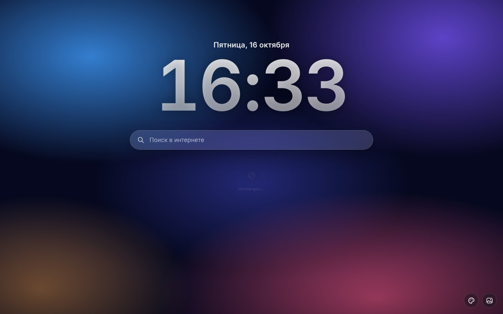
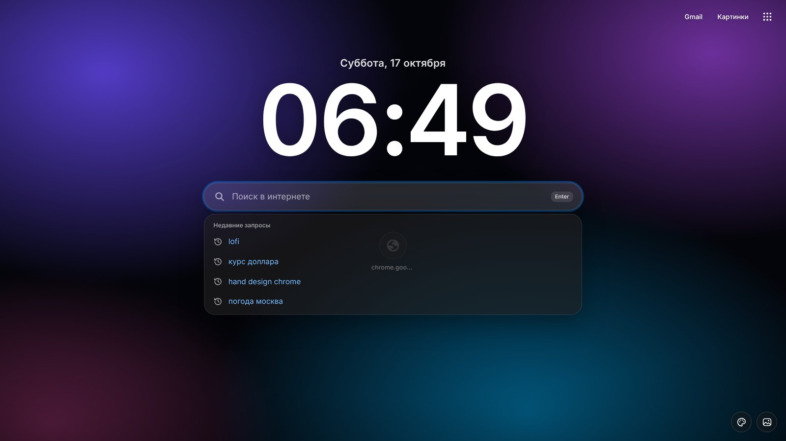
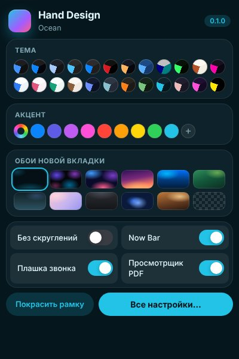
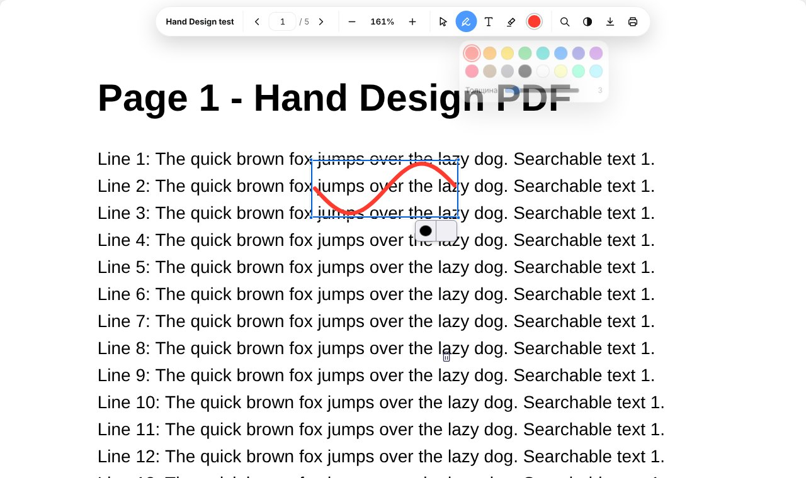
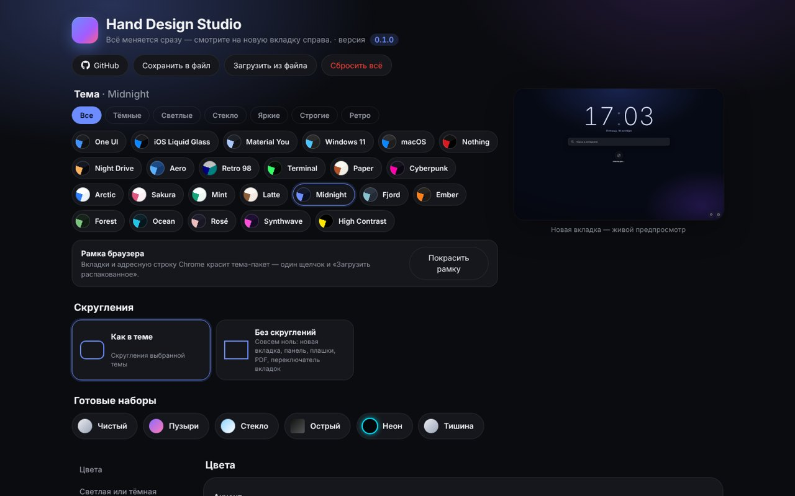

# Hand Design for Chromium 0.1.1

**A redesign for Chrome, Edge, Brave, Vivaldi, Opera and Yandex Browser** · 2026-10-17

## Что нового / What's new

**Новая вкладка больше не нагружает видеокарту, вернулась история поиска.** Исправления по первым отзывам.
*English: the new tab no longer loads the GPU; search history, Gmail, Google apps and Chrome tools are back; Hand Design also opens at browser start and follows the browser language (switch in Studio); the clock colon no longer blinks.*

### Быстродействие
- Видеокарта больше не занята наполовину. Живые обои двигались CSS-анимацией на частоте монитора (144–240 кадров в секунду). Поверх них 11 «стеклянных» элементов каждый кадр заново размывали фон — на RTX 5070 это больше половины нагрузки. Теперь обои сдвигаются 20 раз в секунду (движение медленное, разницы не видно), а ярлыки под ними без размытия. Пока вкладка не на экране, ничего не считается.
- Размытие обоев включается, только если его выставили в Studio. Раньше пустой фильтр тоже стоил работы видеокарте.
- Островок Now Bar на сайтах больше не перерисовывает страницу. Эквалайзер и пульс звонка анимируются без перерисовки, «стекло» под островком убрано (он и так почти непрозрачный).

### Добавлено
- История поиска в строке поиска, как в Chrome. При щелчке видны недавние запросы (Google, Яндекс, Bing, DuckDuckGo, YouTube…). По мере ввода — подходящие прошлые запросы, сайты из истории и подсказки Google. Работают стрелки, Enter и Esc; крестиком запрос удаляется из истории. Подсказки Google выключаются в Studio. Расширению нужно новое разрешение «История».
- Панель сверху справа: Gmail, Картинки и меню ⋮⋮⋮. В меню — инструменты Chrome (история, загрузки, закладки, пароли, расширения, настройки, очистка истории, Studio) и приложения Google. Выключается в Studio → «Новая вкладка».
- Hand Design при запуске браузера. Стартовая Google или пустая вкладка сама заменяется на новую вкладку Hand Design. Раньше её было видно только по Ctrl+T. Выключается в Studio → «Новая вкладка» → «Открывать при запуске браузера».

### Исправлено
- Hand Design говорит на языке браузера. В 0.1.0 язык расширения брался из окна установщика, и при русском Chrome всё могло быть на английском. Теперь язык установщика — только для установщика, а расширение по умолчанию следует языку Chrome. При обновлении навязанный язык сбрасывается один раз.
- Переключатель языка в Studio (Цвета → «Язык / Language»): «Как в браузере», «Русский», «English». Раньше его не было вовсе.
- Двоеточие в часах больше не мигает.

## Скриншоты / Screenshots

| | |
|---|---|
|  |  |
|  |  |
|  |  |

## Установка / Install

1. Скачайте **Hand-Design-Chromium-v0.1.1.zip** и распакуйте. / Download **Hand-Design-Chromium-v0.1.1.zip** and unzip.
2. Запустите **Setup.cmd**, выберите тему и браузеры, нажмите «Установить». / Run **Setup.cmd**, pick a theme and browsers, press Install.
3. В браузере один раз: страница расширений → «Режим разработчика» → «Загрузить распакованное» → Ctrl+V. Потом так же папку `frame` (рамка). / Once in the browser: extensions page → Developer mode → Load unpacked → Ctrl+V, then the `frame` folder.

Уже стоит — просто установите поверх и перезапустите браузер, настройки сохранятся. / Already installed — install over it and restart the browser, settings are kept.

[Все изменения / Full changelog](https://github.com/WiWaSu/Hand-Design---browsers-redesign-/blob/main/chrome/CHANGELOG.md)
