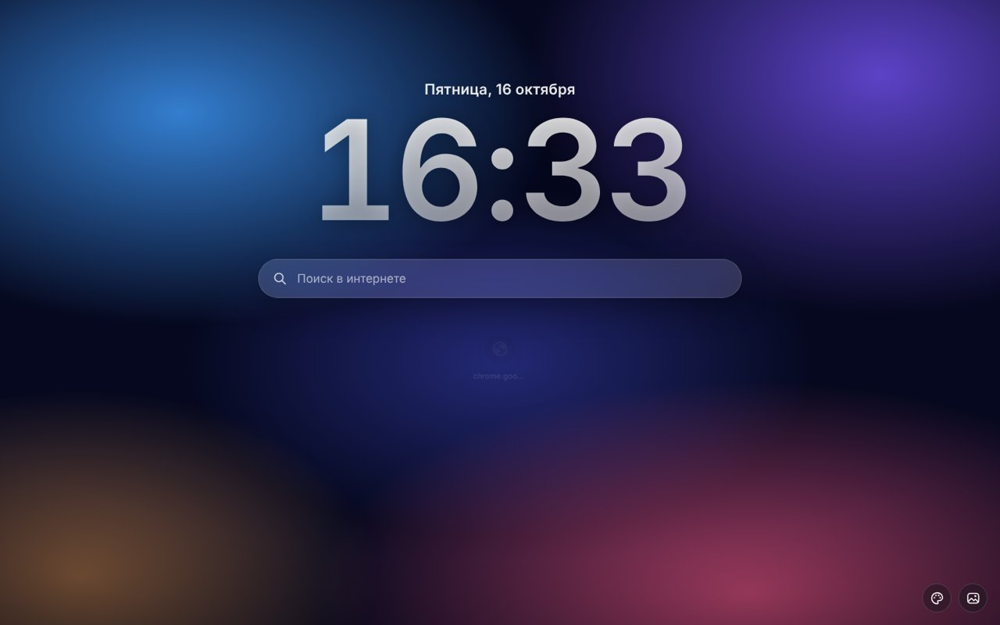
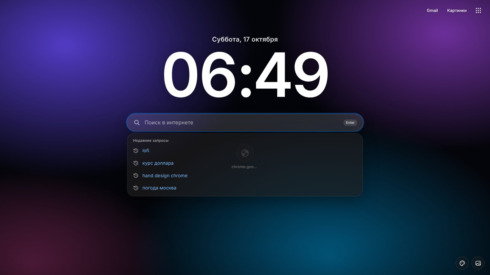
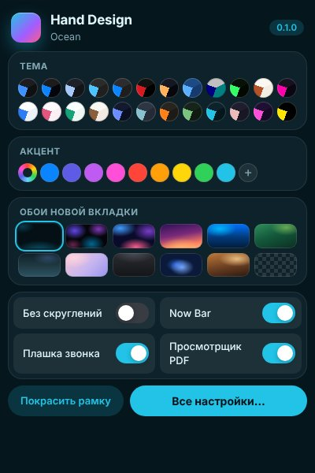
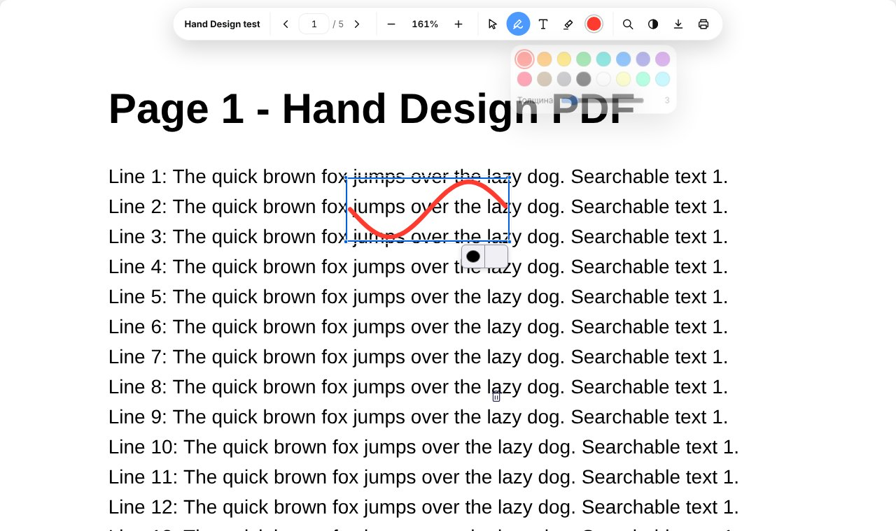
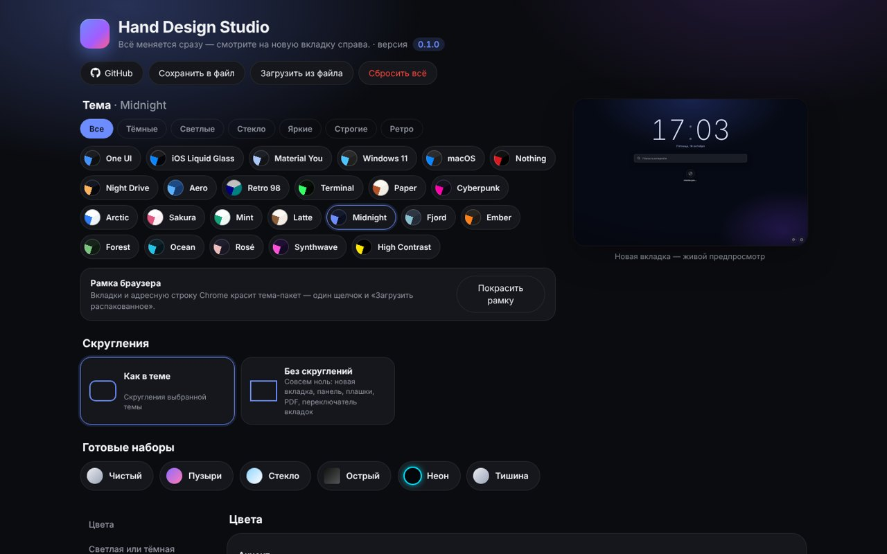

# Hand Design for Chromium 0.1.2

**A redesign for Chrome, Edge, Brave, Vivaldi, Opera and Yandex Browser** · 2026-10-17

## Что нового / What's new

**Верх браузера красится сам.** Вкладки и адресная строка меняют цвет вместе с темой: без «Загрузить распакованное» и без перезапуска.
*English: Chrome, Brave and Chromium now paint the tab strip and address bar automatically whenever the theme changes — no more loading the frame folder by hand.*

### Добавлено
- Верх браузера в цвет темы — автоматически (Chrome, Brave, Chromium). У Chrome нет способа, чтобы расширение само меняло цвет рамки. Поэтому установщик ставит маленький помощник Hand Design, а расширение через него задаёт браузеру цвет темы (политика `BrowserThemeColor` в разделе текущего пользователя, без прав администратора). Цвет меняется сразу при смене темы или акцента. Браузер строит из него свою палитру, поэтому это оттенки акцента темы, а не точные цвета тема-пакета.
- Предупреждение при первом запуске. Из-за политики в меню Chrome появляется «Управляется вашей организацией». На новой вкладке один раз объясняется, что это только цвет, и есть кнопка «Выключить».
- Переключатель «Красить верх браузера» в Studio → Цвета. Если выключить, помощник уберёт политику, и надпись пропадёт.
- Кнопка «Покрасить рамку» в Chrome, Brave и Chromium больше не просит загружать папку: верх уже красится сам. Для Edge, Opera и Яндекса остаётся папка `frame`, как раньше.

### Исправлено
- Установщик показывал номер версии 0.1.0. Теперь номер берётся из файла `VERSION`.

**Важно для обновления:** помощник ставит установщик. Запустите `Setup.cmd` новой версии, затем нажмите ⟳ на карточке Hand Design на странице расширений.

## Скриншоты / Screenshots

| | |
|---|---|
|  |  |
|  |  |
|  |  |

## Установка / Install

1. Скачайте **Hand-Design-Chromium-v0.1.2.zip** и распакуйте. / Download **Hand-Design-Chromium-v0.1.2.zip** and unzip.
2. Запустите **Setup.cmd**, выберите тему и браузеры, нажмите «Установить». / Run **Setup.cmd**, pick a theme and browsers, press Install.
3. В браузере один раз: страница расширений → «Режим разработчика» → «Загрузить распакованное» → Ctrl+V. Потом так же папку `frame` (рамка). / Once in the browser: extensions page → Developer mode → Load unpacked → Ctrl+V, then the `frame` folder.

Уже стоит — просто установите поверх и перезапустите браузер, настройки сохранятся. / Already installed — install over it and restart the browser, settings are kept.

[Все изменения / Full changelog](https://github.com/WiWaSu/Hand-Design---browsers-redesign-/blob/main/chrome/CHANGELOG.md)
