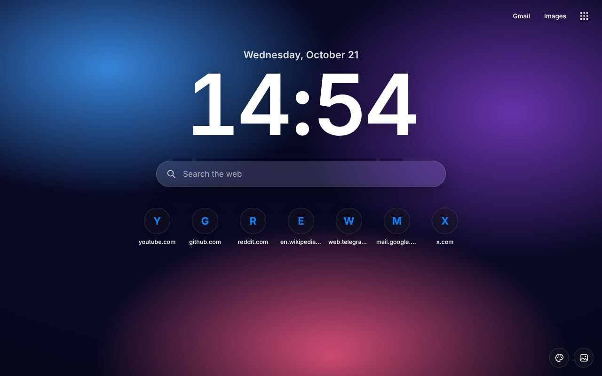
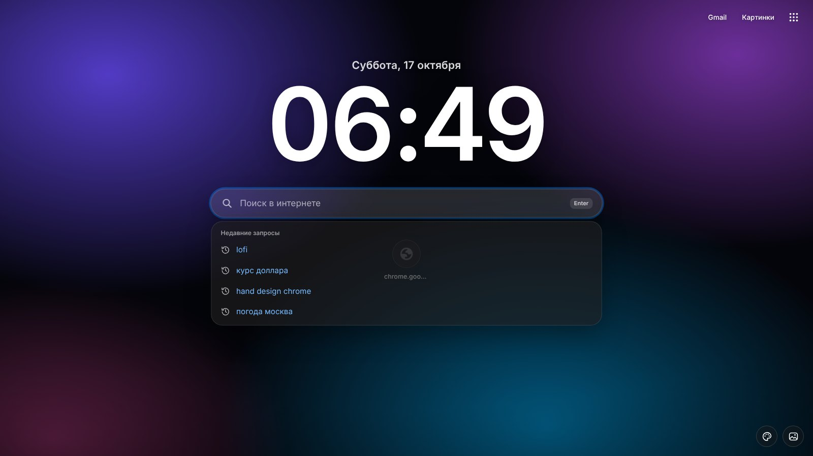
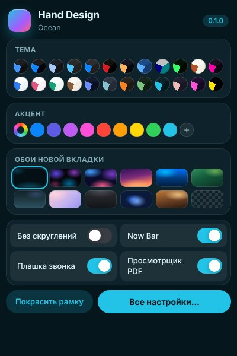
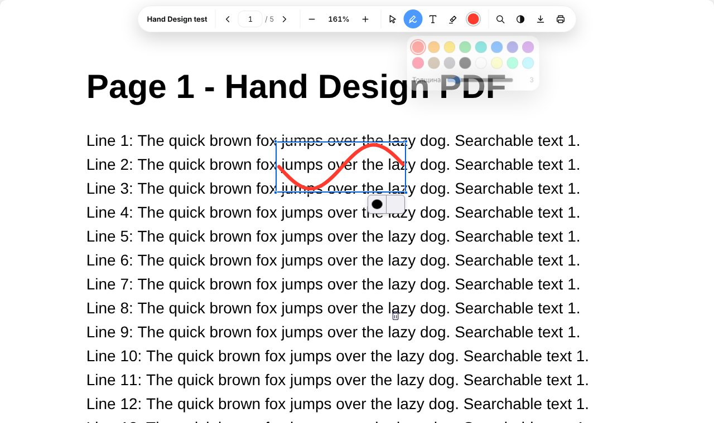
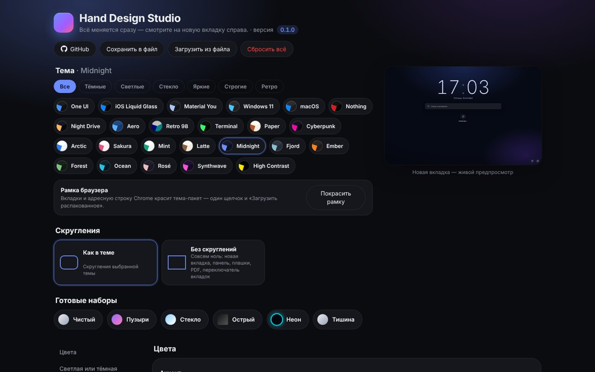

# Hand Design for Chromium 1.0.0

**A redesign for Chrome, Edge, Brave, Vivaldi, Opera and Yandex Browser** · 2026-11-23

## Что нового / What's new

**Заметки, документы и 10 языков.** Из Firefox-версии 2.x перенесены заметки, редакторы файлов, детали тем и переводы.
*English: Notes like in Obsidian, Markdown, CSV and image editors, Documents page, theme details with previews, 10 interface languages, theme picture behind the tab strip, update check at every start.*

### Добавлено
- Заметки (кнопка в быстрой панели, команда «Заметки Hand Design» на `chrome://extensions/shortcuts`). То же приложение, что в Firefox-версии: Live Preview, дерево папок, поиск, закреплённые, `[[ссылки]]` и упоминания, `#теги`, блоки `[!note]`, картинки, граф связей, быстрый переход `Ctrl+O`, заметка дня и шаблоны. Каждая заметка — обычный файл `.md` в папке, которую вы выберете; её можно открыть и в Obsidian. После перезапуска браузера Chrome один раз спросит разрешение на папку — кнопка «Открыть прошлую папку».
- Редактор Markdown. Файл `.md`, открытый с компьютера, показывается оформленным: содержание, просмотр, рядом, текст, таблицы правятся прямо в документе. Файл, открытый через «Документы», сохраняется на место по `Ctrl+S`. Файл, открытый из проводника, в первый раз сохраняется через «Сохранить как»: Chrome не даёт записать в него иначе.
- Редактор таблиц CSV. Файлы `.csv` и `.tsv` открываются таблицей вместо скачивания, с диска и из интернета. Кодировка UTF-8 или Windows-1251 сохраняется как была.
- Редактор картинок: обрезка, поворот, стрелки, рамки, текст, размытие, сжатие и смена формата. Открывается для картинок с компьютера и через «Редактировать картинку» в меню правой кнопки по любой картинке на странице.
- Страница «Документы» (кнопка в быстрой панели): новый документ, новая таблица, картинка, открыть файл, недавние.
- Studio → «Детали тем»: часы, фон новой вкладки и поиск можно взять из любой темы. У каждого варианта есть картинка.
- Studio → «Документы», «Заметки», «Заметки — оформление»: те же настройки, что в Firefox-версии.
- 10 языков интерфейса вместо двух: русский, английский, украинский, немецкий, французский, испанский, португальский, польский, турецкий, китайский. Словари общие с Firefox-версией.
- Тема-пакеты рамки: под полосой вкладок теперь картинка — фон новой вкладки этой темы (сияние iOS, огни Night Drive и так далее). Видна, если рамка покрашена тема-пакетом, а не помощником.

### Изменено
- Проверка обновлений идёт при каждом запуске браузера, а не только раз в сутки.
- Нужен Chrome 140 или новее (или браузер на его основе). Новые разрешения: «Загрузки» (чтобы открывать CSV вместо скачивания) и меню правой кнопки.

## Скриншоты / Screenshots

| | |
|---|---|
|  |  |
|  |  |
|  |  |

## Установка / Install

1. Скачайте **Hand-Design-Chromium-Setup-v1.0.0.exe** ниже и запустите. Без .exe: распакуйте **Hand-Design-Chromium-v1.0.0.zip** и запустите **Setup.cmd**. / Download **Hand-Design-Chromium-Setup-v1.0.0.exe** below and run it. Without the .exe: unzip **Hand-Design-Chromium-v1.0.0.zip** and run **Setup.cmd**.
2. Выберите тему и браузеры, нажмите «Установить». / Pick a theme and browsers, press Install.
3. В браузере один раз: страница расширений → «Режим разработчика» → «Загрузить распакованное» → Ctrl+V → «Выбрать папку». / Once in the browser: extensions page → Developer mode → Load unpacked → Ctrl+V → Select folder.
4. Только для Edge, Opera, Яндекса или если хочется картинку темы под вкладками: так же загрузите папку `frame`. В Chrome, Brave и Chromium цвет верха ставится сам. / Edge, Opera, Yandex, or if you want the theme picture behind the tabs: load the `frame` folder the same way. Chrome, Brave and Chromium get the frame color automatically.

Уже стоит — запустите установщик новой версии и нажмите ⟳ на карточке Hand Design на странице расширений, настройки сохранятся. / Already installed — run the new installer and press ⟳ on the Hand Design card, settings are kept.

[Все изменения / Full changelog](https://github.com/WiWaSu/Hand-Design---browsers-redesign-/blob/main/chrome/CHANGELOG.md)
