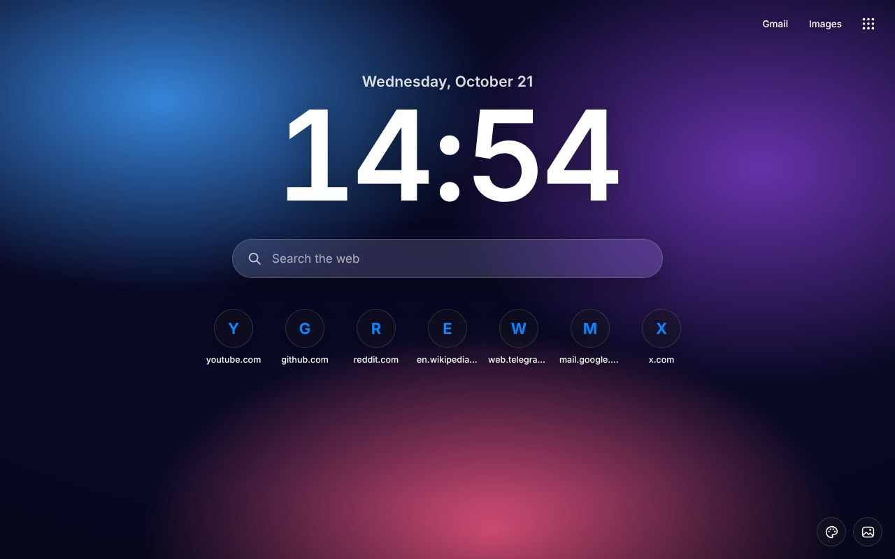
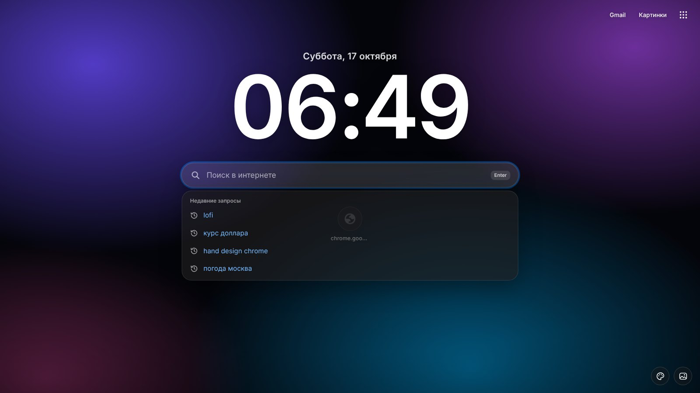
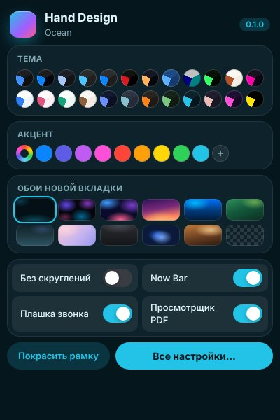
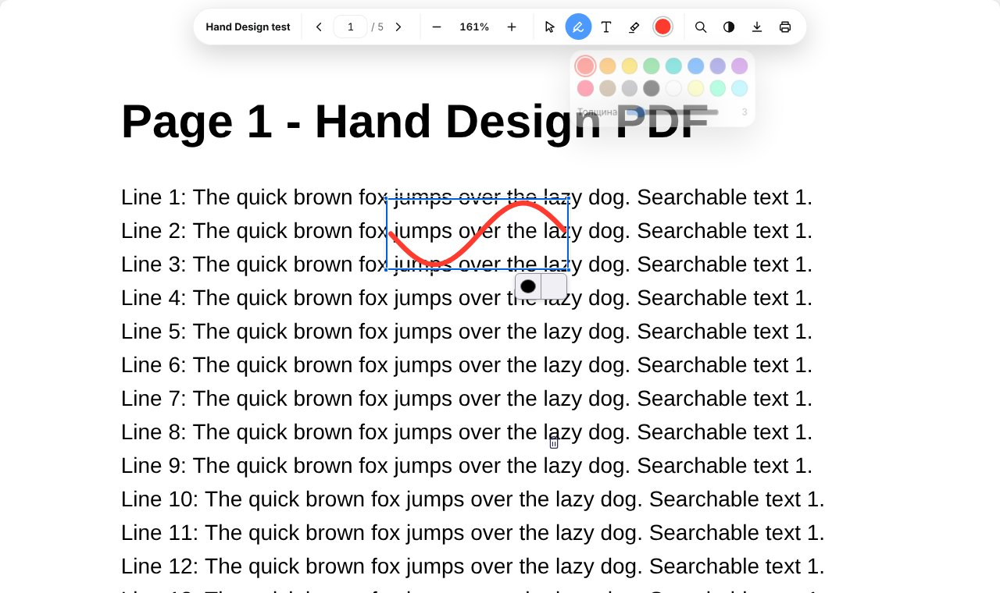
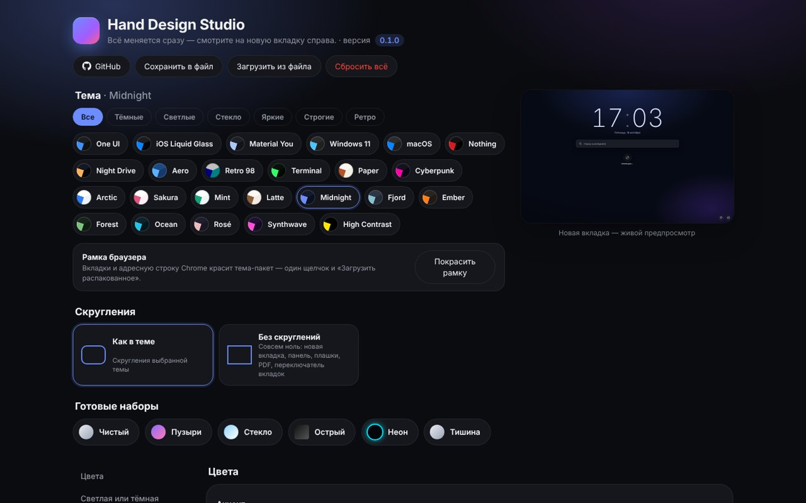

# Hand Design for Chromium 1.1.0

**A redesign for Chrome, Edge, Brave, Vivaldi, Opera and Yandex Browser** · 2026-11-25

## Что нового / What's new

**Установка в один щелчок, импорт заметок и исправленный Now Bar.**
*English: The installer now connects the extension to the browser by itself. Notes import from Notion, Evernote, Google Keep and any folder of Markdown files. A proper quick switcher, note properties shown as a card. Now Bar no longer shows short site sounds as music, shows the site icon and title, and hides during picture-in-picture.*

### Добавлено
- Импорт заметок: кнопка со стрелкой внизу списка заметок. Как в Firefox-версии 3.0.0:
  - Notion — экспорт «Markdown & CSV» (.zip): вложенность страниц, `[[ссылки]]` между ними, базы данных таблицами, картинки.
  - Evernote — экспорт блокнота (.enex): оформление, чекбоксы, таблицы, картинки, вложения, теги и даты.
  - Google Keep — архив Google Takeout (.zip): списки становятся чекбоксами, ярлыки — тегами, архивные заметки уходят в папку «Архив».
  - Папка с файлами .md — хранилище Obsidian, экспорт Joplin и любые другие заметки. Служебные папки вроде `.obsidian` пропускаются.
- Импортированное ложится в папку «Импорт/Notion», «Импорт/Evernote» и так далее. Повторный импорт идёт в новую папку.
- Быстрый переход по заметкам (`Ctrl+O`) — окно по центру с поиском и списком.
- Заметка со свойствами (`---` в начале файла) открывается с ними в виде карточки.
- Название, описание и подписи сочетаний клавиш на странице расширений показываются на языке браузера (10 языков).
- Установщик сам подключает Hand Design в браузере: открывает страницу расширений, включает «Режим разработчика», нажимает «Загрузить распакованное» и выбирает папку. Для Edge, Opera и Яндекса так же подключает рамку. Если не вышло, показывает прежнюю инструкцию.

### Исправлено
- Now Bar больше не показывает короткие звуки сайтов (например, на google.com) как музыку. «Играет» — только когда у вкладки горит значок звука, иначе кнопка «Играть».
- В Now Bar вместо пустого квадрата значок сайта, вместо адреса — заголовок вкладки, кнопка паузы видна всегда.
- Now Bar прячется, пока видео вынесено в окно «Картинка в картинке».

## Скриншоты / Screenshots

| | |
|---|---|
|  |  |
|  |  |
|  |  |

## Установка / Install

1. Скачайте **Hand-Design-Chromium-Setup-v1.1.0.exe** ниже и запустите. Без .exe: распакуйте **Hand-Design-Chromium-v1.1.0.zip** и запустите **Setup.cmd**. / Download **Hand-Design-Chromium-Setup-v1.1.0.exe** below and run it. Without the .exe: unzip **Hand-Design-Chromium-v1.1.0.zip** and run **Setup.cmd**.
2. Выберите тему и браузеры, нажмите «Установить». / Pick a theme and browsers, press Install.
3. Установщик сам откроет страницу расширений и подключит Hand Design. Несколько секунд не трогайте мышь и клавиатуру. Если не получится, он покажет, что нажать. / The installer opens the extensions page and connects Hand Design by itself. Leave the mouse and keyboard alone for a few seconds. If it fails, it shows what to click.

Уже стоит — запустите установщик новой версии и нажмите ⟳ на карточке Hand Design на странице расширений, настройки сохранятся. / Already installed — run the new installer and press ⟳ on the Hand Design card, settings are kept.

[Все изменения / Full changelog](https://github.com/WiWaSu/Hand-Design---browsers-redesign-/blob/main/chrome/CHANGELOG.md)
