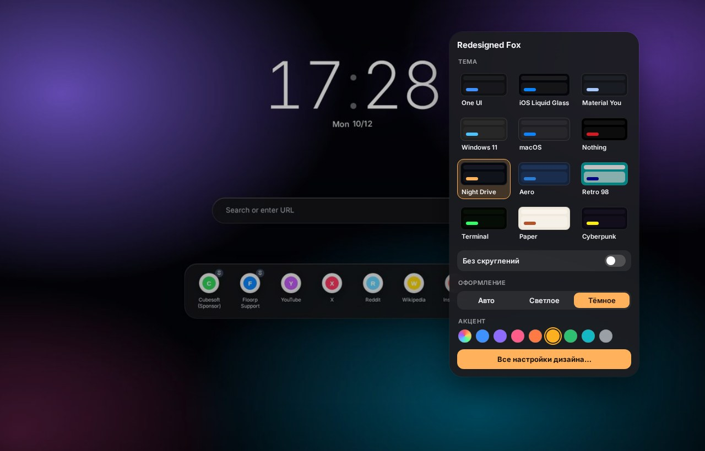

# Redesigned Fox 1.15.0

**A redesign for Floorp, Firefox and Firefox forks** · 2026-10-13

## Что нового / What's new

- Кнопка «Дизайн» (палитра на панели) теперь открывает быструю панель прямо под собой: 12 тем, переключатель «Без скруглений», светлое / тёмное оформление, цвет акцента и кнопка «Все настройки дизайна…». Раньше кнопка открывала вкладку настроек — в Floorp с рабочими пространствами эта вкладка могла оказаться скрытой, и казалось, что ничего не происходит. Теперь скрытая вкладка закрывается и открывается новая.
- Смена темы прямо в браузере, без установщика и без перезапуска. Тема меняется сразу во всех окнах, на новой вкладке, в настройках и в PDF, а заодно переписывается в userChrome.css / userContent.css — после перезапуска всё остаётся как выбрали. Темы можно менять и в Redesigned Fox Studio (новый раздел «Тема» сверху).
- «Без скруглений» — убирает вообще все скругления: окно, страница, вкладки, меню, кнопки, адресная строка, новая вкладка, страницы настроек, PDF. Есть в быстрой панели, в Studio (раздел «Форма») и в установщике («Скругление → Без»).
- Настройки установщика теперь всегда сильнее темы, а настройки Studio — сильнее настроек установщика (CSS-слои).
- Для разработчиков: исходники тем переехали в `src/themes/`, готовые темы для установщика и браузера собирает `tools/pack_themes.py` в `files/pdf-tweaks/themes/`.

## Скриншоты / Screenshots

| | |
|---|---|
|  |  |
|  |  |
|  |  |

## Установка / Install

1. Скачайте **RedesignedFox-v1.15.0.zip** ниже и распакуйте. / Download **RedesignedFox-v1.15.0.zip** below and unzip.
2. Запустите **Setup.cmd**, выберите тему и браузеры, нажмите «Установить». / Run **Setup.cmd**, pick a theme and browsers, press Install.
3. Перезапустите браузер. / Restart the browser.

Уже стоит более старая версия — просто установите поверх, настройки сохранятся. / Already installed — just install over it, your settings are kept.

[Все изменения / Full changelog](https://github.com/WiWaSu/Hand-Design---browsers-redesign-/blob/main/firefox/CHANGELOG.md)
