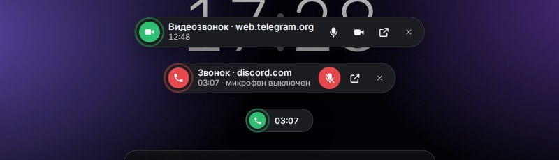

# Redesigned Fox 1.16.0

**A redesign for Floorp, Firefox and Firefox forks** · 2026-10-13

## Что нового / What's new

- Плашка звонка — отдельно от музыки. Когда в другой вкладке идёт звонок (Telegram, Discord, WhatsApp, Meet и т. д. — сайт занял микрофон или камеру), сверху по центру появляется «островок»: сайт, время звонка, кнопки «выключить микрофон», «выключить камеру», «перейти к звонку». Через 6 секунд сворачивается в маленькую таблетку с таймером, при наведении раскрывается. `Alt+Shift+M` — выключить / включить микрофон из любой вкладки. Вкладка со звонком больше не попадает в музыкальный Now Bar. Плашку можно скрыть в Studio («Показать / скрыть → Плашка звонка»).
- Now Bar: пауза в Telegram и похожих сайтах. Telegram играет музыку из «невидимого» плеера, которого нет на странице, — поэтому пауза часто не срабатывала. Теперь такие плееры запоминаются (Telegram, VK, OK, Яндекс Музыка, Звук, SoundCloud, Discord, WhatsApp) и останавливаются напрямую.
- Now Bar больше не выключает звук вкладки, когда пауза на самом деле сработала: раньше значок звука у вкладки гаснет с задержкой ~3 секунды, и Now Bar принимал это за «всё ещё играет».

## Скриншоты / Screenshots

| | |
|---|---|
|  |  |
|  |  |
|  |  |

## Установка / Install

1. Скачайте **RedesignedFox-v1.16.0.zip** ниже и распакуйте. / Download **RedesignedFox-v1.16.0.zip** below and unzip.
2. Запустите **Setup.cmd**, выберите тему и браузеры, нажмите «Установить». / Run **Setup.cmd**, pick a theme and browsers, press Install.
3. Перезапустите браузер. / Restart the browser.

Уже стоит более старая версия — просто установите поверх, настройки сохранятся. / Already installed — just install over it, your settings are kept.

[Все изменения / Full changelog](https://github.com/WiWaSu/Hand-Design---browsers-redesign-/blob/main/firefox/CHANGELOG.md)
