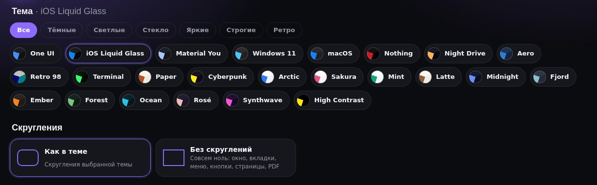

# Redesigned Fox 1.20.0

**A redesign for Floorp, Firefox and Firefox forks** · 2026-10-13

## Что нового / What's new

- 24 темы вместо 12 — новые на любой вкус: светлые **Arctic, Sakura, Mint, Latte**, тёмные **Midnight, Fjord, Ember, Forest, Ocean, Rosé**, яркая **Synthwave** и **High Contrast** для максимальной читаемости.
- Выбор темы — компактно: в Studio вместо больших карточек маленькие «таблетки» с цветным кружком и фильтр «Все / Тёмные / Светлые / Стекло / Яркие / Строгие / Ретро»; в быстрой панели — сетка цветных кружков, название видно при наведении. В установщике — 6 тем в ряд.
- «Без скруглений» — отдельный блок вверху Studio («Как в теме» / «Без скруглений»). Теперь убирает скругления и внутри элементов: кнопки боковой панели, поля, меню новых версий Firefox, саму область страницы.
- Боковая панель с вертикальными вкладками в цветах темы. Раньше при тёмной/светлой теме Firefox или Floorp панель оставалась серой, а при наведении выезжала «не в тему». Теперь фон, выбранная вкладка и кнопки берутся из темы, развёрнутая панель — полупрозрачное стекло с тенью. Поправка подключается на лету (`fixes.css`), переустановка не нужна.
- Меню правой кнопки: стили из Studio не применялись в новых версиях Firefox — у меню больше нет внутренней части `::part(content)`. Теперь фон, скругление, отступы и рамка задаются ещё и через переменные `--panel-*`, которые понимают и старые, и новые версии.

## Скриншоты / Screenshots

| | |
|---|---|
|  |  |
|  |  |
|  |  |

## Установка / Install

1. Скачайте **RedesignedFox-v1.20.0.zip** ниже и распакуйте. / Download **RedesignedFox-v1.20.0.zip** below and unzip.
2. Запустите **Setup.cmd**, выберите тему и браузеры, нажмите «Установить». / Run **Setup.cmd**, pick a theme and browsers, press Install.
3. Перезапустите браузер. / Restart the browser.

Уже стоит более старая версия — просто установите поверх, настройки сохранятся. / Already installed — just install over it, your settings are kept.

[Все изменения / Full changelog](https://github.com/WiWaSu/Hand-Design---browsers-redesign-/blob/main/firefox/CHANGELOG.md)
