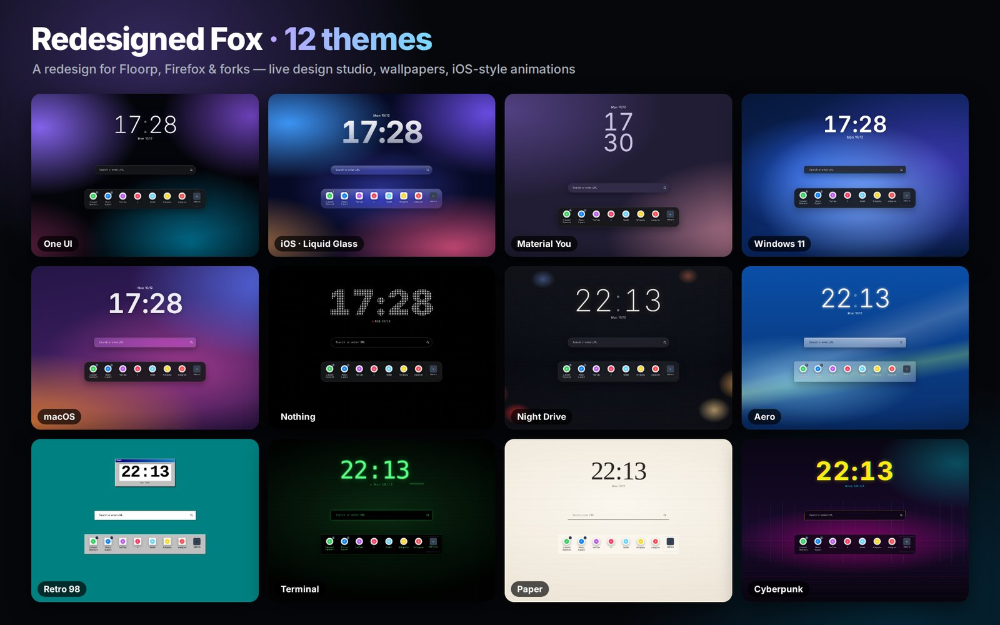
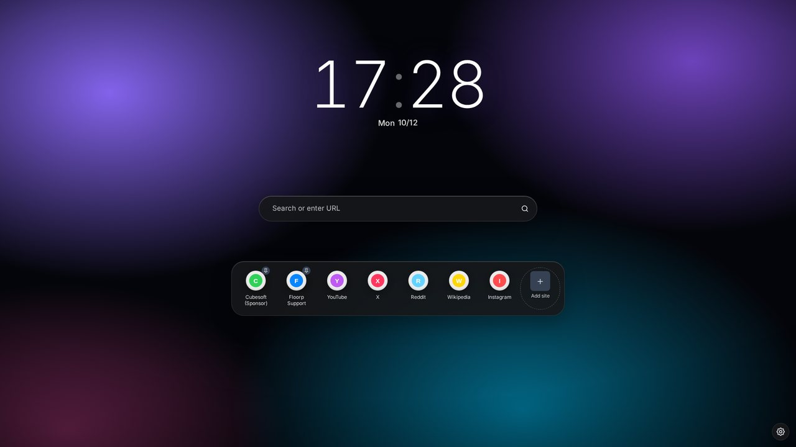
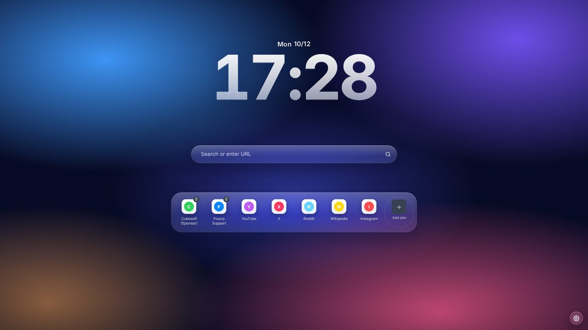
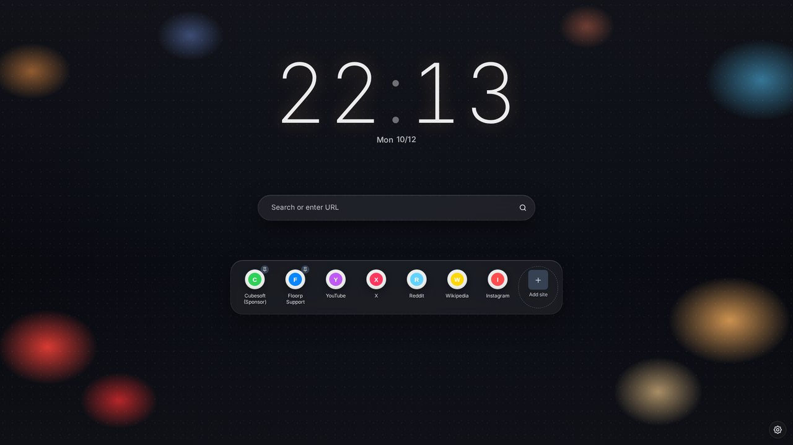
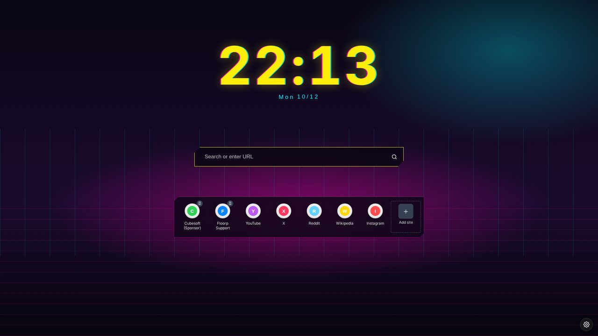
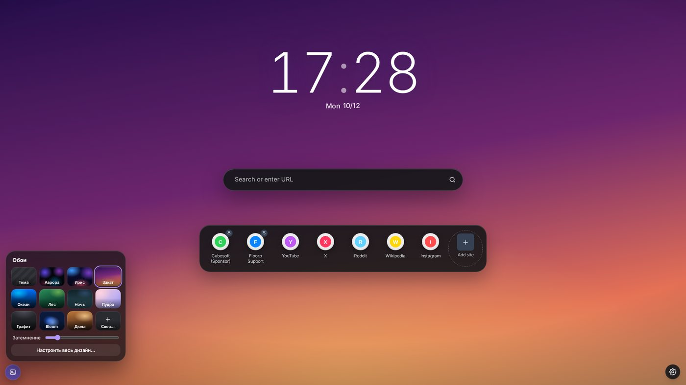
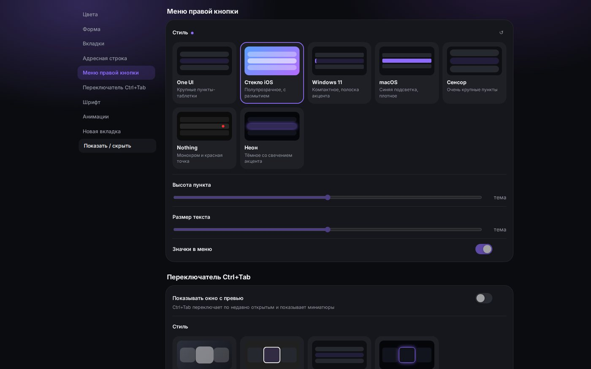

# Hand Design 1.21.0

**A redesign for Floorp, Firefox and Firefox forks** · 2026-10-16

## Что нового / What's new

Большое недельное обновление. / Big weekly update.

**English summary:** Hand Design now speaks 10 languages (English, Russian, Ukrainian, German, French, Spanish, Portuguese, Polish, Turkish, Chinese) — pick one with the globe button in the installer or in Studio. Themes look like themselves again (Studio colors no longer override every theme). PDF viewer: "Clear" button (remove drawings / remove everything), straight lines with Shift like in Paint, tools no longer pop open their settings (small ▾ arrow instead), fast handwriting is no longer merged into one drawing, a new drawing is not auto-selected, a cleaner round toolbar for selected drawings, and two new Studio sections with every PDF viewer and pen timing setting.

- Языки. Hand Design теперь на 10 языках: русский, английский, украинский, немецкий, французский, испанский, португальский, польский, турецкий, китайский. В установщике — кнопка с глобусом в шапке: меняет язык окна сразу и ставит этот же язык всему Hand Design в браузере (Studio, панель «Дизайн», PDF, новая вкладка, уведомления). В Studio — выбор языка в шапке. По умолчанию — язык Windows / браузера.
- Темы снова разные. Свои цвета из Studio (фон окна, поля, меню, текст, акцент) перекрывали любую тему — при смене темы они теперь сбрасываются.
- После рисования рисунок не выделяется сам и панелька не выезжает — выделение по щелчку (Studio → «PDF: карандаш и тайминги»).
- build-exe.bat: собирает .exe и в папке с пробелами в пути.
- PDF: панелька у выделенного рисунка поправлена под новый просмотрщик Firefox: цвет — круглая кнопка с кружком выбранного цвета, без разделителей.
- PDF: «Очистить» — новая кнопка рядом с инструментами: «Убрать все рисунки» (только линии от руки, текст и выделения остаются) и «Убрать всё». Ctrl+Z возвращает.
- PDF: инструменты без лишних окон. Нажатие на карандаш, текст или маркер просто выбирает инструмент — панель настроек больше не выскакивает. Рядом с кнопкой маленькая стрелочка ▾: она открывает полную панель (цвет, толщина/размер с кнопками − / + и готовыми размерами). Клик мимо или Esc — закрыть.
- PDF: быстрое письмо карандашом больше не склеивает всю строку в один рисунок: новый рисунок начинается, если следующий штрих далеко от предыдущего, после паузы или когда рисунок разросся больше слова. Пока пишете, не считается «наведение» на рисунки — не тормозит.
- Studio: два новых раздела для PDF. «Просмотрщик PDF» — оформление и цвет страниц, открывать ли панель инструмента сразу, кнопки − / +, своя палитра, «Очистить», закладки, кнопка темы, быстрый текст, «открывать там, где остановились», анимации. «PDF: карандаш и тайминги» — собирать ли штрихи в рисунок, пауза (мс) и расстояние (px) до нового рисунка, максимальный размер рисунка, захват линии мышью, Shift-линии и шаг угла (45° / 15° / 90°), скорость и задержка автоповтора − / +. Всё применяется сразу.
- PDF: ровные линии с Shift, как в Paint — зажмите Shift во время рисования: линия идёт строго по горизонтали, вертикали или под 45°, пока тянете — видна подсказка.

## Скриншоты / Screenshots

| | |
|---|---|
|  |  |
|  |  |
|  |  |

## Установка / Install

1. Скачайте **Hand-Design-v1.21.0.zip** ниже и распакуйте. / Download **Hand-Design-v1.21.0.zip** below and unzip.
2. Запустите **Setup.cmd**, выберите тему и браузеры, нажмите «Установить». / Run **Setup.cmd**, pick a theme and browsers, press Install.
3. Перезапустите браузер. / Restart the browser.

Уже стоит более старая версия — просто установите поверх, настройки сохранятся. / Already installed — just install over it, your settings are kept.

[Все изменения / Full changelog](https://github.com/WiWaSu/Hand-Design---browsers-redesign-/blob/main/firefox/CHANGELOG.md)
