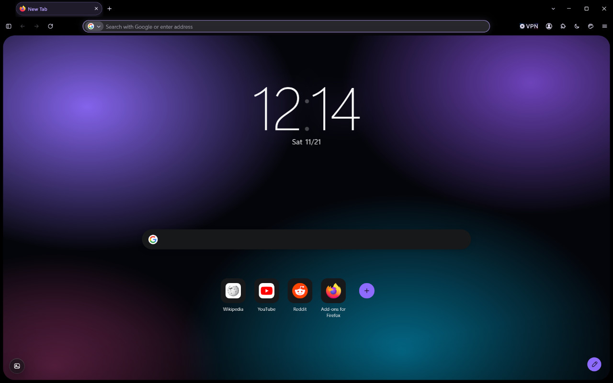
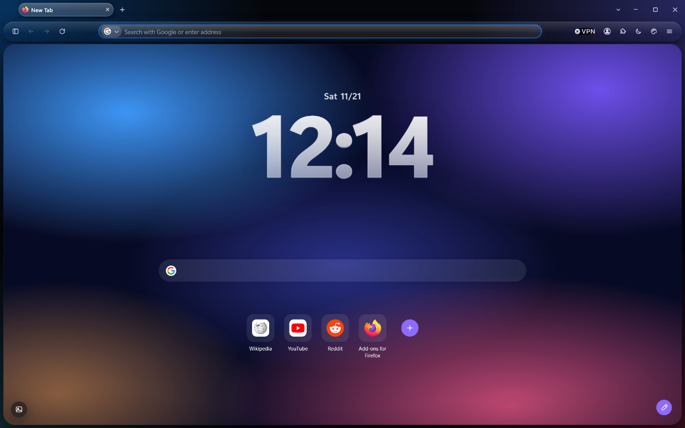
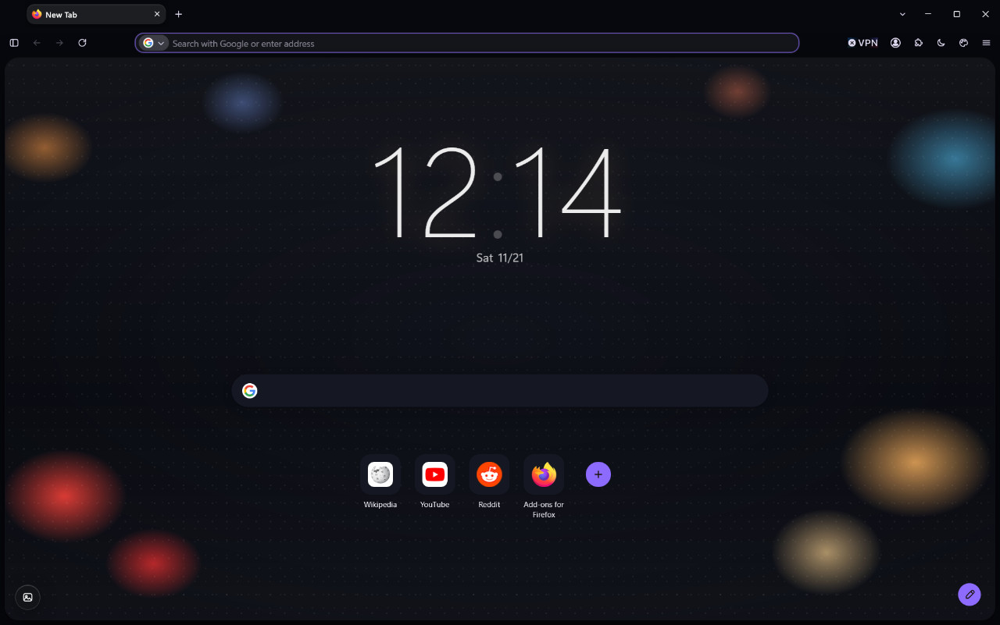
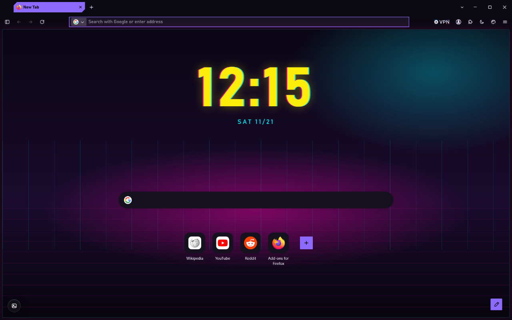
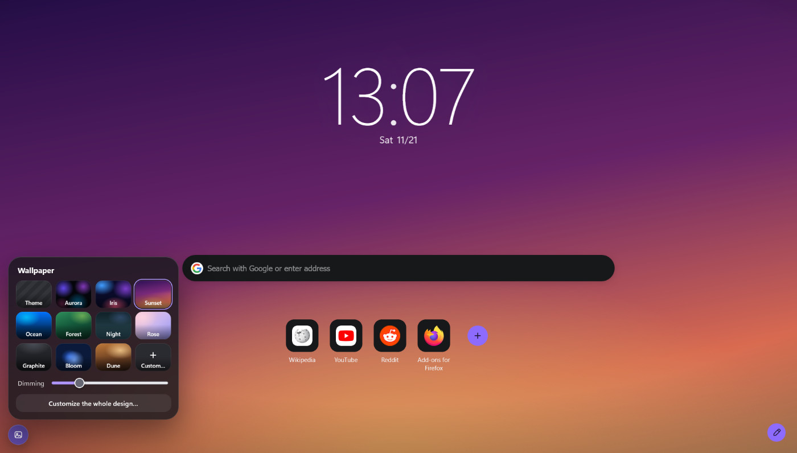
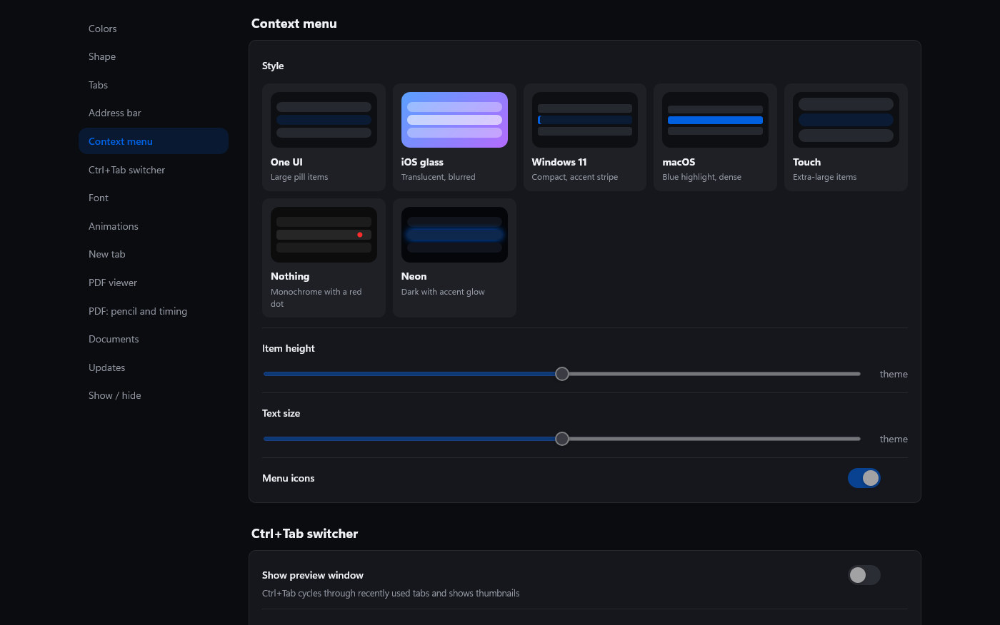

# Hand Design 2.0.0

**A redesign for Floorp, Firefox and Firefox forks** · 2026-11-18

## Что нового / What's new

**English summary:** Studio → Theme details: take the window style, new tab clock, new tab background or search style from any theme and mix them with any other theme. Everything a theme is made of can now be set in Studio without it: secondary text, text on accent, input fields, lines, hover, press, soft accent, toggles, menu item radius, main menu tiles and the PDF toolbar colors. New Notes page (Alt+Shift+N or ☰ → Notes): a folder tree like in Obsidian with search, pinned notes, drag and drop and a right-click menu on the left, a Live Preview editor on the right like in Obsidian: you write in the formatted text and the Markdown marks show only on the line with the cursor. Each note is a plain .md file in a folder you pick on first launch, notes save themselves as you type, the title at the top renames the file, deleted notes go to the .trash folder. Editing tools: a bar over selected text, a “/” menu for blocks, an optional toolbar and a right-click menu. Links between notes work like in Obsidian: [[Name]] with suggestions while typing, click to open or create, a Mentions list under each note, and links are updated when a note is renamed. Obsidian syntax: #tags with a tag list and filter, callouts like > [!note], properties at the top of a file, footnotes and %%comments%%. Images work like in Obsidian: paste or drop them into a note, they are saved to the attachments folder and shown inline; ![[image.png]] links from Obsidian vaults show too. Quick switcher (Ctrl+O), a daily note button, templates and a graph view of links. Studio has new Notes and Notes appearance sections: font, size, line spacing and width, Live Preview on or off, spell check, which tools to show, sorting, list width and background. Hand Design pages (Studio, Notes, Documents, .md files) get their own tab icons. Updates are checked each time the browser starts instead of once a day. The screen sharing picker looks like Discord: tabs for windows, screens, tabs and apps with large cards instead of a drop-down list, and a rounded live preview of the selected source. The "you are sharing" indicator gets a red Stop button and round microphone and camera toggles. In PDFs, the "Image removed · Undo" bar now matches Hand Design. The GitHub button and links in Studio open again. Text added to a PDF no longer gets a white box around it after saving. Markdown tables can be edited right in the document: click a cell and type, Tab and Enter move between cells and add rows, a small bar adds and removes rows and columns and sets column alignment. In text mode Tab lines up the table columns. The PDF toolbar now fits a half-screen window.

- Studio → «Детали тем»: особенности любой темы можно взять отдельно и совместить с любой другой темой. Четыре детали: «Окно и меню» (выделенная вкладка, пункты меню, плитки главного меню, стекло iOS и Aero, «светофор» macOS, кнопки Retro 98, неон Cyberpunk и т. д.), «Часы на новой вкладке» (точки Nothing, окно Retro 98, фосфор Terminal, стеклянные iOS…), «Фон новой вкладки» (огни и капли Night Drive, точечная сетка Nothing, строки развёртки, бумага, неоновая сетка…) и «Поиск и ярлыки». Для каждой: тема-источник или «Без особенностей»; не выбрано — как в текущей теме. Сама тема теперь — это цвета, скругления и набор деталей по умолчанию, выглядит она так же, как раньше.
- Studio: всё, из чего состоит тема, настраивается и без неё. В «Цветах» добавились второстепенный текст, текст на акценте, поля ввода, линии и рамки, наведение, нажатие, мягкий акцент (выбранная вкладка и пункт меню) и цвет переключателей. В «Форме» — скругление пунктов меню. Новый раздел «Главное меню ☰»: форма плиток под значками (круглые, скруглённые, квадратные, без плиток) и их цвет. В «Просмотрщике PDF» — цвет панели и фона групп кнопок. При смене темы новые цвета сбрасываются, как и остальные.
- Заметки — отдельно от редактора файлов. Открываются по `Alt+Shift+N` или через ☰ → «Заметки». Кнопку на панель можно добавить через «Настроить панель», сама она там не появляется. При первом запуске страница спрашивает, где хранить заметки: «Документы\Hand Design Notes» или любая своя папка.
- Слева дерево папок, как в Obsidian. Папки сворачиваются, заметки и папки перетаскиваются мышкой в другую папку или в корень. Сверху кнопки: новая заметка, новая папка (создаются в выбранной папке), свернуть все папки, скрыть список. Закреплённые заметки собраны вверху. Правая кнопка по заметке: открыть, переименовать, закрепить, показать в проводнике, удалить; по папке: новая заметка, новая папка, переименовать, показать в проводнике, удалить. F2 — переименовать. Поиск ищет и по названию, и по тексту и показывает найденное списком с папкой.
- Справа редактор как Live Preview в Obsidian: один режим, пишете прямо в оформленном тексте, а значки разметки (`#`, `**`, `[ ]`) видны только в строке с курсором. Заголовки, жирный, курсив, код, ссылки, цитаты, списки, разделители и таблицы показываются оформленными, задачи отмечаются кружком-галочкой, ссылка открывается по щелчку. Таблица всегда показывается таблицей: щёлкните по ячейке и пишите, Tab — следующая ячейка, Enter — ячейка ниже (в конце добавляет строку), Esc — выйти; над таблицей панель: строка, столбец, удалить их, выравнивание, удалить таблицу. Строки без `|` сразу после таблицы остаются обычным текстом, а после блока, вставленного через «/», остаётся пустая строка. `==текст==` — выделение цветом, как в Obsidian. Ctrl+B, Ctrl+I, Ctrl+K — жирный, курсив, ссылка; Ctrl+Shift+H — выделение цветом; Ctrl+F — поиск в заметке. Редактор сделан на CodeMirror 6, том же движке, что в Obsidian.
- Каждая заметка — обычный файл `.md` в выбранной папке, вложенные папки тоже видны. Такую папку можно открыть в Obsidian, и наоборот: папку Obsidian можно выбрать для заметок. Файлы и папки, начинающиеся с точки (например `.obsidian`), не показываются.
- Заметки сохраняются сами, через полсекунды после того, как перестали печатать. Название сверху — это имя файла, поменяли его — файл переименовался. Удалённая заметка не пропадает, а переезжает в папку `.trash` внутри папки заметок.
- Инструменты в заметках: панелька над выделенным текстом (жирный, курсив, зачёркнутый, выделение цветом, код, ссылка, заголовки, цитата); меню по «/» в начале строки (заголовки, списки, задача, цитата, таблица, блок кода, разделитель, можно начать печатать название); панель инструментов сверху (по умолчанию выключена); своё меню правой кнопки с вырезать/копировать/вставить, оформлением и вставкой блоков.
- Ссылки между заметками, как в Obsidian: `[[Название]]`, `[[Название|подпись]]`, `[[Название#заголовок]]`. При вводе `[[` появляется подсказка с заметками. Ссылка показывается названием и открывает заметку по щелчку; если такой заметки ещё нет, ссылка бледная и пунктирная, а щелчок создаёт заметку. Под заметкой блок «Упоминания»: какие заметки ссылаются на эту, с строкой, где стоит ссылка. При переименовании заметки ссылки на неё обновляются во всех заметках.
- Синтаксис Obsidian в заметках: `#теги` (и вложенные `#проекты/дом`) подсвечены, щелчок по тегу показывает все заметки с ним, внизу списка блок «Теги» со счётчиками, поиск понимает `#тег`. Блоки `> [!note]`, `[!tip]`, `[!warning]`, `[!danger]`, `[!question]`, `[!example]`, `[!quote]` и остальные типы Obsidian — цветные, со значком и названием. Свойства в начале файла (`---` … `---`) показываются карточкой «ключ — значение», теги из них тоже работают в фильтре. Сноски `[^1]` показываются номером, текст сноски — при наведении. Комментарии `%%…%%` приглушены.
- Картинки в заметках, как в Obsidian: `Ctrl+V` со скриншотом или перетаскивание файла сохраняет картинку в папку `attachments` (или рядом с заметкой — настройка в Studio) и вставляет `![[имя.png]]`. Показываются и `![[фото.jpg]]` из папок Obsidian (ищутся по имени во всей папке заметок), и ``, и картинки из интернета. Ширина задаётся как в Obsidian: `![[фото.jpg|300]]`. Щелчок по картинке открывает её крупно, Esc или щелчок — закрыть.
- Быстрый переход `Ctrl+O` (или лупа в шапке списка): набираете часть названия, стрелки и Enter открывают заметку, а если такой нет — «Создать». Кнопка с календарём открывает заметку на сегодня (создаёт, если её ещё нет). Шаблоны: заметки из папки «Шаблоны» вставляются через «/» → «Шаблон», `{{title}}`, `{{date}}`, `{{time}}` заменяются на название, дату и время; заметка дня может сразу начинаться с шаблона.
- Граф связей (кнопка с тремя точками в шапке списка): заметки — точки, `[[ссылки]]` — линии, у кого больше связей, тот крупнее, открытая заметка выделена цветом. Колесо мыши — масштаб, перетаскивание — двигать поле или точку, наведение подсвечивает связи и показывает названия, щелчок открывает заметку. Переключатель «Все заметки» / «Связи этой заметки» (сама заметка, её связи и связи связей). Esc — закрыть.
- Studio → «Заметки»: Live Preview вкл/выкл, проверка орфографии, название над заметкой, счётчик слов, какие инструменты показывать, сортировка, начало текста в списке, название новой заметки, куда сохранять картинки, папка и формат заметки дня, папка шаблонов и шаблон заметки дня, задержка автосохранения.
- Studio → «Заметки — оформление»: шрифт текста (в том числе свой), размер, межстрочный интервал, ширина строки; шрифт, размер и цвет заголовков; размер названия; акцент заметок; цвет текста; фон (как в теме, бумага, тёмный или свой цвет); фон списка; скругления; форма галочек; маркер списка; вид тегов; вид блоков [!note]; вид таблиц; ширина и плотность списка. Всё меняется сразу, без перезагрузки.
- Обновления проверяются при каждом запуске браузера, а не раз в сутки. Если вышла новая версия, при запуске появляется уведомление (пока вы её не поставите или не нажмёте «Позже» в панели «Дизайн»).
- У страниц Hand Design свои значки на вкладках вместо серого глобуса: Studio, «Заметки», «Документы» и открытые файлы `.md`.
- В установщике появилась галочка «Заметки» (в разделе функций), включена по умолчанию.
- Редактор Markdown: таблицы правятся прямо в документе. Щёлкните по ячейке и пишите. Tab — следующая ячейка (в конце таблицы добавляет строку), Shift+Tab — предыдущая, Enter — ячейка ниже, Esc — выйти. Над таблицей появляется панель: строка ниже, столбец справа, удалить строку или столбец, выравнивание столбца. В файл таблица записывается обычным Markdown с выровненными колонками. Таблицы внутри цитат и списков пока правятся только в тексте.
- Редактор Markdown, режим «Текст»: Tab внутри таблицы выравнивает её столбцы пробелами и переходит к следующей ячейке, в конце добавляет строку.
- PDF в узком окне, например в разделённом экране Floorp: панель больше не обрезается справа. Печать и скачивание уходят в меню ⋯, затем по мере сужения прячутся кнопки зума, стрелки страниц, переключатель темы и выбор масштаба. Меню ⋯ видно всегда.

- PDF: надписи, добавленные инструментом «Текст», после сохранения и повторного открытия файла были на белом прямоугольнике, который закрывал текст учебника под ними. Причина в Hand Design: при сохранении Firefox рисует каждую надпись на скрытой пустой странице `about:blank`, а оформление Hand Design красило фон и этой страницы. Теперь пустые страницы не трогаются. Уже сохранённые файлы это не исправит: рамки записаны в сам PDF.
- Показ экрана: окно выбора, что показать сайту, теперь как в Discord. Вместо выпадающего списка — вкладки «Окна», «Экраны», «Вкладки», «Приложения» и крупные карточки с названием; выбранная подсвечена. Окна самого браузера подписаны его названием — Floorp, Firefox, LibreWolf и т. д. (их заголовок — название открытой вкладки, поэтому их легко спутать с другими). Под карточками живое превью выбранного источника со скруглёнными углами. Если что-то пойдёт не так, остаётся обычный список Firefox.
- Окошко «Вы делитесь экраном»: кнопка «Остановить» красная, переключатели микрофона и камеры круглые; выключенный микрофон или камера подсвечиваются красным.
- PDF: плашка после удаления картинки или рисунка («Изображение удалено · Отменить») теперь в стиле Hand Design — тёмная капсула в цвет панели вместо синего прямоугольника.
- Studio: кнопка GitHub в шапке и ссылки «Что нового» / «Скачать» в разделе «Обновления» снова открываются, в новой вкладке. Раньше на них ничего не происходило.
- Редактор Markdown: открываются и файлы `.md`, которые начинаются с HTML, например с `
` — раньше браузер показывал их сплошным текстом. Блоки `
` выравниваются по центру.

## Скриншоты / Screenshots

| | |
|---|---|
|  |  |
|  |  |
|  |  |

## Установка / Install

1. Скачайте **Hand-Design-Setup-v2.0.0.exe** ниже и запустите. / Download **Hand-Design-Setup-v2.0.0.exe** below and run it.
2. Выберите тему и браузеры, нажмите «Установить». / Pick a theme and browsers, press Install.
3. Перезапустите браузер. / Restart the browser.

Если SmartScreen пишет «Система Windows защитила ваш компьютер», нажмите «Подробнее» → «Выполнить в любом случае»: у файла нет платной подписи. / If SmartScreen says "Windows protected your PC", click "More info" → "Run anyway": the file is not signed with a paid certificate.

Уже стоит более старая версия — запустите установщик и нажмите «Обновить», настройки сохранятся. / Already installed — run the installer and press Update, your settings are kept.

Без .exe: **Hand-Design-v2.0.0.zip** — распакуйте и запустите **Setup.cmd**. / Without the .exe: unzip **Hand-Design-v2.0.0.zip** and run **Setup.cmd**.

[Все изменения / Full changelog](https://github.com/WiWaSu/Hand-Design---browsers-redesign-/blob/main/firefox/CHANGELOG.md)
