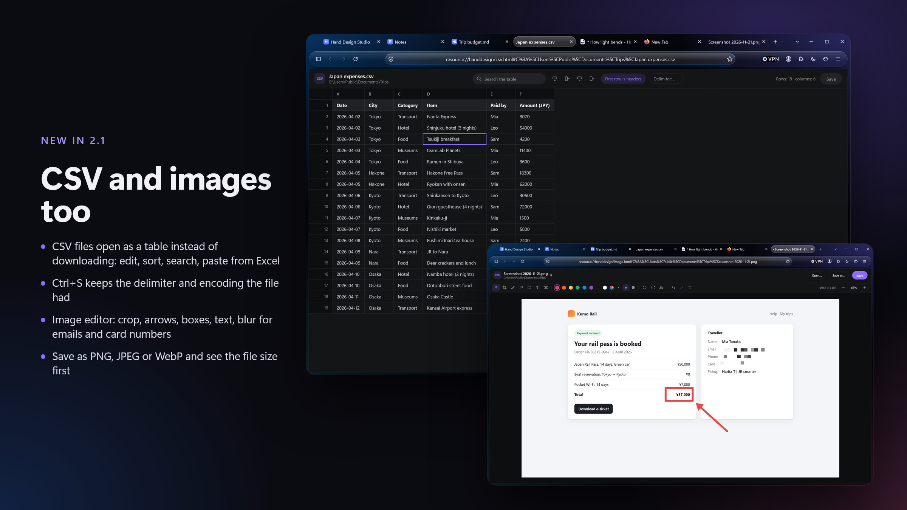
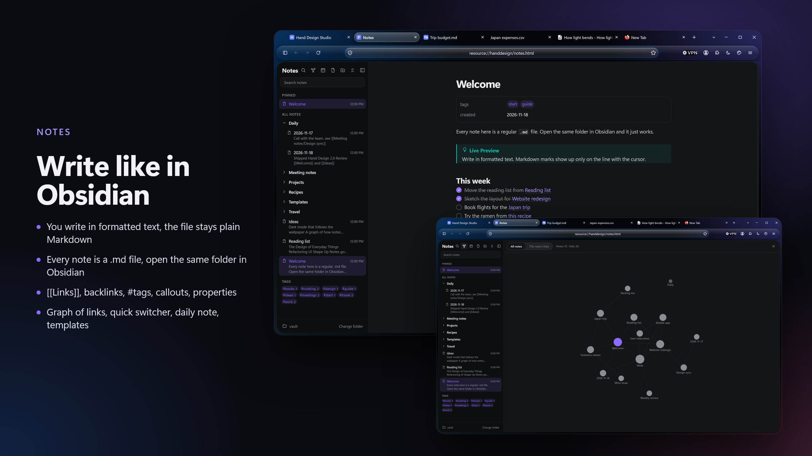
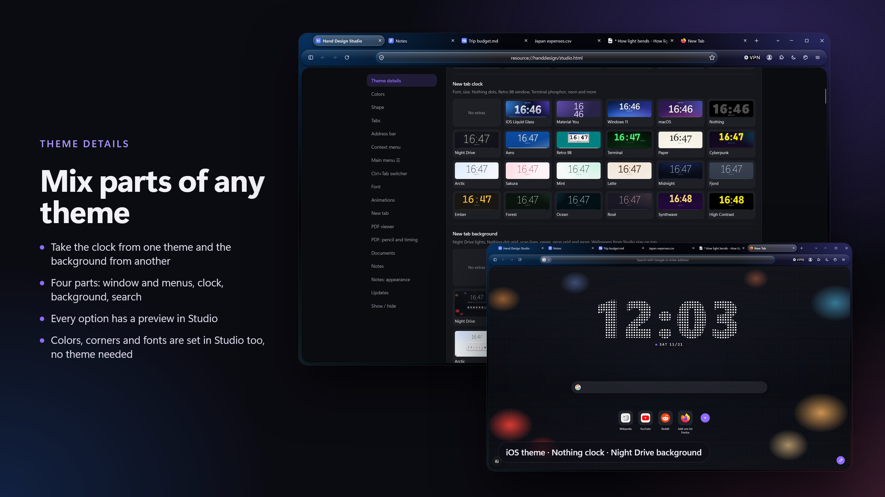
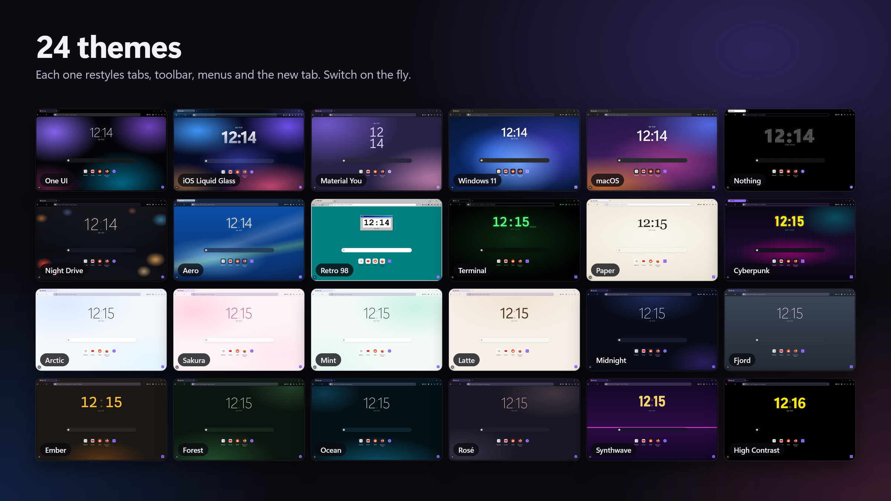

    <div align="center">
    
    # Hand Design 2.1.0
    
    **A Firefox mod that redesigns the whole browser** · 2026-11-21
    
    
    
    </div>
    
    ## Что нового / What's new
    
    **English summary:** CSV tables open right in Firefox instead of downloading: edit cells, sort by a column, search, add and delete rows and columns, paste a block from Excel, undo, save with Ctrl+S in the same encoding and delimiter. A simple image editor (off by default, turn it on in Studio → Documents): crop, rotate, arrows, boxes, text, blur, compression and format change. The installer registers the browser for .md, .csv and .pdf in “Open with” and Default apps, with a button to set it as the default. Notes show only formatted text: markup characters (#, **, ```) stay hidden even at the cursor; Studio → Notes → “Show markup at the cursor” brings back the old behaviour. Studio → Theme details shows a picture for every option. Fixes: the new tab clock shows up in Firefox 157 and newer again; the Design and Notes toolbar buttons work again in Firefox 160, and the moon button shows its notice again. New screenshots in the README and on this page, all taken in Firefox.
    
    - Таблицы CSV открываются прямо в браузере. Раньше Firefox файл `.csv` скачивал, теперь он открывается таблицей — из проводника, перетаскиванием в окно, из адресной строки и со страницы «Документы» (там появилась карточка «Новая таблица»). Щелчок выбирает ячейку, Enter, F2, двойной щелчок или просто ввод — правка; стрелки, Tab и Enter — переход. Щелчок по букве столбца сортирует (числа вида «1 240,50» сортируются как числа), поиск оставляет только подходящие строки. Кнопки и меню правой кнопки: строка выше или ниже, столбец слева или справа, удалить строку или столбец. Блок из Excel или Google Таблиц вставляется по `Ctrl+V` в несколько ячеек сразу. `Ctrl+Z` и `Ctrl+Y` отменяют и возвращают, `Ctrl+S` сохраняет. Разделитель (`;`, `,`, Tab, `|`) определяется сам, кодировка (UTF-8 или Windows-1251, как у русского Excel), BOM и переводы строк сохраняются как были. Выключается в Studio → «Документы» → «Редактор таблиц CSV».
    - Простой редактор картинок. По умолчанию выключен, включается в Studio → «Документы» → «Редактор картинок». Умеет обрезать (свободно или 1:1, 4:3, 16:9 и т. д.), поворачивать, отражать, рисовать стрелки, рамки и кистью, писать текст, размывать кусок картинки (номера, лица, пароли на скриншоте). Всё нарисованное можно двигать, перекрашивать и удалять, `Ctrl+Z` отменяет. «Сохранить как…» сохраняет в PNG, JPEG или WebP с выбором качества и размера и сразу показывает, сколько весит файл. Открывается тремя способами: картинка с компьютера, «Редактировать картинку» в меню правой кнопки на любой картинке, карточка «Картинка» в «Документах», куда можно вставить скриншот по `Ctrl+V`.
    - Файлы `.md`, `.csv` и `.pdf` можно открывать браузером из проводника. Установщик (галочка «Открывать файлы в браузере», включена по умолчанию) добавляет браузер в «Открыть с помощью» и в Параметры → «Приложения по умолчанию» под именем Hand Design. Назначить его программой по умолчанию Windows разрешает только вам: на последнем экране установщика есть кнопка «Открывать .md, .csv и .pdf этим браузером…», она открывает нужную страницу Параметров. Удаление оформления убирает и эти записи.
    - В заметках виден только оформленный текст. Знаки разметки (`#`, `**`, ` ``` `, `>`, `- [ ]`) больше не появляются, когда ставишь на них курсор: заголовок остаётся заголовком, блок кода — блоком без обратных кавычек. Курсор и `Backspace` перескакивают скрытые знаки, `Backspace` в начале заголовка, списка или цитаты превращает строку в обычный текст. `Ctrl+B`, `Ctrl+I` и другие без выделения больше не вставляют пустые `****`: жирным станет то, что напечатаешь дальше, а внутри жирного текста `Ctrl+B` выходит из него. В блоке кода эти сочетания ничего не делают. В файле по-прежнему Markdown. Старое поведение, как в Obsidian, включается в Studio → «Заметки» → «Показывать разметку под курсором».
    - Studio → «Детали тем»: у каждого варианта теперь есть картинка — часы, фон новой вкладки, поиск или верх окна из этой темы. Выбранный вариант обведён акцентом.
    - Часы на новой вкладке снова появляются в Firefox 157 и новее. С новым оформлением Firefox (Nova, его включает установщик) у страницы другая обёртка, и мод не находил, куда их ставить, а когда находил, цифры оставались пустыми: формат даты брался у окна страницы, где его нет.
    - Кнопка «Дизайн» (палитра) на панели снова открывает быструю панель. В Firefox 160 у элементов окна убрали свойство `ownerGlobal`, и обработчик кнопки падал на нём, поэтому нажатие ничего не делало. Из-за того же не работала кнопка «Заметки» на панели, а после переключения темы кнопкой с луной не появлялось уведомление.
    - Выключатель «Редактор Markdown» в Studio теперь срабатывает: раньше вкладка не видела эту настройку.
    - Страницы проекта открываются по адресу `resource://handdesign/…` вместо `resource://pdftweaks/…`: заметки, «Документы», таблицы, картинки. Открытые вкладки со старым адресом переходят на новый сами.
    - Новые картинки в README и на этой странице, все сняты в Firefox: обложка, 24 темы, детали тем, заметки, PDF и Markdown, CSV и картинки, обои, быстрая панель.
    
    ## Скриншоты / Screenshots
    
    | | |
    |---|---|
    |  |  |
    |  |  |
    
    
    
    ## Установка / Install
    
    1. Скачайте **Hand-Design-Setup-v2.1.0.exe** ниже и запустите. / Download **Hand-Design-Setup-v2.1.0.exe** below and run it.
    2. Выберите тему и браузеры, нажмите «Установить». / Pick a theme and browsers, press Install.
    3. Перезапустите браузер. / Restart the browser.
    
    Работает в Firefox 156 и новее и в форках: LibreWolf, Waterfox, Zen, Floorp, Mercury. / Works in Firefox 156 and newer and in its forks: LibreWolf, Waterfox, Zen, Floorp, Mercury.
    
    Если SmartScreen пишет «Система Windows защитила ваш компьютер», нажмите «Подробнее» → «Выполнить в любом случае»: у файла нет платной подписи. / If SmartScreen says "Windows protected your PC", click "More info" → "Run anyway": the file is not signed with a paid certificate.
    
    Уже стоит более старая версия — запустите установщик и нажмите «Обновить», настройки сохранятся. / Already installed — run the installer and press Update, your settings are kept.
    
    Без .exe: **Hand-Design-v2.1.0.zip** — распакуйте и запустите **Setup.cmd**. / Without the .exe: unzip **Hand-Design-v2.1.0.zip** and run **Setup.cmd**.
    
    [Все изменения / Full changelog](https://github.com/WiWaSu/Hand-Design---browsers-redesign-/blob/main/firefox/CHANGELOG.md)
    