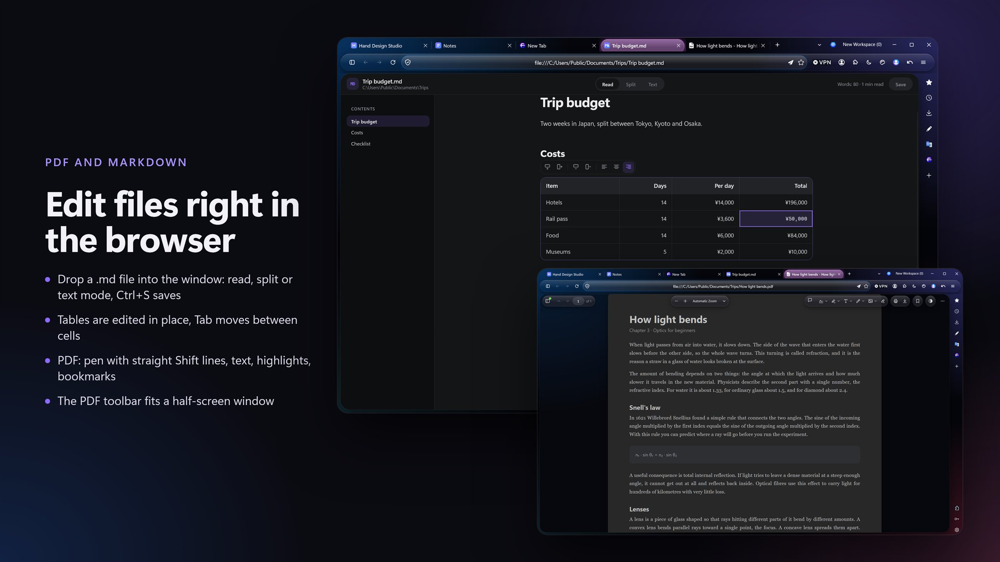

# Hand Design 2.1.0

**A redesign for Floorp, Firefox and Firefox forks** · 2026-11-18

## Что нового / What's new

**English summary:** The Design button (palette icon) on the toolbar opens the quick panel again: in Firefox 160 and Floorp 12.21 it did nothing. The Notes toolbar button works again too, and switching the theme with the moon button shows its notice again. Studio → Theme details shows a picture for every option: the clock, the background, the search box and the window of that theme. New cover and pictures for notes, theme details, PDF and Markdown in the README and on release pages.

- Кнопка «Дизайн» (палитра) на панели снова открывает быструю панель. В Firefox 160 и Floorp 12.21 у элементов окна убрали свойство `ownerGlobal`, и обработчик кнопки падал на нём, поэтому нажатие ничего не делало. Из-за того же не работала кнопка «Заметки» на панели, а после переключения темы кнопкой с луной не появлялось уведомление.
- Studio → «Детали тем»: у каждого варианта теперь есть картинка — часы, фон новой вкладки, поиск или верх окна из этой темы. Выбранный вариант обведён акцентом.
- Новая обложка и картинки в README и на страницах релизов: заметки и граф связей, детали тем, PDF и Markdown. Сетка всех 24 тем осталась в разделе «Темы».

## Скриншоты / Screenshots

| | |
|---|---|
|  |  |
|  |  |

## Установка / Install

1. Скачайте **Hand-Design-Setup-v2.1.0.exe** ниже и запустите. / Download **Hand-Design-Setup-v2.1.0.exe** below and run it.
2. Выберите тему и браузеры, нажмите «Установить». / Pick a theme and browsers, press Install.
3. Перезапустите браузер. / Restart the browser.

Если SmartScreen пишет «Система Windows защитила ваш компьютер», нажмите «Подробнее» → «Выполнить в любом случае»: у файла нет платной подписи. / If SmartScreen says "Windows protected your PC", click "More info" → "Run anyway": the file is not signed with a paid certificate.

Уже стоит более старая версия — запустите установщик и нажмите «Обновить», настройки сохранятся. / Already installed — run the installer and press Update, your settings are kept.

Без .exe: **Hand-Design-v2.1.0.zip** — распакуйте и запустите **Setup.cmd**. / Without the .exe: unzip **Hand-Design-v2.1.0.zip** and run **Setup.cmd**.

[Все изменения / Full changelog](https://github.com/WiWaSu/Hand-Design---browsers-redesign-/blob/main/firefox/CHANGELOG.md)
