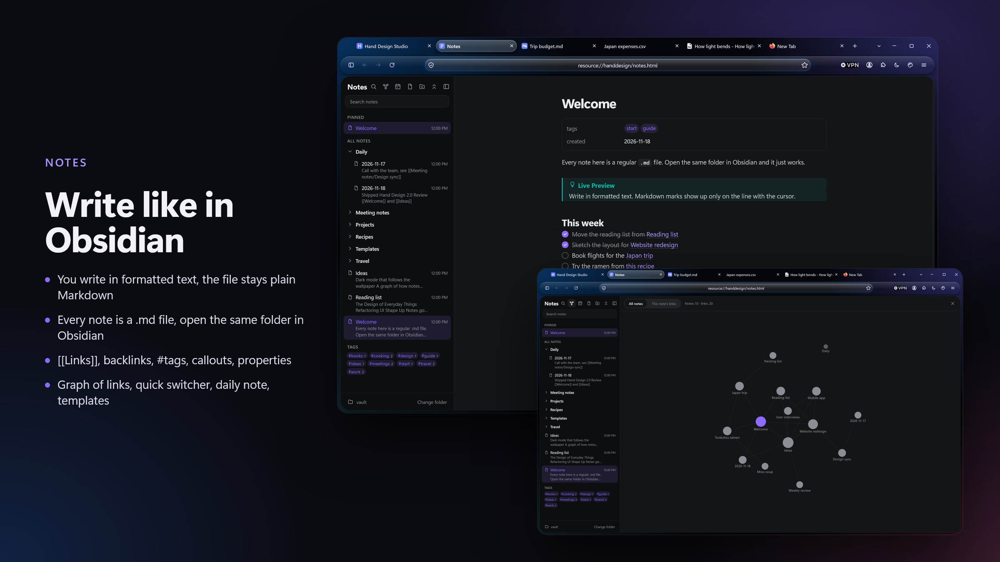
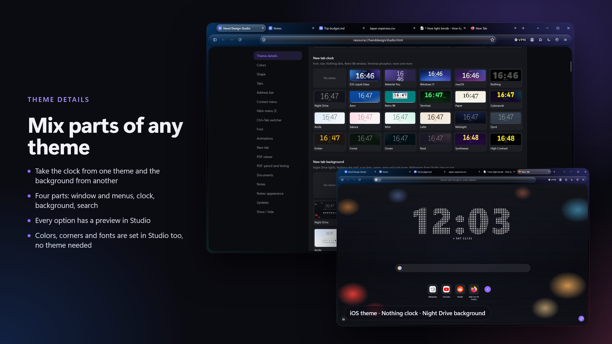
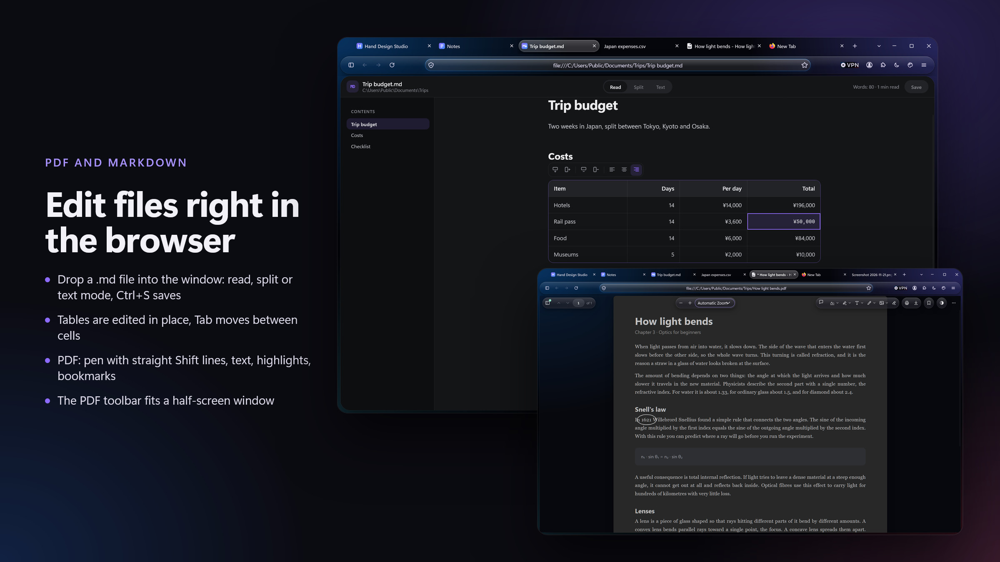
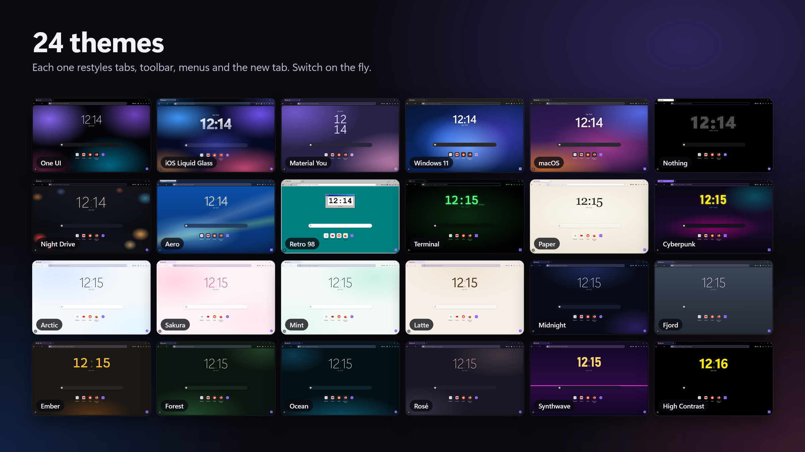

# Hand Design 2.2.0

**A redesign for Floorp, Firefox and Firefox forks** · 2026-11-22

## Что нового / What's new

**English summary:** PDF: presentation mode shows only the pages, the pencil draws on top of inserted images, Shift lines go straight where you drag, a stroke carries over to the next page, Ctrl+V pastes a copied image without picking a tool, and the alt text dialog no longer pops up. The Pages sidebar is redesigned. The call bar and center notifications no longer fall apart and stay out of the vertical tabs. Tab groups in vertical tabs get a calm header with a name and an arrow. The downloads button takes the theme color and fills a thin bar while a file downloads. New tab hover preview with three styles in Studio. Icons in context menus. Menus are solid in every theme except the glass ones. Blue info bars and the bright blue button in Floorp dialogs now use the theme colors. The image editor gets the same color picker as the PDF viewer. In Firefox 159 the Back, Forward, Reload, menu and sidebar buttons are visible again.

- PDF, режим презентации: на экране только страницы. Панели, рамки и кнопки редактирования спрятаны, рисунки не реагируют на мышь.
- PDF: карандашом можно рисовать поверх вставленной картинки, и линия видна над ней, а не под ней.
- PDF: линия с зажатым `Shift` идёт ровно туда, куда ведёте мышь, с шагом угла из Studio. Раньше конец линии уезжал в сторону.
- PDF: штрих, начатый на одной странице, продолжается на следующей, если довести его туда.
- PDF: `Ctrl+V` с картинкой в буфере вставляет её на текущую страницу сразу, без выбора инструмента «Картинка».
- PDF: при добавлении картинки больше не открывается окно «Изменить альтернативный текст». Белая плашка с предупреждением на картинке тоже убрана.
- PDF: панель «Страницы» переделана. Без зелёного «НОВОЕ» и серой шапки, «Управление» стало небольшой кнопкой. Галочки выбора появляются на миниатюре при наведении, номер страницы стоит под ней, у текущей страницы рамка в цвет акцента.
- Плашка звонка больше не разваливается: подложка всегда целиком под кнопками и временем. Плашка держится в области страницы и не налезает на вертикальные вкладки и боковые панели.
- Уведомления по центру: подложка больше не съезжает влево.
- Вертикальные вкладки, группы: вместо яркой цветной полосы строка с точкой цвета группы, названием и стрелкой. У свёрнутой группы лёгкая подложка, у группы без названия подпись «Без названия». Цвета групп приглушены под тему.
- Кнопка загрузок во время скачивания красится в акцент темы, а вместо круглого индикатора под стрелкой заполняется тонкая полоска.
- Превью вкладки при наведении в стиле Hand Design: миниатюра сверху, под ней название и адрес. В Studio → «Вкладки» → «Превью при наведении» можно выбрать «Карточка», «Компактное» (без миниатюры) или «Крупное».
- Значки во всех контекстных меню: у страницы, ссылки, картинки, вкладки, панели инструментов, закладок, боковой панели. Выключаются в Studio → «Меню правой кнопки» → «Значки в меню».
- Меню: во всех темах фон плотный, кроме стеклянных (iOS, Night Drive, Aero, Midnight, Ocean). В них лёгкая прозрачность осталась, но меню стало плотнее, чтобы текст читался поверх любой страницы.
- Синие информационные полосы (в PDF, в окне браузера, на страницах настроек) теперь в цветах темы, предупреждения и ошибки со своим оттенком. Синяя кнопка в окнах Floorp, например «Добавить панель», стала в цвет акцента, разделитель боковой панели при перетаскивании больше не светится синим.
- В поле поиска боковой панели закладок и истории больше нет двойной обводки.
- Firefox 159: на панели снова видны кнопки «Назад», «Вперёд», «Обновить», меню ☰ и боковая панель. Их значки были прозрачными, теперь они берут цвет темы и рисуются в любой версии Firefox.
- Редактор картинок: цвет выбирается так же, как в PDF. Одна кнопка с текущим цветом открывает 20 цветов, последние выбранные и свой цвет (поле, оттенок, HEX).

## Скриншоты / Screenshots

| | |
|---|---|
|  |  |
|  |  |

## Установка / Install

1. Скачайте **Hand-Design-Setup-v2.2.0.exe** ниже и запустите. / Download **Hand-Design-Setup-v2.2.0.exe** below and run it.
2. Выберите тему и браузеры, нажмите «Установить». / Pick a theme and browsers, press Install.
3. Перезапустите браузер. / Restart the browser.

Если SmartScreen пишет «Система Windows защитила ваш компьютер», нажмите «Подробнее» → «Выполнить в любом случае»: у файла нет платной подписи. / If SmartScreen says "Windows protected your PC", click "More info" → "Run anyway": the file is not signed with a paid certificate.

Уже стоит более старая версия — запустите установщик и нажмите «Обновить», настройки сохранятся. / Already installed — run the installer and press Update, your settings are kept.

Без .exe: **Hand-Design-v2.2.0.zip** — распакуйте и запустите **Setup.cmd**. / Without the .exe: unzip **Hand-Design-v2.2.0.zip** and run **Setup.cmd**.

[Все изменения / Full changelog](https://github.com/WiWaSu/Hand-Design---browsers-redesign-/blob/main/firefox/CHANGELOG.md)
