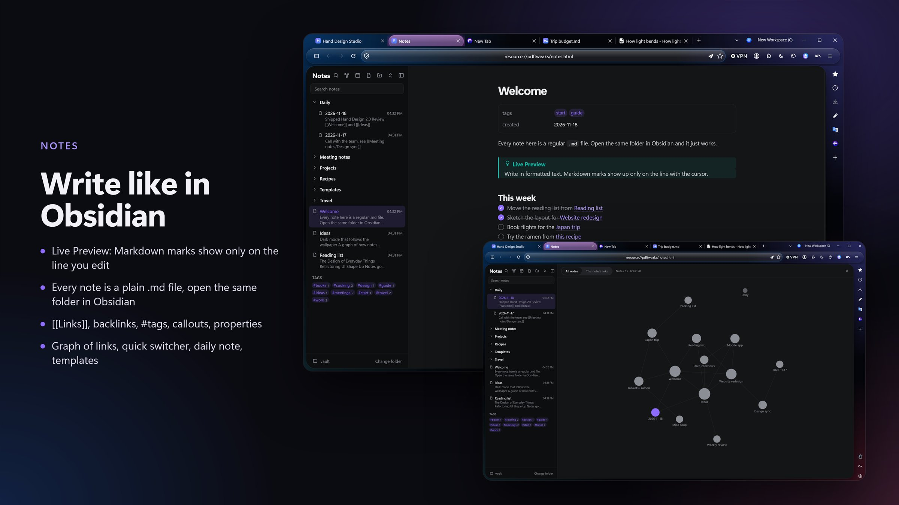
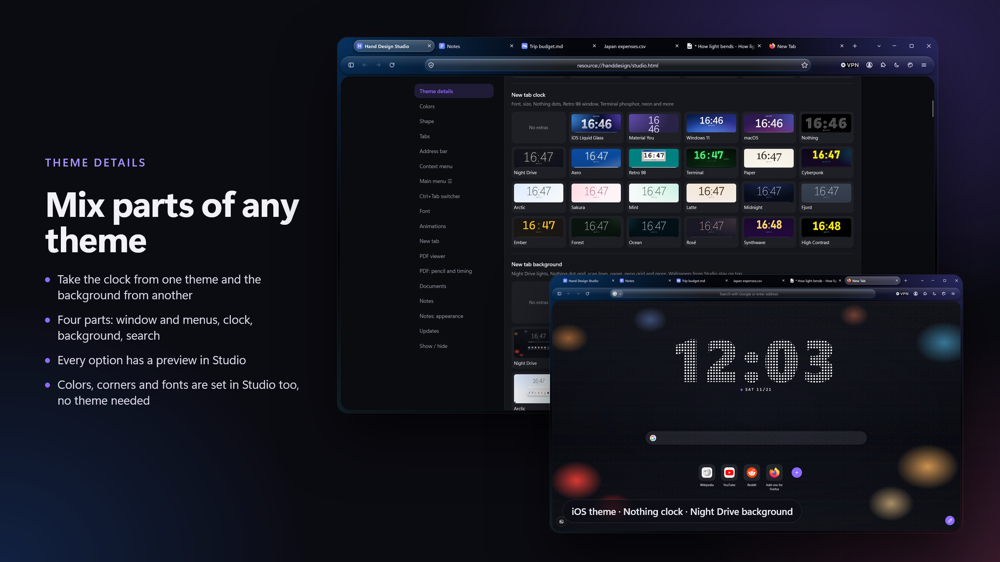
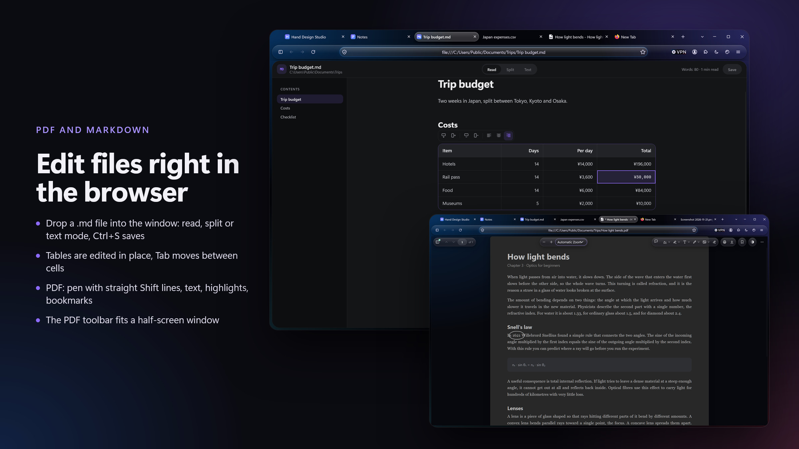
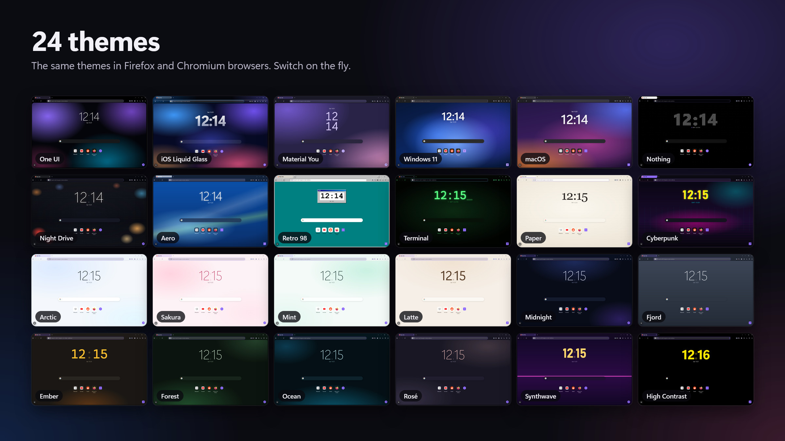

# Hand Design 3.0.0

**A redesign for Floorp, Firefox and Firefox forks** · 2026-11-25

## Что нового / What's new

**English summary:** Notes can import from Notion (Markdown & CSV export), Evernote (.enex), Google Keep (Google Takeout) and any folder of Markdown files such as an Obsidian vault or a Joplin export. Imported notes land in their own folder under Import, links between pages turn into [[links]], images and attachments come along, tags and dates become note properties. The quick switcher (Ctrl+O) got a proper look, and a note with properties now opens with them shown as a card instead of raw text. The password manager opens as a compact window next to the button you pressed instead of a separate tab: search, copy, show, edit, add and delete passwords, with an optional primary password and a lock button. Now Bar hides while the video plays in a picture-in-picture window. Studio is redesigned: sections in a sidebar, search across all settings, a theme gallery, plain-language labels and hints, and a live preview on the side that shows every change and highlights where the hovered setting lives in the window. Every theme now has its own icon pack (24 in all) that redraws every icon in the browser and in Hand Design; any pack can be used with any theme (Studio → Icons), and it switches instantly.

- Импорт заметок: кнопка со стрелкой внизу списка заметок, рядом с «Сменить папку». Откуда можно забрать:
  - Notion — экспорт «Markdown & CSV» (файл .zip). Страницы и подстраницы сохраняют вложенность, ссылки между ними становятся `[[ссылками]]`, длинные номера из названий убираются, базы данных превращаются в заметки с таблицей, картинки переносятся.
  - Evernote — экспорт блокнота (файл .enex). Сохраняются оформление, списки, чекбоксы, таблицы, картинки и вложения, а также теги, даты создания и изменения и адрес источника.
  - Google Keep — архив Google Takeout (файл .zip). Списки становятся чекбоксами, ярлыки — тегами, картинки переносятся, архивные заметки уходят в папку «Архив», закреплённые остаются закреплёнными. Удалённые заметки пропускаются.
  - Папка с файлами .md — хранилище Obsidian, экспорт Joplin в Markdown и любые другие заметки в Markdown. Служебные папки вроде `.obsidian` не копируются.
- Импортированное ложится в отдельную папку «Импорт/Notion», «Импорт/Evernote» и так далее. Повторный импорт идёт в новую папку и ничего не перезаписывает.
- Быстрый переход по заметкам (`Ctrl+O`) получил нормальный вид: окно по центру с полем поиска и списком. Раньше список выводился без оформления внизу страницы.
- Заметка со свойствами (`---` в начале файла) открывается с ними в виде карточки. Раньше курсор вставал в начало, и свойства показывались сырым текстом.
- Менеджер паролей открывается компактным окном, а не отдельной вкладкой. Окно встаёт у края с той стороны, где нажата кнопка: ключ в боковой панели Floorp внизу справа — окно внизу справа, пункт «Пароли» в меню ☰ — вверху справа.
  - Сверху поиск, ниже пароли для открытого сайта, потом все остальные. Пароль копируется прямо из списка.
  - В карточке пароля: копирование логина и пароля, показ пароля, «Изменить», «Удалить» с подтверждением, переход на сайт.
  - Кнопки в заголовке: добавить пароль, настройки паролей, «Развернуть» (полный менеджер во вкладке), закрыть. Размер окна меняется уголком и запоминается.
  - Перед показом или копированием пароля браузер, как и раньше, просит пароль Windows.
  - Пароли и так хранятся зашифрованными. По желанию можно задать основной пароль, тогда без него их не откроет ни другой браузер, ни другая программа на компьютере. Когда он задан, в заголовке появляется замок «Заблокировать».
  - Окно берёт цвета, скругления и шрифт из темы. Выключается в Studio → Пароли.
- Now Bar не появляется, если видео вынесено в маленькое окно «Картинка в картинке»: у этого окна свои кнопки.
- Паки значков: у каждой из 24 тем свой набор, и он перерисовывает все значки браузера и Hand Design. Это панель и адресная строка, вкладки и кнопки окна, меню ☰ и меню правой кнопки, боковые панели Firefox и Floorp, загрузки, разрешения сайтов, настройки и дополнения, окно паролей, Now Bar, заметки, таблицы, редактор картинок, просмотрщик PDF.
  - У главных значков (ключ, замок, дом, поиск, настройки, звезда, папка, корзина, колокольчик, глаз, глобус, щит, стрелки, часы, загрузки и других, около 55) четыре разных рисунка. Ключ бывает классическим, горизонтальным с квадратными бородками, вертикальным с круглым ушком или ключом-картой. Настройки — шестерёнкой, гайкой, цветком или ползунками. Часы — циферблатом или секундомером. Каждая тема берёт свой рисунок и рисует его в своём стиле.
  - Паки отличаются формой, а не только цветом и толщиной:
    - Retro 98 — пиксельные с тенью, Terminal — пиксельные в рамке-скобках, Nothing — точечная матрица;
    - Cyberpunk — граненые с наклоном, Arctic — граненые «кристаллы» в шестиугольнике;
    - One UI и Latte — залитые с прорезями, High Contrast — вырезаны из плитки;
    - Material, Sakura, Mint и Ocean — на плитках: квадратной, круглой, шестиугольной, скруглённой;
    - macOS — в контурной рамке, Rosé — в тонком круге, Fjord — в рамке-скобках;
    - Night Drive, Midnight и Synthwave — полые двойные линии (у Synthwave ещё и с наклоном), Ember — наклонные залитые;
    - Paper — нарисованы карандашом, Forest — от руки и с шестиугольниками, Aero — со стеклянным ореолом.
  - У VPN у каждого состояния свой значок: выключен, включён, пауза, сайт-исключение, ошибка.
  - Ещё четыре набора, нарисованных от руки: «Набросок» (двойная неровная линия со штриховкой), «Маркер» (толстый фломастер), «Каракули» (три небрежных прохода), «Кисть» (жирный мазок с тонким вторым). Их можно поставить к любой теме.
  - В пак попали и значки диалогов и служебных страниц: категории настроек и дополнений, значки контейнеров, менеджер паролей Firefox, страница защиты, вкладки «Сведений о странице», сортировка в таблицах.
  - Любой пак можно поставить к любой теме: Studio → Значки. Не выбрано — пак текущей темы. Значки меняются сразу, без перезапуска, предпросмотр показывает пак при наведении на карточку.
  - Не меняются только логотипы, анимации загрузки, значки сайтов и значки рабочих пространств, которые вы выбираете сами.
- Полоска загрузки страницы своя у каждой темы: пиксельные блоки Retro 98, сегменты Terminal, точки Nothing с красной головой, волна Ocean, огонь Ember, неон Synthwave, бегущие косые полосы Cyberpunk и другие. Любую можно поставить к любой теме: Studio → Плашки и полоски → Вид полоски загрузки.
- Studio переделана.
  - Слева меню по разделам: Внешний вид, Окно браузера, Новая вкладка, Функции, Система. У каждого пункта значок из текущего пака, точка рядом значит, что в разделе что-то изменено.
  - Сверху поиск: «прозрач», «вкладк», «шрифт» оставляют только подходящие настройки.
  - Справа предпросмотр: уменьшенное окно браузера с вкладками, адресной строкой, закладками, новой вкладкой, меню правой кнопки и Now Bar. Он не уезжает при прокрутке. Наведите на настройку, и в окне подсветится место, к которому она относится. Наведите на тему или готовый набор, и окно примерит его, не меняя настоящий браузер.
  - Темы выбираются из галереи: на каждой карточке маленькое окно в цветах темы.
  - Все названия и подсказки переписаны простыми словами, про каждую настройку сказано, что именно она меняет. Настройки, которые лежали не на месте, переехали: прозрачность и скругление меню теперь в «Меню», кнопки панели и закладки — в «Панель и кнопки», Now Bar, плашка звонка и полоска загрузки — в «Плашки и полоски». Отдельная кнопка «Без скруглений» вверху убрана, переключатель остался в «Форме».
  - GitHub, сохранение и загрузка настроек и «Сбросить всё» собраны в меню «⋯» в углу.
  - Сохранённые настройки не сбрасываются: все прежние пункты на месте.
- Настройки браузера (about:preferences): у выбранного раздела слева больше нет полоски, линия между меню и страницей убрана, меню стало шире, и длинные названия разделов не переносятся.

## Скриншоты / Screenshots

| | |
|---|---|
|  |  |
|  |  |

## Установка / Install

1. Скачайте **Hand-Design-Setup-v3.0.0.exe** ниже и запустите. / Download **Hand-Design-Setup-v3.0.0.exe** below and run it.
2. Выберите тему и браузеры, нажмите «Установить». / Pick a theme and browsers, press Install.
3. Перезапустите браузер. / Restart the browser.

Если SmartScreen пишет «Система Windows защитила ваш компьютер», нажмите «Подробнее» → «Выполнить в любом случае»: у файла нет платной подписи. / If SmartScreen says "Windows protected your PC", click "More info" → "Run anyway": the file is not signed with a paid certificate.

Уже стоит более старая версия — запустите установщик и нажмите «Обновить», настройки сохранятся. / Already installed — run the installer and press Update, your settings are kept.

Без .exe: **Hand-Design-v3.0.0.zip** — распакуйте и запустите **Setup.cmd**. / Without the .exe: unzip **Hand-Design-v3.0.0.zip** and run **Setup.cmd**.

[Все изменения / Full changelog](https://github.com/WiWaSu/Hand-Design---browsers-redesign-/blob/main/firefox/CHANGELOG.md)
