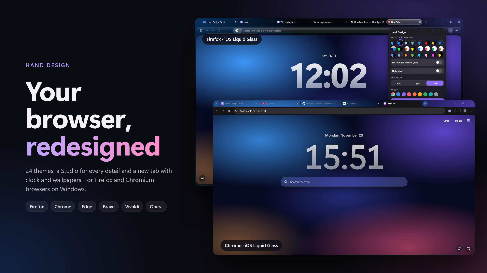
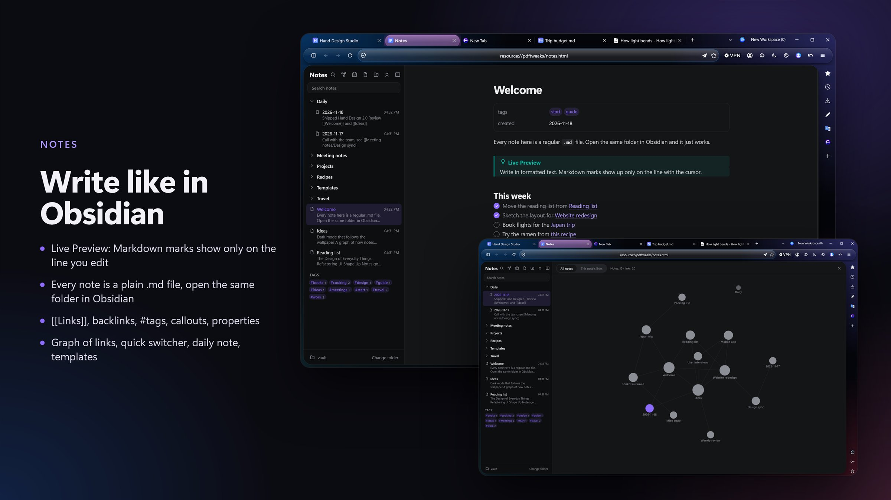
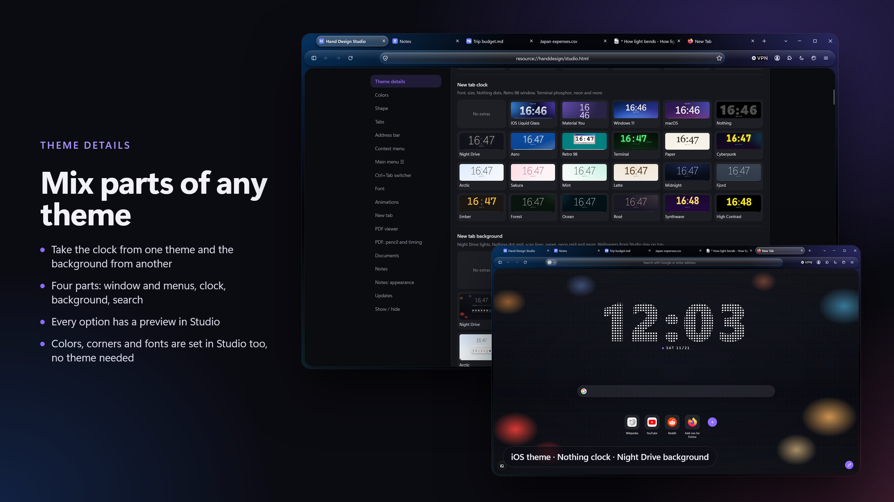
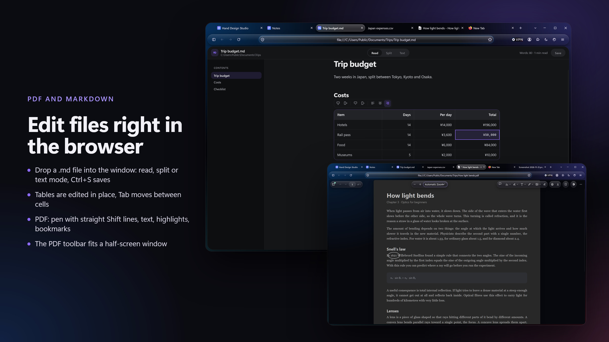
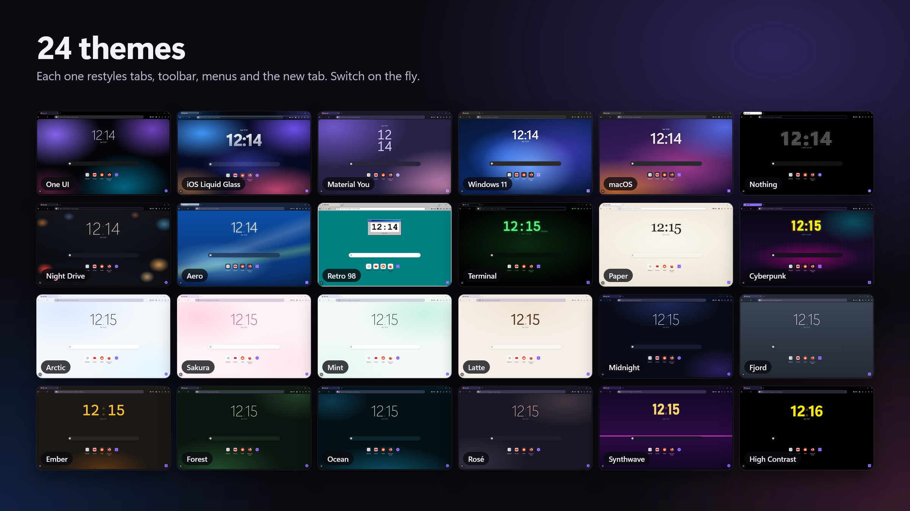

# Hand Design 3.1.0

**A redesign for Floorp, Firefox and Firefox forks** · 2026-11-26

## Что нового / What's new

**English summary:** A Hand Design new tab with widgets (Studio → New tab): clock, search, shortcuts and wallpaper in the current theme plus 16 widgets you can drag anywhere and resize, drawn in the style of each theme (the calendar keeps events by day, the note widget edits and adds tasks in place), and your own widgets from an .html file that run in an isolated frame. A “Notes and documents” side panel for the Floorp and Firefox sidebars, with search, recent and pinned notes, recent files and a quick note to Inbox, plus an optional toolbar button. Hand Design pages (Notes, Documents, Studio, tables, image editor) gather in one special “Hand Design” tab group with an H badge in the theme color. The Documents page is now one place for every file Hand Design works with: Markdown, tables, PDFs and images you've opened, grouped by day, with type filters, pinned files on top and search by name and inside .md and .csv. PDFs show the page you stopped on. The window buttons no longer drift off their place at 125–150% display scaling in Floorp; they are a bit larger now and line up with the tabs, and in Firefox they and the tab close button are normal size again. Small icons in the Midnight, Night Drive, Synthwave, Aero, Rose, Terminal and Cyberpunk packs are sharp again, and the VPN panel shows a proper status icon instead of a dark square.

- Страница «Документы» собирает все файлы, с которыми работает Hand Design: Markdown, таблицы, PDF и картинки. Раньше там были только .md и .csv.
  - PDF с диска попадают в список сами, рядом видно, на какой странице вы остановились: «стр. 14 из 40».
  - Недавние разложены по дням: сегодня, вчера, на этой неделе, раньше. Сверху фильтры: все, Markdown, таблицы, PDF, картинки.
  - Файл можно закрепить булавкой у строки, закреплённые стоят карточками над списком и не выпадают из него.
  - Поиск сверху (`Ctrl+K`) ищет по имени, а в .md и .csv ещё и по тексту. Найденное показано куском строки с подсвеченным словом.
  - У строки кнопки «Закрепить», «Показать в папке» и «Убрать из списка». Если файл удалили или перенесли, строка пишет «Файл не найден».
  - «Открыть файл» принимает документы, таблицы, PDF и картинки.
- Своя новая вкладка с виджетами. Включается в Studio → Новая вкладка → «Своя новая вкладка с виджетами».
  - На ней часы, поиск, ярлыки сайтов и обои в оформлении текущей темы. Детали тем (часы Nothing, окно Retro 98, фон Night Drive и другие) и настройки Studio для новой вкладки работают и здесь.
  - Кнопка «Виджеты» справа внизу включает правку. Виджеты перетаскиваются куда угодно, размер меняется за уголок, крестик убирает. Часы, поиск и ярлыки тоже двигаются, меняют размер за уголок и убираются: у поиска меняются ширина и высота, часы и ярлыки масштабируются. Сетку выравнивания можно выключить, «Сбросить» возвращает вкладку как было.
  - 16 виджетов:
    - погода: сейчас, по часам, на неделю, «ощущается»;
    - часы мира;
    - календарь: события по дням (точка под числом, список и поле под сеткой), «через 3 дня» у выбранного дня, ближайшее событие, кнопка «Сегодня», месяц листается колесом мыши, видны дни соседних месяцев, по желанию номера недель и неделя с воскресенья;
    - обратный отсчёт до даты;
    - заметка из Заметок: галочки отмечаются прямо на виджете, счётчик задач, правка текста карандашом, поле внизу дописывает задачу или строку, выполненные можно скрыть; без выбранной заметки виджет сразу показывает последние заметки;
    - список дел;
    - последние документы;
    - папка закладок;
    - недавно закрытые вкладки;
    - музыка из любой вкладки с кнопками;
    - таймер: любое время прямо на виджете (часы, минуты, секунды, колёсиком мыши), быстрые кнопки от 1 минуты до часа, «+1 мин», пауза, в конце три сигнала и мигающая карточка до «Стоп», режим «Помидор»;
    - секундомер с сотыми и кругами, лучший и худший круг подсвечены;
    - лента RSS;
    - курсы валют;
    - свой текст;
    - картинка с компьютера.
  - Виджеты рисуются в стиле темы: стекло в iOS, Aero, Night Drive, Midnight и Ocean; окна с синим заголовком в Retro 98; моноширинный шрифт и красная точка в Nothing; фосфор в Terminal; бумага в Paper; неон в Cyberpunk и Synthwave.
  - Свой виджет — один файл .html: вставьте код или откройте файл. Его можно написать самому или попросить нейросеть: кнопка «i» в окне своего виджета копирует задание для неё, это же задание есть в README. Свой виджет работает в изолированной рамке: без доступа к странице, браузеру и файлам, в интернет — только по адресам, которые он объявил и которые вы видите до добавления.
  - Пока своя вкладка включена, виджеты новой вкладки самого браузера (погода Firefox и другие) не используются.
  - В интернет ходят только погода (Open-Meteo), курсы (open.er-api.com), RSS и свои виджеты, и только когда вы их добавили. Подробно — в [SECURITY.md](https://github.com/WiWaSu/Hand-Design---browsers-redesign-/blob/main/SECURITY.md).
- Боковая панель «Заметки и документы». Во Floorp она сама добавляется в его боковую панель, в Firefox — в боковую панель Firefox.
  - Наверху переключатель «Заметки / Документы» и поиск. Заметки ищутся по названию и по тексту.
  - Закреплённые заметки сверху, ниже недавние: у каждой первая строка, папка, время правки и, у списков дел, сколько задач отмечено.
  - Документы — те же файлы, что на странице «Документы», у PDF видна страница, на которой вы остановились.
  - Внизу быстрая заметка: Enter дописывает строку с датой в заметку «Входящие». Кнопка «ссылка на страницу» вставляет название и адрес открытой страницы.
  - Заметка или файл открываются во вкладке, панель остаётся рядом.
  - Studio → Функции → Боковая панель: панель выключается, а кнопку для неё можно поставить на панель инструментов.
- Вкладки Hand Design собираются в одну группу «Hand Design»: Заметки, Документы, Studio, таблицы и редактор картинок больше не теряются среди сайтов. У группы свой ярлык с буквой H в цвете темы, её не спутать с обычными группами. Если во вкладке группы открыть сайт, вкладка сама выходит из группы, а чужую вкладку в неё не добавить ни перетаскиванием, ни через меню. В вертикальных вкладках ярлык компактный, со стрелкой свёртывания, в узкой панели — квадрат с H. В списке свёрнутой группы у вкладок их значки, а не глобусы. Выключается в Studio → Вкладки → «Вкладки Hand Design в своей группе». Работает там, где браузер умеет группы вкладок.
- Кнопки окна справа сверху (свернуть, развернуть, закрыть): значки растягивались на всю кнопку и съезжали вправо и вниз. Крестик вылезал за свою красную подсветку и обрезался у края экрана. Так было в Firefox всегда, а во Floorp при масштабе Windows больше 100 %, в окне и на весь экран. Теперь значок стоит ровно по центру кнопки при любом масштабе. Значки стали чуть крупнее, кнопки высотой со строку вкладок, и значки на одной линии с вкладками. Крестик на вкладке в Firefox тоже стал обычного размера и нарисован значком выбранного набора.
- В превью вкладки при наведении у своей новой вкладки больше нет подписи «handdesign», а у Заметок, Документов и Studio вместо «handdesign» и «fmstudio» написано «Hand Design».
- Панель VPN Firefox и Floorp: вместо значка состояния был тёмный квадрат. Теперь там значок из выбранного набора в цвете состояния: зелёный щит, когда VPN включён или отключён для сайта, предупреждение при ошибке.
- Значки паков Midnight, Night Drive, Synthwave, Aero, Rose, Terminal и Cyberpunk на мелком размере были мутными: полые линии, свечение и ореол сливались в кашу. Теперь значок до 26 пикселей рисуется обычной чёткой линией, а крупный остаётся как в паке.

## Скриншоты / Screenshots

| | |
|---|---|
|  |  |
|  |  |

## Установка / Install

1. Скачайте **Hand-Design-Setup-v3.1.0.exe** ниже и запустите. / Download **Hand-Design-Setup-v3.1.0.exe** below and run it.
2. Выберите тему и браузеры, нажмите «Установить». / Pick a theme and browsers, press Install.
3. Перезапустите браузер. / Restart the browser.

Если SmartScreen пишет «Система Windows защитила ваш компьютер», нажмите «Подробнее» → «Выполнить в любом случае»: у файла нет платной подписи. / If SmartScreen says "Windows protected your PC", click "More info" → "Run anyway": the file is not signed with a paid certificate.

Уже стоит более старая версия — запустите установщик и нажмите «Обновить», настройки сохранятся. / Already installed — run the installer and press Update, your settings are kept.

Без .exe: **Hand-Design-v3.1.0.zip** — распакуйте и запустите **Setup.cmd**. / Without the .exe: unzip **Hand-Design-v3.1.0.zip** and run **Setup.cmd**.

[Все изменения / Full changelog](https://github.com/WiWaSu/Hand-Design---browsers-redesign-/blob/main/firefox/CHANGELOG.md)
